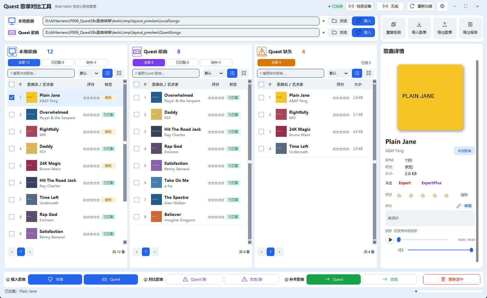
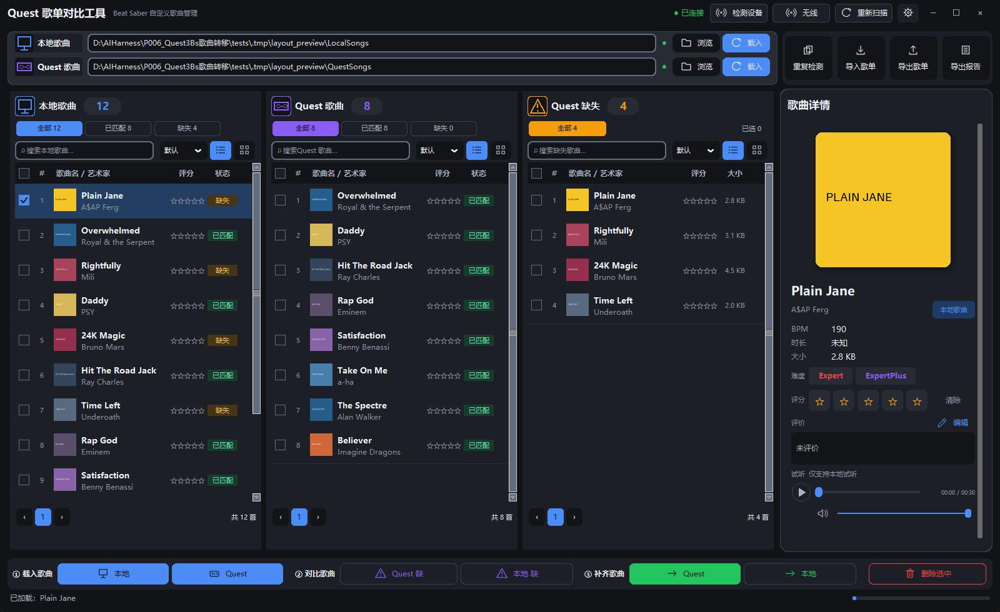

> 新版曲库上方 Quest 区已补回“无线连接”：支持USB转无线、已有地址连接和配对码连接，向导可显示本次歌曲传输按钮。重启新版程序后生效，打开窗口不会自动连接或传输。隔离Qt56/56、旧完整28/28通过；真实无线与传输待验。详见[使用说明](docs/82_Qt无线连接与传输入口恢复.md)。

> Quest曲库现在先显示歌曲资料，再补可见/选中歌曲的封面与缺失时长；列表显示作者和BPM，详情保留难度/格式版本。重启新版程序后生效；未浏览的缺失时长仍可未知，点击表头可按补全后的时长重排。本批Qt55项均有通过记录（含显示等待失败项的同字节独立复验）、旧完整28/28通过。详见[操作与实测范围](docs/81_Quest资料优先加载与封面信息.md)。

> Quest歌曲读取已减少缺失时长的往返：每首3次合并为1次，同一8首样本时长读取耗时减少约46%；整库比例待实测。退出并重新打开新版程序后生效。Qt首轮52/53，唯一失败项同字节三档复验通过；旧完整28/28通过。详见[范围与证据](docs/80_Quest单曲时长合并读取.md)。

> Quest目录选择已接入“SongCore 普通歌曲”“SongLoader 兼容目录”“WIP 测试歌曲”，保留实际路径与用途提示，专项通过；整体验收仍有窗口命中回归待续验。读取速度分析及后续方案见[说明](docs/79_Quest目录用途标注与读取性能分析.md)；本轮未更改读取后端。

> Qt新界面已按A下载页、C曲库布局更新：直接收藏、歌曲列内封面/双行文字、单行试听栏；原搜索、筛选、预加载、下载、评分与设备护栏保留。关闭旧窗口后，使用桌面“Quest 歌曲工具（新版曲库）”或“Quest 下载歌曲”打开。验证与已知限制见[A/C界面实现与验证](docs/78_Qt_A_C界面改版.md)。

> 本地歌曲版本识别：读取预算不足且有进展时，一次操作自动补验最多3轮，无需重复点击；每轮保留原读取预算，同次最多2000独立路径。选项中可取消，并查看实际轮数。仍显示“部分结果”的未识别项保持未知，不能当作未安装。手动重新扫描仅首轮清缓存。详见[续扫说明](docs/75_Qt本地识别有界续扫.md)。

> 下载页右上角选项现可收藏当前歌曲、打开收藏清单。收藏长期保留，与下载勾选分开；清单可搜索、看详情、使用缓存封面/共享试听、多选取消收藏，或仅把所选行加入跨页已选后按原流程下载。不会自动下载或删除歌曲。最多200首/2MiB；收藏专项通过，完整回归因当前会话音频不可用尚未通过。详见[收藏使用说明](docs/72_Qt歌曲收藏清单.md)。

> 最新集中验证：Qt49/49及旧完整28/28通过，两个隔离启动链路和一首公开歌曲的搜索、媒体、下载解压、本地读取、同版本识别与ZIP导入通过。真实Quest现场和不同实际显示环境另验，正式数据未用于测试。详见[验证范围与结果](docs/70_全流程贯通与集中回归.md)。

> 下载页右上角选项中可将当前推荐分类设为下次打开的启动分类，或恢复精选。只保存分类，不保存搜索词、筛选或勾选；保存不会打断当前浏览。搜索和随机不能设为启动分类。详见[使用与边界](docs/69_Qt推荐启动分类偏好.md)。

> 新版下载页标签栏右侧会显示本地识别进度及完成、部分结果、失败或取消；悬停可查看完整数量、当前保存目录和最近处理时间。未匹配不代表未安装；在选项中可重新扫描或取消识别，取消不会取消下载。原搜索和预加载提示保留在底部。详见[下载页识别状态提示](docs/67_Qt下载页识别状态提示.md)。

> 新版下载页可识别当前保存目录中手动导入、没有下载记录的歌曲；按实际谱面哈希匹配同版本。“选项 → 重新扫描本地歌曲”强制更新，“取消本地扫描”取消识别任务，菜单显示检查数量和完成/部分结果。翻页不重扫，自动刷新可复用未变化结果；切换目录清除旧结果。扫描有数量/读取上限，未匹配仍保持未知，不会自动覆盖或删除歌曲。详见[手动导入歌曲本地识别](docs/66_Qt手动导入歌曲本地识别.md)。

> 新版曲库Quest区域会显示本次读取完成时间及已过时长，约15分钟后提示建议重新读取。较矮窗口将时间合并到快照摘要，完整日期和时区可悬停查看。快照不代表设备仍在线；不会自动读取设备，需要更新时点击设备区原有“读取快照”。不完整快照仍保留原安全限制。详见[Quest快照时效提示](docs/65_QtQuest快照时效提示.md)。

> 新版下载页新增本地下载记录核验：后台检查当前保存目录里下载记录对应的歌曲路径，区分同/其他版本已核验、路径缺失、版本变化和无法核验。“选项 → 重新核验本地下载记录”可手动刷新，结果仅代表读取时状态；无记录歌曲不凭歌名判断，谱面版本核验不等于音频内容校验，也不会自动下载或删除。详见[本地下载记录核验](docs/64_Qt本地下载记录核验.md)。

> 新版下载页会将已加载封面保存在独立Qt运行目录的qt-cover-cache-v1中，重开后可复用；最多128MiB或2000张，写入30天后重新获取。下载页“选项”菜单可清理磁盘封面缓存，保留当前显示的内存图片和歌曲文件；缓存异常自动回退正常加载。必要专项通过，真实网络与完整验收待验。详见[封面磁盘缓存](docs/63_Qt封面磁盘缓存.md)。

> 新版下载页封面已改为最多4张并发，优先当前选中及可见卡片；下一页仍后台预热。保留图片/网络校验，遇到最终限流或拒绝访问后暂停新封面请求30秒。磁盘封面缓存尚未接入；重启后缓存仍不保留。必要专项通过，真实网络速度与完整验收待验。详见[封面四通道与优先级](docs/62_Qt封面四通道与加载优先级.md)。

> 桌面入口已修复隐藏启动：双击“Quest 歌曲工具（新版曲库）”或“Quest 下载歌曲”。继续使用无控制台Python，不额外弹出黑色命令窗口；两入口共享新版单实例保护，已有窗口时先关闭它再切换入口。详见[桌面启动修复](docs/61_桌面启动入口隐藏窗口修复.md)。

> 下载任务页新增含历史/全部保存目录的状态汇总。用下拉框查看失败/中断等任务，再选中需要处理的行使用原“重试所选”；重试需保持任务原保存目录。可“复制当前结果”获取当前筛选下的7列文字报告，包含来源和任务ID。清除已结束记录仍包含筛选隐藏项，不删除歌曲文件。已实施并通过必要专项，完整验收继续暂缓。详见[下载队列结果汇总](docs/60_Qt下载队列结果汇总.md)。

> 下载页新增“当前筛选”和“个人预设”：可查看/移除已应用条件、保存常用组合并显式载入。预设只存筛选条件，载入会使用当前搜索框与分类重新查询；切换分类可解除冲突。重名不覆盖，最多20份，保存在新版独立目录的qt-filter-presets.json。该功能已实施并完成必要专项，完整验收仍按用户要求暂缓。详见[筛选摘要与个人预设](docs/59_Qt筛选摘要与个人预设.md)。

> 最新（2026-10-23T18:47:51+08:00）：Qt跨页已选清单与当前目录队列/版本记录标记已实施，整体验收继续暂缓。底部“已选清单”按需打开非模态单实例窗口，支持缓存封面、清单内搜索、详情、试听/停止接线、移除勾选与全部已选下载，明确搜索隐藏项仍包含在提交集合中；失败保留清单并回显队列错误。卡片/列表/详情显示当前目录的队列状态或同/其他版本下载记录，不将历史或同名当作实时安装事实，不读取Quest。最终静态7项、主题、双语和14组无音频Qt专项共17项均退出0；197份源码/测试与隔离副本同哈希，正式五项运行数据未变。下载/搜索/音频/数据库/设备后端与护栏未改；未访问真实网站、播放音频、运行完整回归或启动正式数据实例。 详见[已选清单与状态](docs/58_Qt已选清单与歌曲记录状态.md)。

> 最新（2026-10-23T17:15:01+08:00）：Qt下载完成后本地刷新合并已实施，完整验收继续按用户要求暂缓。同一轮多个完成任务合并一次自动刷新，250ms短窗口吸收连续通知；在读扫描不被自动刷新取消，期间仅保留一个后续刷新。手动刷新/切换目录立即执行并清掉旧排程；校验代次与目标目录，重复终态不再重复发主曲库刷新信号，关闭取消排程。静态7项、主题、双语和11组无音频Qt专项共14项均退出0；194份源码/测试与隔离副本同哈希，正式五项运行数据未变。无本地读取业务、下载解压、搜索预取、音频、数据库或设备护栏变更；未访问真实网站、播放音频、运行完整回归、启动正式实例或操作Quest。 详见[刷新合并](docs/57_Qt下载完成后刷新合并.md)。

> 最新（2026-10-23T16:45:49+08:00）：Qt下载任务增量刷新已实施，完整验收继续按用户要求暂缓。相同任务快照不再发出表格更新通知；进度只更新发生变化的单元格，表头仅在翻译变化时通知，空轮询不重复刷新整套控件。追加/尾部移除保留原任务选中项，行身份变化重置选择以防错位；下载完成后本地刷新及动作结束恢复控件仍保持。静态7项、主题、双语和9组无音频Qt专项共12项均退出0；193份源码/测试与隔离副本同哈希，正式五项运行数据未变。无下载解压、搜索/预取、音频、数据库或设备业务变更；未访问真实网站、播放音频、运行完整回归、启动正式实例或操作Quest。 详见[增量刷新](docs/56_Qt下载任务增量刷新.md)。

> 最新（2026-10-23T15:04:27+08:00）：Qt下载页预加载反馈与刷新本页已实施，完整验收继续按用户要求暂缓。底部显示下一页列表即将准备、准备中、已准备及当前页来自缓存；缓存到期自动撤下就绪提示，状态读取不改变LRU顺序或延长TTL。新增“刷新本页”及F5，按已提交条件重新请求当前页，保留勾选和搜索草稿；加载中、其他页签及筛选弹窗不误触。静态7项、主题、双语和8组无音频Qt专项共11项均退出0；192份源码/测试与隔离副本同哈希，正式五项运行数据未变。无搜索业务后端、下载解压、音频、数据库或设备护栏变更；未访问真实网站、播放音频、运行完整回归、启动正式实例或操作Quest。 详见[反馈与刷新](docs/55_Qt下载页预加载反馈与刷新.md)。

> 最新（2026-10-23T14:32:52+08:00）：Qt下载页分页预加载已实施，完整验收继续按用户要求暂缓。当前页成功显示后延迟300ms预取下一页；列表缓存最多3页、120秒、规范化元数据8MiB，封面复用现有串行通道且每页最多预取21张。同条件翻页保留当前内容，命中缓存直接切换；正在预取的同页请求直接复用。切换搜索/分类/排序/筛选/每页数量取消旧预取；随机推荐不缓存或预取。静态7项、主题、双语和7组无音频Qt专项共10项均退出0；191份源码/测试与隔离副本同哈希，正式五项运行数据未变。不改变搜索业务服务、下载解压、试听、数据库或设备护栏；未访问真实网站、播放音频、运行完整回归、启动正式实例或操作Quest。 详见[分页预加载](docs/54_Qt下载页分页预加载.md)。

> 最新（2026-10-23T13:07:25+08:00）：UI第六批主窗口操作帮助已实施，完整验收仍按用户要求暂缓：顶部“操作帮助”或F1按需打开原生帮助窗口，集中说明已有快捷键及选择范围，关键控件增加双语悬停提示；不增加业务命令。静态7项、主题对比度、双语及5组无音频Qt自检通过；189份源码/测试与隔离副本同哈希，正式五项运行数据未变。未播放音频、运行完整回归、启动正式实例或操作Quest。 详见[操作帮助第六批](docs/53_Qt主窗口操作帮助第六批.md)。

> 最新（2026-10-23T12:47:17+08:00）：UI第五批曲库空白状态提示已实施，完整验收仍按用户要求暂缓：本地列表/封面、Quest及缺失栏增加未加载、读取中、失败、空库、筛选无结果、无法对比及不完整快照等说明。固定4个原生提示标签，鼠标穿透且不接收焦点；不更改读取、搜索或快照门禁。静态7项、主题对比度、双语及5组无音频Qt自检通过；187份源码/测试与隔离副本同哈希，正式五项运行数据未变。没有音频播放、完整回归、正式实例或Quest操作。 详见[曲库空白状态第五批](docs/52_Qt曲库空白状态第五批.md)。

> 最新（2026-10-23T09:16:33+08:00）：UI第四批歌曲详情呈现已实施，完整验收仍按用户要求暂缓：详情封面使用现有有界缓存按宽度/DPI呈现；元数据独立容器、空副标题/作者收起、状态分色及窄栏整行换行。静态7项、主题对比度及5组无音频Qt自检通过；185份源码/测试与隔离副本同哈希，正式五项运行数据未变。未播放音频、运行完整回归、启动正式实例或操作Quest，UI2/3待集中验收状态保留。 详见[详情呈现第四批](docs/51_Qt歌曲详情呈现第四批.md)。

> 最新（2026-10-23T08:59:45+08:00）：UI第三批封面卡片信息已实施，完整验收按用户要求暂缓：标题加粗、底栏增加时长，评分/时长在窄列或大字体下自动分行；保留虚拟列表、原缓存及勾选。静态7项、主题对比度及4组无音频Qt自检通过；184份源码/测试与隔离副本同哈希，正式五项运行数据未变。没有音频播放、完整回归、正式实例或Quest操作。UI2历史未通过状态保留，不计为已验收。 详见[封面信息第三批](docs/50_Qt主曲库封面信息第三批.md)。

> 最新（2026-10-23T07:56:41+08:00）：UI第二批主曲库已实施，整体验收未完成：默认静态7项通过，修复后Qt29/31、旧完整26/28（退出1）。183份源码/测试与隔离副本同哈希，正式五项运行数据未变；没有真实Quest操作或正式数据实例。停止产品写入，下一步核查音频输出并续验原范围，不扩大迁移或设备写删。 详见[主曲库第二批](docs/49_Qt主曲库统一视觉第二批.md)。

> **新版启动**：双击桌面 **Quest 歌曲工具（新版曲库）** 管理本地/Quest歌曲；双击 **Quest 下载歌曲** 搜索和下载。项目目录的“启动.bat”或“启动.vbs”同样打开新版曲库。“创建桌面快捷方式.vbs”可重建这两个入口。切换入口前先关闭已有新版窗口。旧 main.py 仅保留作回退，不再作为日常启动入口。旧入口备份：E:/AI-Project-Backups/P006_launchers_20261023。

> 最新（2026-10-22T22:32:09+08:00）：UI第一批自动化验收完成：共享桌面令牌、Qt统一字体/状态/下拉箭头/滚动条、下载页固定详情动作和虚拟卡片外观已实施；默认3列×7行/页（21首）、九类入口、搜索/勾选/分页/下载/试听接线保持。默认GBK静态7项、Qt30/30、旧完整28/28退出0；182份源码/测试与隔离副本同哈希，正式五项运行数据未变。本轮不访问真实Quest，不改搜索/下载/音频/数据库/传输业务或主曲库列布局；共享样式会被其他Qt页面继承。 详见根03/04及docs/48。

> 最新（2026-10-22T21:42:29+08:00）：Quest3有效歌曲读取已恢复，快照仍不完整：真实隔离Qt窗口从SongCore读取216首，解析错误0，已知时长209、未知7，耗时66.53秒；另有1个非UTF8名称目录保留并提示，未改名或删除。分批/逐首8首及头尾时长正向复验通过。异常目录隔离与完整对比/报告/传输阻断自动化验收完成：Qt29/29、旧完整28/28退出0、默认GBK静态7项通过；181份源码/测试同隔离副本哈希，正式五项运行数据未变。真实设备验证未执行写入、复制删除或播放；电脑隔离回归包含本地真实音频测试，系统设置未更改；不宣称全部217目录完整可用。 详见根03/04及docs/47。

> 最新（2026-10-22T20:54:30+08:00）：M8A2 Qt双侧对比报告自动化验收完成：默认GBK静态7项通过，Qt28/28、旧完整28/28（退出0）。BPM/难度可选字段透传、原五字段兼容、独立本地评分/未知标注、全量快照CSV/Markdown、后台保存与取消/关闭/迟到护栏已接入。180份源码/测试与隔离副本同哈希，正式五项运行数据未变。没有真实设备操作，不改下载/音频/数据库结构/传输护栏或默认入口。 详见根03/04及docs/46。

> 最新（2026-10-22T20:37:16+08:00）：M8A1验收续办完成：最终Qt27/27、旧完整28/28退出0，默认GBK静态7项通过；178份源码/测试与全新隔离副本同哈希，正式五项运行数据未变。本轮仅补下载窗口完全离屏时的初始位置保护及既有专项，未改音频引擎、布局、阈值或系统设置。活动控制台会话1枚举到5个真实WASAPI输出；不作音频引擎修复结论。此前音频失败、第一轮Qt26/27和第二轮Qt25/27的离屏失败证据保留。按用户连续流程授权接M8A2，真实设备/正式数据不碰。 证据：E:/AI-Project-Backups/P006_M8A1_resume_20261022T195304。

> 最新（2026-10-22T14:32:02+08:00）：M8A1共享报告渲染代码已实施，整体验收未完成：默认GBK静态7项及独立报告专项通过，18组新旧输出逐字一致；Qt25/27、旧完整26/28（退出1）。178份源码/测试与隔离副本同哈希，正式五项运行数据未变。未操作设备或正式实例，旧入口与报告八列/BOM/换行语义保持。 先续验当前失败项；不宣告完成，不启动M8A2，已准备的后续设计保留。 详见根03/04及docs/45。

> 最新（2026-10-22T14:05:26+08:00）：M8A0报告导出源码审计完成：旧CSV/Markdown八列与BOM/换行要求已核对，Qt缺报告入口且快照丢弃BPM/难度、Quest评分不可沿用旧库。下一批M8A1先抽纯渲染函数并保持旧版调用，再由M8A2补字段和Qt入口；本轮只改12份文档，176份源码/测试及正式五项运行数据未变，没有运行产品测试。真机R0空枚举停点保留，R1及传输未执行。 详见根03/04及docs/44。

> 最新（2026-10-22T14:01:22+08:00）：M7B2E现场只读续验在R0停止：仅1次ADB devices -l枚举，返回空设备列表，未检测到可用目标。R0为blocked、R1及8首采样not_run；没有身份/根检查、歌曲读取、整库或设备写入。源码176份和正式五项运行数据未变。不能算真机验收通过；原根是否恢复仍待现场核实。 详见根03/04及docs/43。

> 最新（2026-10-22T12:40:25+08:00）：M7B2D集中真机验收准备完成：明确8首只读续验、单首导出、唯一新目录推送及回读SHA256的分段门禁、范围冻结、停止条件和证据要求；只改12份文档。176份源码/测试及正式五项运行数据保持不变。本轮不启动GUI/音频/回归，不连接设备、不执行传输，不能算真机验收通过。上批Qt26/26、旧28/28仅为历史证据。 详见根03/04及docs/42_Qt集中真机验收清单.md。

> 最新（2026-10-22T01:08:42+08:00）：M7B2C事务查看与失败重试离线自动化验收完成：Qt26/26、旧完整28/28（退出0）、默认GBK静态7项通过。只读有界日志查看、当前明确失败项重新确认重试、重试途中关闭后的完成跟踪已接入。176份源码/测试与隔离副本同哈希，正式五份运行数据未变。没有真实设备操作、自动恢复或清理；日志不证明远端现状。正式20.4、默认Qt M7A2C与推送保护模式M7B2B保持，事务功能增量M7B2C。时长真机补验保留。 详见根03/04及docs/41。

> 最新（2026-10-22T00:39:36+08:00）：M7B2B暂存推送与备份发布离线自动化验收完成：Qt25/25、旧完整28/28（退出0），默认GBK静态7项通过。独立ASCII快照/远端暂存、校验、mv -nT非覆盖发布、默认已有跳过、备份及恢复日志、主窗口双向确认与显式--quest-push均已接入并封闭模拟验证。未访问真实Quest，远端命令兼容和实际备份恢复未验收。173份源码/测试与隔离副本同哈希，正式五份运行数据未变。正式20.4、默认Qt阶段M7A2C保持，推送模式M7B2B。常规任务可自主接续，真实写删仍需集中授权；M7A2F时长真机补验保留。 详见根03/04及docs/40。

> 最新（2026-10-21T23:55:32+08:00）：M7B2A Quest→本地导入离线自动化验收完成：Qt24/24、旧完整28/28（退出0），默认GBK静态7项通过。实际AdbBridge/AdbFS后端和主窗口入口仅封闭假传输验证，未连接真实Quest。显式--quest-pull、固定勾选和来源确认、独立暂存/校验/Windows非覆盖发布、已有跳过及匹配目标刷新已接入。170份源码/测试与隔离副本同哈希，正式五份运行数据未变。正式20.4、默认Qt阶段M7A2C保持，导入模式M7B2A。本批停止写入；Quest推送/覆盖备份/删除未接，M7A2F时长真机补验仍待完成。 详见根03/04及docs/39。

> 最新（2026-10-21T23:25:35+08:00）：M7B1 Qt复制队列离线自动化验收完成：Qt23/23、旧完整28/28（退出0），默认GBK静态7项通过。仅注入模拟后端与独立对话框，未接生产设备后端、CLI或主窗口复制入口；真实传输与备份恢复未验收。167份源码/测试与隔离副本同哈希，正式五份运行数据未变。正式20.4、Qt界面M7A2C保持，离线模块M7B1。本批停止写入；M7A2F原目录缺失的真机补验仍待完成，M7B2未开始。 详见根03/04及docs/38。

> 最新（2026-10-21T22:52:13+08:00）：M7A2F Quest时长回退自动化通过，真机接入正向复验待完成：Qt22/22、旧完整28/28（退出0），默认GBK静态7项通过。原8首有界头尾取到正时长，后续新CLI因原SongCore根及父目录不再存在而拒绝读取；未自动改库或恢复目录。164份源码/测试与隔离副本同哈希，正式五份运行数据未变。正式20.4、Qt界面M7A2C保持，采样工具M7A2F。本批停止写入。 使用与边界见根03/04及docs/37。

> 最新（2026-10-21T21:04:11+08:00）：M7A2E独立受限ADB采样入口自动化验收完成：Qt21/21、旧完整28/28（退出0），默认GBK静态7项通过。162份源码/测试与隔离副本同哈希，正式五份运行数据未变。采样入口仅模拟验证；首轮旧自检额外触发真实只读发现，已修正自检隔离，无歌曲读取或写入。正式APP_VERSION20.4、Qt界面M7A2C保持，独立采样工具M7A2E。本批停止写入，不接其他后端、无线或写删。 使用与限制见根03/04及docs/35。

> 最新（2026-10-21T20:12:05+08:00）：M7A2C设备状态与重试自动化验收完成：Qt20/20、旧完整28/28（退出0），默认GBK静态7项通过。160份源码/测试与隔离副本同哈希，正式五份运行数据未变。本批停止写入；真实Quest兼容性仍待验，不接其他后端、无线或写删。正式APP_VERSION20.4，Qt阶段M7A2C。 详见根03/04与docs/32。

> 最新续验：M7A2B自动化验收续办完成：本轮Qt19/19、旧完整28/28（退出0），默认GBK静态7项通过；159份源码/测试与交付及隔离副本同哈希，正式五份运行数据未变。无产品/测试源码、音频引擎、阈值、依赖或系统设置变更，无真实设备操作。本批停止写入，未推进其他设备后端。 证据及停止点见根03/04与docs/31。

> 最新续验：M7A2B验收续办仍未通过：本轮全部Qt19/19、旧完整26/28（退出1），默认GBK静态7项通过；159份源码/测试与原交付及隔离副本同哈希，正式五份运行数据未变。未修改产品/测试源码、音频引擎、等待阈值、依赖或系统设置；未操作真实设备。本批停止写入，未推进其他设备后端。 证据及停止点见根03/04与docs/31。

> M7A2B ADB分批只读功能已实施，整体验收未完成：Qt17/19、旧完整26/28（退出1），默认静态7项通过。分批及原ADB专项通过；1000首模拟元数据载荷72次，对比逐首1000次，另1次能力探测。未访问真实设备，不推进MTP/盘符、无线或写删；正式20.4、Qt M7A2B，本批停止写入。

ADB元数据现支持有界分批及能力不足时逐首回退，沿用`python main_qt.py --library --quest-adb`入口。[本批范围、限制及验收状态](docs/31_QtM7A2B_ADB分批只读.md)。

> M7A2A ADB只读提供者自动化验收完成：Qt18/18、旧完整28/28退出0，默认静态7项通过。新增专项中英三档覆盖真实AdbBridge参数与拦截传输、显式CLI/Qt接线、身份变更、取消及备份过滤。没有访问真实ADB设备；Qt MTP/盘符提供者、无线连接和设备写删未接入；正式20.4、Qt阶段M7A2A，本批停止写入。

Qt ADB只读预览：在项目目录执行 `python main_qt.py --library --quest-adb`，手动刷新、选择候选后读取；默认不扫描。详细范围与限制见[ADB只读提供者](docs/30_QtM7A2A_ADB只读提供者.md)。

> 最新验收（2026-10-21T02:18:46+08:00）：M7A1自动化验收续办完成：本轮全部Qt17/17、旧完整28/28退出0，默认GBK静态7项通过；未改产品/测试源码、引擎、依赖、测试阈值或系统设置。音频本轮探测初始化约0.055～0.443秒，但恢复原因未确认，不能称引擎已修复；M7A2及无线/写删未启动。本批停止写入，最终证据见根03/04与docs/28、29。

> M7A1离线适配已实施、整体验收未完成：新增设备专项中英三档通过；全部Qt15/17、旧完整26/28失败，均为音频相关，端点曾消失并恢复，真实试听仍失败。本批停止写入，先核查稳定音频并续验，M7A2及无线/写删未开始；最新见根03/04与docs/28。

> M6C2恢复100%基线后自动化验收完成：本轮Qt16/16、旧完整28/28退出0；仅补旧GUI测试第二次导入重载同步，产品源码未变，正式数据未触碰。本批停止写入，M7未开始；最新见根03/04和docs/27。

> M6C2功能已实施、整体验收未完成：默认静态通过，Qt16/16；旧完整先27/28、最新22/28退出1。当前DPI168/175%及音频长耗时等证据见docs/27和根03/04。本批停止写入，待用户选择基线/兼容处理方向，M7未开始。

> M6C1评分列表/封面与排序自动化验收完成：Qt15/15、旧完整28/28退出0；正式数据未触碰。下一批建议M6C2无损主窗口操作，本批停止写入，M7未开始；最新见根03/04及docs/26。

> M6C0主窗口功能保全文档审计完成：18项源码对照及快捷键差异已登记，下一批建议M6C1本地评分浏览/排序一致性；本批无源码变更、无产品测试，M7未启动。见docs/25及根03/04。

> M6B3本地评分评价与试听偏好自动化验收完成：Qt14/14、旧完整28/28退出0；仅独立Qt数据库/偏好，正式数据未触碰。本批停止写入，M7未开始；最新见根03/04及docs/24。

> M6B2横屏续验完成：GUI/截图2/2、旧完整28/28退出0；原Qt13/13同字节源码证据沿用。M6B2自动化验收完成，评分/设置与M7未开始，本批停止写入。最新见根03/04与docs/23。

> M6B2接线与Qt13/13通过，旧完整26/28退出1，验收未完成；待恢复横屏后续验gui/shots及完整回归。评分/设置与M7未开始，本批停止写入。详情见根03/04及docs/23_QtM6B2本地试听.md。

> 最新：M6B1只读歌曲详情自动化验收完成；Qt12/12、旧完整28/28通过。本地试听、评分与设置留后续M6B批次，M7未开始；当前以根03/04及docs/22_QtM6B1歌曲详情.md为准，以下旧状态保留。

> 最新：M6A2封面墙、独立列宽/视图偏好与快照对比视图已自动化验收；Qt11/11、旧完整28/28通过。Quest真实数据仍待M7，下一批M6B未开始。当前以根03/04及docs/21_QtM6A2封面与对比.md为准，以下旧状态保留。

> 只读本地曲库预览：`python main_qt.py --library`；显式选择本地目录，旧入口与正式数据保持隔离。

> 最新：M6A1主窗口本地只读列表及下载刷新桥接自动化验收完成；Qt专项10/10、旧完整28/28通过。M6A2封面墙/列宽偏好/对比视图未开始；当前以根03/04及docs/20_QtM6A1本地曲库.md为准。以下旧状态保留。

> 最新：M5B验收续办完成，默认静态与隔离完整28/28通过；补旧Tk过期宽度布局保护，M6未开始。当前以根03/04及本批证据为准；以下旧状态保留。

> Qt M5B已接入目录选择、链接/ZIP、保留ZIP、历史清理及独立本地列表刷新，完整27/28未通过；主窗口迁移待M6，详情见根03/04与docs/19_QtM5B导入与刷新.md。

> 当前M5B目录/导入/历史清理/本地刷新，最新以根03/04及docs/19_QtM5B导入与刷新.md为准。

> Qt M5A已接入沙箱单曲/批量下载、队列进度、取消与重试，完整28/28通过；正式路径/导入/历史管理待M5B。详情见根03/04及docs/18_QtM5A下载队列.md。

> 当前M5A下载队列，状态见根03/04及docs/18_QtM5A下载队列.md；下面旧批次记录保留。

> Qt M4B已接入真实试听、停止/切歌、音量与进度拖动；完整28/28通过，下载迁移待M5。详情见docs/17_QtM4B试听.md及根03/04。

> 当前批次M4B试听适配，最终验收见根03/04及docs/17_QtM4B试听.md；以下旧记录保留。

> **Qt M4A真实封面**：`python main_qt.py` 默认在线读取歌曲封面，卡片和详情共用有界缓存；筛选/搜索保留。`--samples`离线示例不联网。试听留M4B、下载留M5，本批不宣称整个M4完成。说明：[Qt M4A真实封面](docs/16_QtM4A真实封面.md)，最终状态见根03/04。

> **历史Qt M3B完整筛选**：`python main_qt.py` 在线元数据模式可打开四分类筛选，保留全部条件、英文名/中文注释、草稿和重置/取消/应用。`--samples`保留离线示例；封面/试听及下载待后续阶段。说明：[Qt M3B完整筛选](docs/15_QtM3B完整筛选.md)。最终验收见根03/04。

> **历史M3A元数据浏览**：`python main_qt.py` 默认连接BeatSaver搜索/推荐，支持排序、真实分页、取消/重试和跨页多选。`--samples` 保留离线示例，`--components` 保留基础控件。封面、筛选、下载和试听仍待后续阶段；旧main.py保留。说明：[Qt M3A搜索适配](docs/14_QtM3A搜索适配.md)。

> **历史M2B歌曲浏览预览**：`python main_qt.py` 展示固定示例歌曲，支持封面/列表、详情、行列分页与跨页勾选；搜索、真实封面、下载、试听尚未接入。旧Tk入口仍为main.py。说明见[Qt M2B歌曲浏览](docs/13_QtM2B歌曲浏览.md)。

> **历史M2A下载页预览**：运行 `python main_qt.py` 查看下载页骨架；`python main_qt.py --components` 查看M1基础控件。旧Tk入口仍为main.py。当前歌曲功能尚未接入，说明见[Qt M2A下载页骨架](docs/12_QtM2A下载页骨架.md)。

> **Qt M1独立预览**：运行 `python main_qt.py` 可查看基础窗口与控件。旧版仍使用 `python main.py`。Qt预览尚未接入歌曲业务，说明及隔离数据路径见 [Qt M1基础框架](docs/11_QtM1基础框架.md)。

# Quest歌单对比工具 v20.4

对比 PC 本地与 Meta Quest 头显上的 Beat Saber 自定义歌曲：评分/评价、搜索排序、
一键补齐缺失歌曲、设备端删除。

> **刚接手这个项目？先读 [`HANDOVER.md`](HANDOVER.md)** —— 那里有一分钟摘要、
> 环境自检步骤、架构说明、已知坑与迭代清单。
> 用户报"选不了文件夹/老弹窗" → [`docs/06_Quest3连接与文件夹选择.md`](docs/06_Quest3连接与文件夹选择.md)

---

## 控件检查

让Quest程序获得焦点，Ctrl+Alt+I开关检查模式；悬停查看、点击锁定，Tab或F2切换详细浮层，Ctrl+Alt+D打开可滚动复制的完整属性。关闭检查模式后恢复正常操作。见[控件检查器](docs/09_控件检查器.md)。

## v20.3 下载中心布局

按用户手工参考图紧凑排列搜索、全部推荐分类、网格与详情；结果数量与翻页同栏，底部固定保存路径、批量下载与试听条。宽窗口中文分类单行，窄窗口自动换行；仍可切列表、自定义行列，默认3列×7行。

## v20.0 下载中心

v20.1修复卡顿与窗口层级，结果取消编号，复选框在播放按钮上方；推荐分类全部展开，筛选英文名称附中文解释。默认每页3列×7行共21首，行列可调整并记住。歌曲时长增加音频头尾读取；首次升级会重新读取旧版零时长缓存，评分/评价保留。缺失音频或无法解析的曲包仍显示未知。

「发现歌曲」默认展示封面卡片，可切紧凑列表；选择推荐分类或全局搜索，再用筛选缩小范围。点击封面/歌名看详情，勾选多首后在底部批量下载，也可从详情直接下载单首。切换视图和翻页保留已选歌曲。

「下载任务」查看进度、取消/重试与打开目录；「链接 / ZIP导入」用于链接/编号和本地ZIP。三个页面共用底部保存位置；试听栏始终保留，浏览和切页签不会打断当前片段。完整说明见[下载中心使用说明](docs/08_下载推荐筛选与试听.md)。

## 快速开始

```powershell
pip install customtkinter pillow

python main.py                  # 启动图形界面
python -m quest_tool --doctor   # 环境自检（依赖 / 目录 / adb / 便携设备）
python -m quest_tool --scan     # 只探测 Quest 位置并打印结果
python tests\run_all.py         # 跑全部 26 组自动化测试
```

**三步用法**：① 分别载入本地与 Quest 的 `CustomLevels` 文件夹 →
② 点「🔍 Quest 缺的」对比 →③ 点「📤 缺失 → Quest」补齐。

**Quest 连接方式**（详见用户文档）：

| 方式 | 需要什么 | 适用 |
|---|---|---|
| **adb**（推荐） | 装 Android Platform Tools，头显开开发者模式并允许 USB 调试 | 读写/删除，速度快 |
| **MTP**（免安装） | 插上即可 | 程序自动把设备歌曲镜像到本地再解析，较慢，不删设备文件 |

> 系统自带的「选择文件夹」对话框**无法选中 MTP 设备里的目录**（Windows 没给 MTP 设备盘符），
> 这是系统限制，所以程序内置了自己的设备文件夹选择器。

---

## v18.1 参考图修正

歌曲行的方框和 # 编号分别显示，支持表头全选当前页及跨页选择；搜索、排序和视图入口同行，底部使用数字分页。试听控件位于评价下面，圆形播放按钮、进度/时间和音量始终可见，音量会实际改变试听输出。

窗口使用单一应用栏，右侧提供最小化、最大化/恢复和关闭按钮；可拖动应用标题及空白区域，边缘可调整大小。原来的完整菜单可通过**右击应用标题**打开，F1 帮助和原有快捷键保留。

## v18.0 新版布局

顶部集中双路径与歌单/报告入口，中间保留本地、Quest、缺失三列与右侧详情，底部按载入、对比、补齐、删除组织。歌曲行显示歌名、作者、本地封面、评分与真实匹配状态；点击封面或勾号区域可追加选择，Ctrl/Shift 和跨页选择仍有效。

| 浅色实际界面（合成示例曲库） | 深色实际界面（合成示例曲库） |
| --- | --- |
|  |  |

本地文件列表支持异步封面；设备侧不为列表额外下载封面，可继续使用原封面墙。原复制/删除确认与护栏保留。以下为旧版历史预览。

## 界面预览

| 列表视图（深色） | 封面墙视图 |
|---|---|
|  |  |

| 列表视图（浅色） | 确认对话框 |
|---|---|
|  |  |

---

## 数据文件位置

都写在**程序所在目录**（打包后是可执行文件目录；不可写时自动退回 `%LOCALAPPDATA%\QuestSongComparator`）：

| 文件 | 用途 |
|---|---|
| `settings.json` | 路径、主题、adb 路径、列宽、视图模式（损坏时自动备份为 `.bak` 并回落默认值） |
| `songs_cache.db` | 歌曲元数据缓存 + 评分/评价（评分按「位置 + 文件夹名」存储，本地与设备互不影响） |
| `logs/quest_comparator.log` | 运行日志（2 MB 轮转，保留 3 份） |

---

## 模块结构

```
main.py                        启动入口
quest_tool/
├─ app.py                      主窗口 + 业务编排
├─ theme.py                    设计令牌（语义色板浅/深 + 间距/圆角/字号）
├─ constants.py                常量、字体、Quest 路径候选
├─ storage.py                  运行目录、settings.json（原子写、损坏自愈）
├─ logging_setup.py            日志（懒初始化 + 轮转）
├─ database.py                 SQLite：meta（元数据）+ userdata（评分/评价）
├─ songs.py                    info.dat 解析（v1~v4、多编码兜底）
├─ fsapi.py                    文件系统抽象（SongFS / LocalFS）
├─ adb.py                      adb 桥（查找、设备、ls/cat/pull/push、tar 批量读）
├─ device_adb.py               adb 后端（批量元数据、删除护栏）
├─ device_mtp.py               MTP 后端（Shell CopyHere 镜像）
├─ device_shell.py             Shell 命名空间桥（PowerShell 枚举便携设备）
├─ device.py                   设备探测：盘符 → adb → MTP
├─ workers.py                  后台任务 + 消息队列 + 危险操作护栏
├─ ui_songlist.py              歌曲列表（分页/搜索/多选/列宽/悬停）
├─ ui_coverwall.py             封面墙（虚拟化网格 + 异步封面）
├─ ui_dialogs.py               统一对话框（ModalDialog + 6 个子类）
├─ ui_devicepicker.py          设备文件夹浏览器
├─ ui_dnd.py                   拖拽导入（WM_DROPFILES，零依赖）
├─ ui_toast.py                 右下角通知
└─ shell_probe.ps1 / shell_copy.ps1   PowerShell 辅助脚本（UTF-8 BOM）
```

---

## 主要特性

### 数据安全（原版有实测事故，均已修复）

| 原版行为 | 新版行为 |
|---|---|
| 两个路径框填成同一目录时，复制会**先删源歌曲再复制**（实测源目录被清空） | `guard_copy()` 在动手前拦截"源==目标 / 互为父子目录" |
| 删除走 `shutil.rmtree(base_path)`，路径变量为空时会删**当前工作目录下的相对路径** | `guard_delete()` 强制绝对路径 + 必须是根目录的直接子目录 + 拒绝盘符根 |
| 删除在主线程执行，大目录卡死界面 | 后台执行，并**删除后复查**目录是否真的消失 |
| MTP 覆盖已存在歌曲时弹「替换/跳过」对话框等人点，或静默跳过导致歌曲没更新 | 标志位 1556（不弹窗）+ 复制前把旧文件夹改名挪开（保证真的更新） |

### 功能

拖拽导入 ｜ 多选批量删除 ｜ **跨页多选**（`Ctrl+A` 当前页 / `Ctrl+Shift+A` 全部页）｜
封面墙视图 + 右键菜单 ｜ **三列筛选档位（全部 / 已匹配 / 缺失）** ｜ 复制前显示总大小/预计耗时 ｜ 增量扫描（只解析新歌与改动过的）｜
列宽可拖拽并记忆 ｜ 行悬停高亮 ｜ 圆角+阴影封面 ｜ Toast 非模态通知 ｜
菜单栏 + 快捷键 ｜ 深浅主题切换 ｜ **可拖动分栏** ｜ **高 DPI 适配** ｜ **中英双语** ｜
**首次使用向导** ｜ **无线调试连接** ｜ **重复歌曲检测** ｜ **对比报告导出（CSV / Markdown）** ｜
**Beat Saber 歌单导入导出（`.bplist`）** ｜ **试听片段** ｜ 可打包成 exe

### 三列的区分方式（v17.4）

本地 / Quest / 缺失三列各有一套**图标 + 语义色**（`app_common.COLUMN_IDENTITIES` 一处定义）：

| 列 | 图标 | 色 | 含义 |
|---|---|---|---|
| 本地歌曲 | 💻 | 蓝 `ACCENT` | 只读、主操作 |
| Quest 歌曲 | 🥽 | 紫 `INFO` | 设备侧 |
| 缺失歌曲 | ⚠️ | 橙 `WARNING` | 待处理 |

**图标和颜色是双重编码**：色盲用户靠图标也能分列。列表标题栏、封面墙标题栏、
空状态提示三处都会带上本列图标，所以"这块空白属于哪一列"永远看得出来。

底部操作按钮按**副作用**分成四组四色，不是随便挑的好看颜色：

| 组 | 色 | 说明 |
|---|---|---|
| ① 载入 | 蓝 | 只读，不改任何数据 |
| ② 对比 | 紫 | 只改"缺什么"这一视图 |
| ③ 补齐 | 绿 | **真的往磁盘/设备写文件** |
| ④ 删除 | 红 | **不可逆** |

扫一眼颜色就知道哪颗按钮会动文件。

### 三列的筛选档位（v17.7）

每列除了搜索框，还有三个**档位**按钮，旁边带实时数量：

| 档位 | 本地列的含义 | Quest 列的含义 |
|---|---|---|
| **全部** | 本地曲库所有歌 | Quest 上所有歌 |
| **已匹配** | 这首歌 Quest 上也有 | 这首歌本地也有 |
| **缺失** | Quest 上没有 | 本地没有 |

「已匹配 / 缺失」都是**相对另一侧**说的，数量在每次灌数据时刷新，
所以**还没点「对比」也能先看到有几百首对不上**。

用法举例：本地列切到「缺失」→ 再按 `Ctrl+Shift+A` 全选 → 点「📤 → Quest」，
就是「把 Quest 上缺的全补过去」。

**界面语言**：设置里可切中/英（`quest_tool/messages.py`，235 条文案）。
**全部界面文案都走文案表** —— 注释、日志、异常消息仍为中文，那是给开发者看的，不是界面。
CI 级的检查（`tests/smoke_i18n.py`）会挡住"又写回内联中文"，英文界面实测零中文残留。

### 试听片段

详情栏的 **▶ 试听** 按钮播放当前歌曲的片段，进度条可**拖动**跳转（拖动时暂停跟随，松手才跳）。

**时长可配**：设置对话框里可选 **15 秒 / 30 秒 / 60 秒 / 整曲**，默认 30 秒。
（原先固定 30 秒是**人为设的上限**，不是格式或设备限制 —— 试听只为快速认歌。）

**拖动是"从这一秒重新起播"**，不是设备级快进：miniaudio 那条生成器链路没有随机访问能力，
所以每次跳转都会重新开一段解码。

**只支持本地歌曲**：设备上的歌要先拉 4~13 MB 音频下来才能放，那是"为听 5 秒传一个文件"，
不如先复制到本地。界面会明说这条原因，而不是静默失败。

**依赖是软性的**：`miniaudio` 只在本功能被调用时才 import。没装不影响程序启动，
只是按钮变灰并给出提示（`pip install miniaudio`）。

**解码是流式的**：`song.egg` 内容就是 OGG，但**扩展名**不被 miniaudio 认
（`stream_file(路径)` 会按扩展名猜格式 → `DecodeError: unsupported file format`），
所以读成字节再走 `stream_memory(字节)`。

**停止不卡界面**：`device.stop()` 内部要 join 音频回调线程，实测耗时≈
`buffersize_msec` 的 2.5 倍（200ms → 约 600ms）。它原本是在**界面线程**上同步调的 ——
停止、切歌、拖动起点全都会卡半秒。现在关停丢给后台线程，实测 **600 ms → 0.5 ms**。

实测（13.66 MB / 369 秒的文件，`tracemalloc` 峰值）：

| 做法 | 耗时 | 峰值内存 |
|---|---|---|
| 整曲解码再切片（v16.8 的实现） | 580 ms | 66.0 MB |
| `stream_preview()`（现在） | **72 ms** | **13.7 MB** |

13.7 MB 就是源文件缓冲本身，解码增量接近零。详见 `quest_tool/audio.py` 的
`stream_preview()` 文档串（含三个必须注意的实现细节）。

### Beat Saber 歌单（`.bplist`）

菜单「文件 → 导出 Beat Saber 歌单」/「导入 Beat Saber 歌单并高亮匹配」。

**这个格式的关键：游戏按 `hash` 找歌，不是按名字。** `hash` 是谱面文件的 SHA-1
（`info.dat` 的内容 + 它按顺序列出的每个难度文件，依次拼接后取 SHA-1）。
hash 不对的话，歌单在游戏里**能打开却一首都不显示**。

所以导出时是真算 hash 的：

* **算不出 hash 的歌照样写进去，但会明确告诉你"这几首在游戏里不会显示"** ——
  不静默丢弃，也不用名字伪造一个 hash（错的 hash 会让歌单看起来正常、实际空白）；
* `info.dat` 或某个难度文件缺失/损坏 → 判为"算不出"，而不是给一个猜的值；
* 导出要读每首歌的 `info.dat` 和全部难度文件，几百首有明显耗时 → 后台执行 + 进度窗口。

导入**不做复制**：它只告诉你"这份歌单里你有哪些"，在列表里高亮出来；
要补齐没有的，接着用「复制缺失」即可。匹配**优先按 hash**；hash 对不上时才退回
"标题 + 谱师**都**相同"（**不做只按标题的匹配** —— 重名歌太多，会把歌单对到错误的歌上）。

> ⚠️ **导出后请上机确认**：把 `.bplist` 放进 Quest 的 `Playlists` 目录，
> 在游戏里确认歌单真的显示出这些歌。算法已与独立计算的 SHA-1 逐位对照过，
> 但"游戏认这个文件"只能上机验证。

### 正确性（原版缺陷 → 修复）

UTF-8 BOM / GBK 的 `info.dat` 不再解析失败 ｜ 缓存按 mtime 真正生效 ｜
无 `info.dat` 的歌曲评分不再丢失 ｜ 本地与 Quest 同名歌曲评分不再串号 ｜
高亮用文件夹名而不是下标（排序后不再高亮错歌）｜ 搜索框里按 Delete 不再触删除 ｜
难度解析覆盖 v1~v4 ｜ 解析时长与封面文件名

### "看起来成功、实际没生效"这类缺陷（本项目最高发，共 10 次）

值得单独列出来，因为**它们都不报错、界面看着正常**：

| 缺陷 | 症状 | 为什么没被发现 |
|---|---|---|
| `tar` 分组调用 | 217 首变 217 次调用（18.2 秒） | 结果是对的，只是慢 |
| 回退 `find` 命令 | 真机上永远返回 0 行 | `find /sdcard` 在符号链接上不工作 |
| toybox `find -printf '%y'` | 输出被截断成 1 行 | 本机 fake adb "太正确"，掩盖了真机行为 |
| 增量扫描 | 缓存永远命中 0，每次全量重解析 | 功能没报错，只是从没生效 |
| `prune_meta` | `keep_names` 语义反了（`IN` 应为 `NOT IN`） | 该函数从未被调用 |
| `shell_copy.ps1` | 复制 1 首会推送**整个歌库** | 3 首的测试里"3 首全成功"看着像正常 |
| `self._missing_side` | 封面墙「缺失」列永远空白 | 读的是从未赋值的属性，`AttributeError` 被 `except` 吞掉 |
| 缺失列表删除 | 按 Delete 什么都不做 | `delete_missing_song` 无人调用，且方向是反的 |
| 预计耗时 | 按**源**侧速率算（150 MB/s），实际 17.4 MB/s | 数字看着合理 |
| 歌单 hash | 猜一个 hash → 歌单打开但一首不显示 | 文件本身完全合法 |

**共同教训**：功能"写好了"和"生效了"是两件事。
所以仓库里有两道网 —— `tests/static_check.py`（未定义名 / 未使用 import / 后台线程碰 UI /
Settings 字段没人读 / `.ps1` 的 BOM）和 `HANDOVER.md` 第 19 条要求的**周期性死代码体检**。

### 性能（实测）

| 场景 | 原版 | 新版 |
|---|---|---|
| 渲染 2000 首 | 8001 个 Tk 控件 / 15.5 秒 | 只渲染当前页，控件总数恒定 51 |
| 搜索连敲 5 个字符（1000 首） | 29.8 秒（界面假死） | 180 ms 防抖 + 只重排当前页 |
| 载入 Quest 歌单（真机 217 首） | 不可用 | **冷启动 1.47 秒 / 第二次 0.88 秒（缓存全命中）** |
| 取 217 首的 mtime | — | **一次 `find` 0.35 秒**（逐首 stat 要 17.6 秒） |
| 读上千个 `info.dat` | 不可用 | `tar` 单流批量读：217 首 0.74 秒 |
| 封面墙首屏 | — | 852 ms（虚拟化 + 每格 3 个控件） |

> 上面几项都在真机 Quest 3 上量过。**注意"增量扫描"直到 v14.5 才真正生效** ——
> 此前载入时从不把元数据落库，缓存永远命中 0，每次都是全量重解析（见 `CHANGELOG.md` v14.5）。

### 线程安全

**工作线程只允许 `queue.put()`**；`TaskRunner` + `app._pump_queue()` 是唯一 UI 更新入口；
任务带 token，旧任务的迟到消息会被丢弃。（原版有 11 处工作线程直接碰 Tk）

---

## 测试与验证

```powershell
python tests\run_all.py            # 一键跑全部 19 组（推荐）
python tests\static_check.py       # 静态：未定义名 / PowerShell 脚本 BOM / 未用 import / 后台碰 UI / Settings 字段（秒级，先跑这个）
python tests\e2e_core.py           # 扫描/解析/缓存/对比/护栏/真实复制删除
python tests\e2e_adb.py            # 假 adb 驱动完整读写删
python tests\e2e_mtp.py            # MTP 镜像 + 解析
python tests\e2e_gui.py            # 真实窗口驱动整条主流程
python tests\smoke_features.py     # 多选/列宽/悬停/封面墙/拖放/设置往返
python tests\smoke_songlist.py     # 列表/分页/跨页多选/排序/快捷键
python tests\smoke_dialogs.py      # 各对话框
python tests\smoke_i18n.py         # 文案表一致性 + 切换生效 + 不许退回内联中文
python tests\smoke_wireless.py     # 无线调试（假 adb 回放，含全部失败路径）
python tests\smoke_duplicates.py   # 重复检测（一半在测"不该报的绝不能报"）
python tests\smoke_diagnostics.py  # 卡死诊断：慢操作记录 / 看门狗 / 异常接管 / 日志尾部
python tests\smoke_audio.py        # 试听：真音频解码 / 流式限长（会开真声卡，有声音）
python tests\selftest_playlist.py  # 歌单导入导出（.bplist）
python tests\scaling_check.py      # 高 DPI 三档：不裁切、不重叠
python tests\screenshot_regression.py  # 与基线像素比对（配色/版式改坏会失败）
python tests\screenshot.py         # 无人值守出图（UI 回归）
python tests\diag_layout3.py       # 打印各区域几何，定位布局问题
python tests\diag_boxes.py         # 洪水填充定位截图上画错的控件
```

**真机写/删验证**（会改设备数据，所以**不**在 `run_all.py` 里，且默认只演练）：

```powershell
python tests\e2e_device_real.py         # 演练：只打印计划，不动设备
python tests\e2e_device_real.py --yes   # 真跑：新建测试歌曲 → 校验 → 删除 → 比对歌单
```

`tests/archive/` 里保留了重构过程中的一次性排查与取证脚本（用途见该目录 README）。

---

## 卡住了怎么办（v17.6）

程序会**自己记录卡顿**。如果用户觉得"点了没反应""卡死"：

1. 菜单 **「帮助 → 环境自检信息」** —— 一屏就能看到版本/缩放/曲库数量、
   看门狗状态与**当前正在跑的操作**，以及**最近的警告与错误**，可一键复制。
2. 日志文件：`logs/quest_comparator.log`（菜单「文件 → 打开日志目录」）。
   日志会写明「慢操作：建立主界面 用了 1302 ms（线程=MainThread，界面线程=是）」
   以及「界面线程卡顿 1.5 秒，多半卡在刚跑完的『建立主界面』上」。

**记录里为什么一定要有「界面线程=是/否」**：同样耗时 1 秒，跑在界面线程上才叫
卡死，跑在后台线程上只是慢。不区分的话，看日志的人会去优化一条不影响体验的路径。

三个参数在 `quest_tool/diagnostics.py`：`TICK_SECONDS = 0.05`（心跳）、
`STALL_FACTOR = 5.0`（卡顿判据 = 0.25 秒）、`SLOW_SECONDS = 0.8`（慢操作）。

## 打包成 exe（免装 Python）

```powershell
pip install pyinstaller
pyinstaller quest_tool.spec --noconfirm
```

产物在 `dist\QuestSongCompare\`（onedir，约 37 MB），双击里面的
`QuestSongCompare.exe` 即可。**整包一起拷走**，别只拷 exe。

调试时想看控制台输出（`--doctor` / `--scan`）：

```powershell
$env:QUEST_CONSOLE="1"; pyinstaller quest_tool.spec --noconfirm
```

配置/日志/数据库都在 exe 同级目录；如果那个目录不可写（例如装在 `Program Files`），
会自动回退到 `%LOCALAPPDATA%\Quest歌单对比工具\`。

> `quest_tool.spec` 里踩过的两个坑写在文件注释里，改打包配置前先读：
> **customtkinter 的主题 JSON 要 `collect_data_files`**、
> **两个 `.ps1` 必须 `datas` 打进去**（运行时按路径读取，不是 import）、
> **别把 `setuptools` 排除掉**（`pkg_resources` 的运行时钩子需要它）。

---

## 从原版迁移评分/评价

原版（单文件版）把评分混在 `songs` 表里、只按 `folder_name` 唯一；新版拆到了 `userdata`，
键是 `(location, folder_name)`。所以升级过来要迁一次：

```powershell
python -m quest_tool --migrate-legacy "D:\旧版\songs_cache.db" --location "local:D:\Songs"
```

* `--location` 必填：告诉它这些歌属于哪个位置（`local:D:\Songs`、
  `adb:/sdcard/ModData/com.beatgames.beatsaber/Mods/SongCore/CustomLevels` 等）；
* **只读打开旧库**，绝不动它；**幂等**，重复执行不会产生重复行、也不会覆盖新版里改过的分；
* 只迁有评分或评价的记录（原版表里全是歌，绝大多数没评分）。

---

## 文档索引

| 文档 | 给谁看 |
|---|---|
| [`HANDOVER.md`](HANDOVER.md) | **接手开发的人**：环境、架构、坑、迭代清单 |
| [`docs/06_Quest3连接与文件夹选择.md`](docs/06_Quest3连接与文件夹选择.md) | 用户/客服：连不上设备、选不了文件夹、弹窗问题 |
| [`docs/02_UI设计说明.md`](docs/02_UI设计说明.md) | 改界面的人：设计令牌、版式、UI 待办 |
| [`docs/01_代码审查-原版问题清单.md`](docs/01_代码审查-原版问题清单.md) | 想知道"为什么重构"的人：原版逐行审查 |
| [`docs/05_改进记录-重构前后对照.md`](docs/05_改进记录-重构前后对照.md) | 同上：15 项缺陷的修复对照与实测数据 |
| [`CHANGELOG.md`](CHANGELOG.md) | 版本变更记录 |
| [`docs/reference/`](docs/reference/) | 原版单文件代码、另一套 MTP 参考实现 |

---

## 已知限制

* **adb 通道已完整实测**：Quest 3 / Android 14 / 216 首真实歌单 —— `--scan`、
  载入（冷 1.47 秒 / 第二次 0.88 秒）、封面 216/216、复制到设备（含中文歌名）、
  设备端删除与护栏，全部通过，跑完歌单复原。
* **MTP 通道未在真机上实测**：本机 Quest 的 MTP 没枚举出来（`VID_2833` 的
  `XRSP`/`COMMLIB`/`Highwind` 三个 Meta 私有接口缺驱动报 Error，`ADB Interface` 正常）。
  MTP 的逻辑靠 `tests/e2e_mtp.py` 验证 —— 它用的是**真实 PowerShell + COM `CopyHere`**，
  只是把设备换成一个本地目录，所以命令语义是测到了的。
* **MTP 模式较慢**且不删除设备文件；首次加载会把歌曲目录镜像到本地
  （之后是**增量**更新：只拉新增/改动过的）。
* **MTP 无法保留文件时间戳**（Android 协议限制），该模式下增量扫描会自动退回全量。
* MTP 的复制后校验只能比**文件数**（Shell 的"大小"列是四舍五入后的字符串，比不了字节）。
* **评分/评价是按"位置标识"存的**（`local:D:\Songs` / `adb:/sdcard/...`），
  所以从 MTP 换成 adb（或换了挂载方式）后，**旧位置下的评分看起来会"消失"**。
  数据没丢（在 `songs_cache.db` 的 `userdata` 表里，键是位置标识），
  但目前没有自动迁移 —— 安全的迁移需要判断"两个位置是不是同一个曲库"。
* 设备到设备的复制会先经本地临时目录中转。

## 下载歌曲（v19.0）

点击顶部工具区「下载歌曲」，粘贴 `https://beatsaver.com/maps/14752` 或输入 `14752`。
多首可换行、空格或逗号分隔。确认「保存位置」后点击「下载并解压」。默认最多同时处理两首，
每个任务固定自己的目标目录；更改输入框只影响后续任务。仅选择已存在的本地文件夹，
不支持盘符根目录、UNC网络路径、adb/MTP地址；可在浏览对话框中自行新建文件夹。

「导入ZIP」用于已经从浏览器下载的歌曲压缩包；原ZIP不会被删除。
勾选「保留原ZIP」会额外保留一份在目标目录的`.quest-download-archives`归档文件夹中（不显示在本程序歌曲列表）。
曲包检查完成后才进入正式列表，已有同版本默认跳过，重名目录另存，不覆盖。
目标为当前本地曲库时自动刷新并选中新歌；其他目录可在任务中点「打开文件夹」。

下载窗口可以关闭，队列继续。退出整个程序会取消后台工作；再次打开后，未完成记录显示为
「上次未完成」，需要主动重试，重试从头下载。历史最多500条，可用「清除已结束记录」整理，
这个按钮不删除歌曲。意外强制结束进程可能留下以`.quest-download-`开头的暂存目录（本程序歌曲列表忽略），
不会进入正式歌曲列表；本版本不自动清扫未知目录。

当前限制：ZIP最大256MiB、解压合计1GiB、最多4000项，单个谱面JSON最多64MiB。
尚未加入歌单缺失补下载；下载完成也不会自动写入Quest。
专项验证：`python tests/smoke_downloads.py`；完整回归：`python tests/run_all.py`。

## 搜索并下载歌曲（v19.1）

打开「下载歌曲」→「搜索歌曲」，输入歌名、歌手或谱师，按回车或点「搜索」。可按相关度、最新发布、好评或精选排序，每页最多20首。点击歌名查看歌手、谱师、编号、BPM、时长、好评率、难度/模式/NPS及网站扩展标注。未标注的数据显示未知，不表示已验证游戏或模组兼容性。

勾选多首、翻页继续选择，点击「下载已选」加入原有下载队列；可「选择本页」或「清空选择」，跨页最多200首。换关键词或排序会清空旧选择，分页保留。无效目标目录不会丢失选择；成功加入后转到「下载任务」。队列仍按保存位置、安全校验与查重规则执行，下载时重新查询最新已发布版本，网站数据可能更新。

搜索只在主动点击或回车时请求网络；快速重新搜索会取消旧请求并忽略旧结果。封面与在线试听见下方v19.2说明；下载不自动补歌单或写Quest。关闭下载窗口会取消搜索，但已加入的下载任务继续。
专项：`python tests/smoke_search.py`。官方接口契约：https://api.beatsaver.com/docs/index.html。

## 推荐、封面、在线试听与网页筛选（v19.2）

打开「下载歌曲」，在搜索框下方的分类中选择精选推荐、本周/月/年高评分、最新、认证谱师、排名曲目或随便听听，不输入关键词也可浏览。推荐来自网站精选/好评/发布时间，不需要个人账号，也不声称按个人口味推荐。

歌曲行显示封面及圆形试听按钮，右侧显示大封面。点击播放可听网站提供的片段（最多前30秒），支持停止、音量和定位；切歌/关闭窗口取消旧试听。无资源或加载失败有提示，失败不会影响下载。

「筛选」按网页分为常规与扩展、标签、环境、数值与日期：45项风格/曲风标签、47个环境，以及人工/AI、排名、精选认证、扩展需求、模式、NPS、BPM、时长、好评、星级、投票和日期。应用后由网站查询，取消不改变已应用条件。详情与访问限制见[下载推荐筛选与试听](docs/08_下载推荐筛选与试听.md)。

本轮已匿名验证公开列表、封面、试听及曲包地址，无需登录。网站仍可能限流或拒绝请求；遇429按网站等待要求有限重试，401/403明确提示。本程序不提供账号登录或绕过。程序最多同时下载两首、跨页选200首，与网站额度是两回事。

专项：`python tests/smoke_discover.py`。浅深实际窗口截图：docs/images/v19.2-discover-light.png、v19.2-discover-dark.png；筛选截图：docs/images/v19.2-filters.png。

### v20.2 筛选窗口现代化

歌曲筛选窗口采用统一蓝白表单、固定操作区和自适应复选框分组，支持键盘焦点及中英文说明。全部网站筛选条件、草稿和应用行为保留；主窗口、下载卡片及播放器布局不在此阶段改造。验证与待验收状态见根目录04_交接状态.md。
