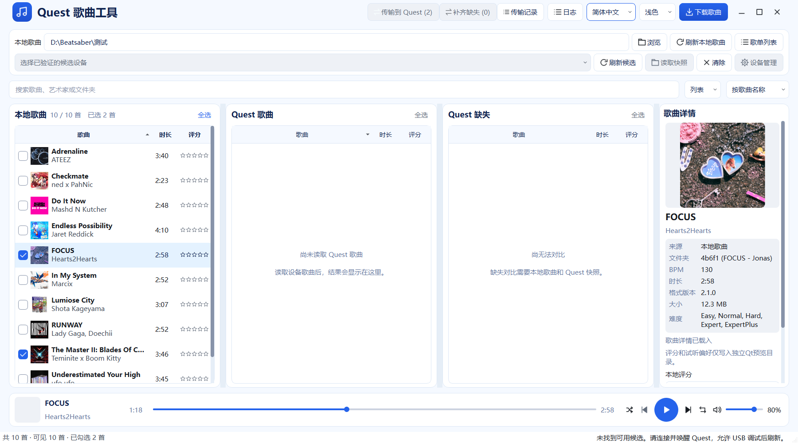

# 打开软件与日常使用

说明依据：2026-10-28 的源码入口与当前 Qt 布局。

## 打开软件

双击项目根目录的 [启动.vbs](../启动.vbs)。已有桌面“Quest 歌曲工具（新版曲库）”打开主曲库，“Quest 下载歌曲”直接打开下载页。[创建桌面快捷方式.vbs](../创建桌面快捷方式.vbs) 可重新创建这两个入口。

`启动.bat` 委托同一 VBS；`启动.pyw` 也打开 Qt 曲库。Qt 使用独立运行目录与实例锁，已打开的实例需要先正常退出，才能切换独立入口。下载页右上角“曲库 / 传输”可在同一程序内打开完整曲库。

旧 `main.py` 启动 Tk 界面，保留用于兼容和回退；不作为日常启动入口。

## 本地曲库

点击“本地歌曲”右侧“浏览”，选择实际歌曲目录，例如 `D:\Beatsaber\本地`。Qt 主曲库与下载窗口共享显式选定的目录，下次启动恢复该选择；已提交的任务仍使用提交时的目的地。

主曲库固定显示本地歌曲、Quest 歌曲、Quest 缺失和右侧详情。支持搜索、排序、列表/封面切换以及评分、评价和试听。各列的“全选/取消全选”仅作用于当前搜索结果，保留搜索范围外已经选中的歌曲。

主曲库和下载窗口的系统标题栏均已合并到品牌栏。右上角提供最小化、最大化/还原和关闭；品牌图标、标题及空白处可拖动，双击可最大化/还原。搜索框、导航标签、下拉框和操作按钮保持各自交互，歌单管理和设备管理也使用合并标题栏，其他辅助弹窗保留正常标题栏。品牌栏的垂直留白已减少10px；宽窗口一行排列操作，窄窗口将操作区移到品牌栏下一行。

“传输到 Quest”“补齐缺失”“传输记录”和“日志”位于顶部、语言与主题选项之前。窄窗口的日志入口只显示图标，悬停可见名称。列表标题、数量和全选合并为一行，播放器直接位于列表下方。底部状态栏左边显示本地统计，右边显示设备状态；长文本可悬停查看。掉线后的“重新连接”按需显示在设备操作行。窄窗会临时收紧表格列宽，原有列宽设置继续保存。

删除歌曲：在歌曲列表右键选择“删除歌曲…”，或让列表获得焦点后按 `Del`。有勾选时处理该列表的勾选歌曲，否则处理高亮选中项；右键未勾选歌曲则只处理该歌曲。确认窗口列出数量、位置和全部文件夹，`Enter` 确认、`Esc` 取消。搜索输入框中的 Del 仍用于编辑文字。

本地歌曲文件夹进入 Windows 回收站。Quest 歌曲移动到所选曲库里的 `.quest-deleted-<事务编号>/` 隐藏隔离目录，电脑运行目录 `deleted-songs/` 保存源位置和隔离位置；恢复需按记录移回原位置。本轮没有自动清空隔离区的功能，隔离不会释放头显空间，也不会改动歌单文件。设备或歌曲发生变化时会停止处理，完成后刷新相应列表。

[深色主曲库](images/96-library-dark.png)

## 下载歌曲与歌单

在主窗口右上角点击“下载歌曲”。顶部提供发现歌曲、发现歌单、下载任务及链接/歌单/ZIP 导入。推荐分类直接展示，默认 6 列 × 8 行，每页最多 48 首；封面/列表、列数和每页行数可调整。可按歌名、歌手、谱师搜索，也可粘贴 BeatSaver 歌曲链接，或输入 `#1f33` 形式的编号；纯数字歌名仍按文字搜索。

先选择保存目录，再勾选歌曲批量下载，或在右侧详情下载单曲。筛选窗口保留全部筛选参数及应用、取消、重置；个人预设位于设置菜单。跨页勾选可在已选清单中检查。下一页会在后台有限预加载，刷新本页可重新获取内容。

[深色下载页](images/96-download-dark.png)

本地 `.bplist` 可从主曲库“歌单列表”导入。歌单以谱面 hash 匹配本地版本；未匹配不等于本地一定不存在。下载页“发现歌单”可以浏览在线歌单、进入详情、选择歌曲或整份下载，支持返回后保留勾选与页码。

链接导入支持歌曲/歌单官方网址和本地歌单或 ZIP。整份歌单下载先预览并确认，交给原下载队列；每批最多 200 个不同歌曲编号。下载的是网站当前发布版本，可能与歌单原有 hash 不同。超量或缺少编号会明确提示，不静默截断。

已有同版本歌曲默认跳过，不同版本可另存；安全解压与校验由原下载服务完成。失败项从下载任务中重试，取消后重试重新下载，不承诺 HTTP 断点续传。列表接口及访问限制以服务实际响应为准，本项目没有新增账号登录功能。

## 试听

主曲库默认播放已安装的本地或 Quest 整曲，已移除播放时长下拉框，旧的30/60秒偏好不再限制播放。底部和下载页共用同一排控件：播放/暂停、上一首、下一首、随机、单曲循环、进度与音量。暂停后继续从当前位置播放；拖动、点击进度轨道或使用方向键/Home/End均按整条时间轴定位，松开鼠标才提交一次跳转。

双击主曲库歌曲、封面或歌单管理中的已匹配歌曲即可播放；单击只查看详情，保持正在播放的歌曲。上一首/下一首按开始播放时的可见本地列表切换；随机会避开当前歌曲，上一首优先返回播放历史。自然播完继续下一首，单曲循环优先于随机。

下载发现歌曲和在线歌单详情也支持双击播放。在线来源依然只有网站提供的试听片段，通常最多30秒；“本地整曲”不会将网站片段变成整曲。Quest 来源不能直接播放，需要本地副本。播放和选歌不自动下载或传输。主曲库与下载窗口共享音频设备，后播放的窗口接管声音。

## 传输记录与日志

“传输记录”按全部、已完成和需关注显示数量，可搜索文件夹、状态或事务文件名，并按状态筛选。右侧“记录详情”显示易读摘要，“原始记录”显示通过校验的事务数据；支持复制当前视图。它只查看记录，不自动重试或恢复设备文件。

“日志”位于主曲库顶部传输记录右侧，下载窗口也可从设置菜单打开。显示运行版本、窗口尺寸、运行目录，以及启动、未处理界面异常、播放请求/定位和音频错误，支持刷新、复制。读取每个日志的尾部最多64KiB，最多当前日志及两份轮转日志；界面最多保留2500行，超限有提示。界面和复制内容会替换用户主目录、IPv4地址及常见密钥字段；原始日志不会因此修改。日志不会自动上传。

窗口外框统一请求Windows原生圆角；系统不支持时使用不透明的圆角裁切，最大化保持直角。圆角不使用透明阴影或逐帧重绘。

[传输记录界面](images/96-transfer-history.png) · [诊断日志界面](images/96-logs.png)。截图来自隔离运行目录，传输记录及下载歌曲为布局样例，不作为真实Quest传输或网站请求证明。

## 读取 Quest

用 USB 数据线连接已开机的 Quest，戴上头显完成解锁并允许 USB 调试。点击“刷新候选”，选择歌曲目录，再“读取快照”。

| 目录 | 用途 |
| --- | --- |
| SongCore / CustomLevels | 普通自定义歌曲库，通常优先选择 |
| SongLoader / CustomLevels | 兼容目录，是否使用取决于头显上的 Mod |
| WIP | 测试歌曲目录 |

这几处目录不会自动合并，存在也不表示游戏当前一定使用它。Quest 的 MTP 对象不是 Windows 盘符，普通文件夹选择对话框无法当作本地路径访问。

主曲库设备区域的“设备管理”打开连接窗口；启动软件或仅打开窗口不会自动开启无线调试或配对。窗口提供三种方式：

- **USB 转无线**：先用数据线连接并在头显内授权，点击检查 USB、选中 Quest，再点击“开启无线并连接”。IP 留空时读取头显的 Wi-Fi 地址；只有提示连接成功且身份核验通过后再拔线。
- **已有设备**：点击“发现设备”读取无线广播及当前已连接的 Quest，也可手动填写 IP 与连接端口。发现的广播标为待核验；选中地址不会自动连接。经典 USB 转无线一般使用 5555，TLS 无线调试端口以头显实际显示为准。
- **配对码连接**：仅适用于头显确实支持并开放无线配对的情况。填写配对端口和六位码，连接端口可留空自动发现；“已配对，尚未连接”时补填连接端口，再点击“继续连接”，无需重复输入配对码。多个连接端口不会自动猜选。

“连接诊断”显示当前 ADB 版本和自动发现查询是否可用。发现失败时仍可手填地址。连接成功后点击“读取曲库”，或返回主窗口选择歌曲目录再读取。未找到歌曲目录与连接未建立是不同问题；目录缺失仍由原曲库读取流程提示。

连接成功并核验身份后，“已有设备”页会保存最近 8 台头显的地址、端口、硬件身份和型号。选中记录不会立即连接；点击“重新连接”才执行，并要求仍是原头显。同一个 IP 被另一台设备使用时会拒绝。修改 IP 或端口后按手动新地址连接；“移除记录”只删除电脑上的这条记录，不断开头显，也不清除设备配对。

主窗口选中已核验的无线 Quest 后，在窗口可见、未执行其他设备任务时每 5 秒检查现有连接；不读取整库，也不自动重连。检测到掉线、未授权或身份变化后，旧歌曲列表保留并失效，传输和补齐不可用，设备状态旁出现“重新连接”。点击后按原记录核验，成功后点击“读取曲库”重新取得快照。头显 IP 改变或原无线调试端口关闭时，仍需在设备管理中输入新地址或通过 USB 重新开启。

最近记录保存在 Qt 独立运行目录的 `qt-wireless-recent.json`，不保存配对码或密钥。记录损坏时保留原文件并提示，仍可手动连接。启动软件不会因为存在记录而探测或自动连接设备。本阶段未做 USB／无线通道归组，也不提供二维码配对、全网段扫描或断开全部设备操作。歌曲传输继续使用主曲库现有按钮，没有额外的传输启用开关。

元数据先显示，当前可见/选中歌曲的封面和缺失时长稍后补全。刷新期间保留旧画面；失败时旧结果会失效，不能据此推送或补齐。文件损坏、异常名称或跳过项目会导致快照不完整。

## 比较与传输

主曲库顶部默认显示“传输到 Quest”“补齐缺失”和传输记录，不再需要额外启用。缺少本地曲库、设备快照或选曲时，按钮会禁用并说明原因；点击可用按钮后仍需核对方向、设备和目录并确认。

“检查缺失”位于缺失列表空状态，按 Info 和谱面内容识别同版本，可停止/继续。双方快照或核验不完整时，未知项不会当作缺失。

勾选本地歌曲后点击“传输到 Quest”，或选择缺失歌曲“补齐缺失”。确认窗口显示方向、数量、本地位置、目标设备和目录，以及本地文件大小估算、默认跳过已有歌曲的策略。大小只是估算，复制时仍重新核验。

传输结果区分成功、已存在跳过、失败、取消/未执行及安全阻止；只重试明确失败项，并再次确认。推送后重新读取 Quest，避免继续使用过期结果。传输记录可查看已有事务。此前底部 Quest→PC 导入按钮已按布局要求移除，后端仍保留。

## 常见问题

- 找不到传输：从下载页返回“曲库 / 传输”，查看主曲库顶部品牌栏中的传输按钮。
- 读取不到目录：先确认头显已开机、解锁并允许 USB 调试，再刷新候选。
- 三个目录都有歌曲：按实际 Mod 选择目录，软件不会自动合并或删除。
- 封面、BPM、时长未知：等待可见项补全；无法读取的资料保留未知。
- 软件没有窗口：确认是否已有实例；当前入口会把完全离屏的窗口移回可用区域。
- 旧 Tk 曲库路径为空：根 `settings.json` 曾指向已经清理的测试目录，可在界面重新选择实际曲库。Qt 使用独立的 `qt-workspace.json`。

更多限制和验证范围见 [验证与已知问题](验证与已知问题.md)。

## 发现歌单、本地歌单与 Quest 歌单

“发现歌单”使用精选、最新、高评分和相关度分类，点击封面卡片进入详细歌单。封面使用四路有界加载和磁盘缓存，可见内容优先。可试听、勾选下载、整单下载或“保存到本地歌单”；整单下载时也会尝试保存歌单文件，保存失败会单独提示，不撤销已经加入的歌曲下载任务。

动态搜索歌单显示“动态歌单”标记。网站未提供数量时显示“数量待计算”，进入详情后按实际返回结果确认数量；配置中的1000等数值是搜索上限，不作为实际歌曲数。动态歌单刷新后可能变化，保存到本地得到的是当次获取的固定清单，不会自动同步网站。详情底部区分本页条数和总数；总数未知或清单未完整加载时，仍可选择可用歌曲下载。整份下载继续要求完整清单及每批最多200个不同歌曲编号，不自动截断。

主曲库“歌单列表”分为“本地歌单”和“Quest 3 歌单”。本地支持导入、移除记录、导出 `.bplist`、按本地曲库哈希核验、试听和准备下载。在线保存的歌单同时进入本地记录和运行目录 `playlists/`，导出的文件可另选位置。

在主窗口选中已连接 Quest 后，进入“Quest 3 歌单”点击“读取 Quest 歌单”。目标为 `/storage/emulated/0/ModData/com.beatgames.beatsaber/Mods/PlaylistManager/Playlists`，即头显文件管理器中的 `ModData/com.beatgames.beatsaber/Mods/PlaylistManager/Playlists`。目录必须实际存在并通过设备身份、规范路径核验；不会猜测其他位置或自动新建模组目录。

选中本地歌单后“发送歌单到 Quest”，核对提示并确认。只发送 `.bplist`，相同内容跳过、不同内容不覆盖；先暂存、校验内容后再发布，记录在运行目录 `playlist-transfers/`。Quest 页可将已有歌单保存到本地或导出。发送完成后在游戏中刷新歌单或重启游戏；**歌单只是一份曲目清单，音频和谱面必须另外下载、传输**。整单歌曲下载继续沿用每批最多 200 个不同编号的限制。

## Quest 歌单与拖动传输补充（2026-10-28）

- 在歌单管理的“Quest 3 歌单”读取后，如果主曲库尚无设备快照，会继续读取当前所选歌曲目录；歌曲资料按可见区域加载，后台用哈希匹配已安装歌曲。只有hash的条目也会保留，并尝试获取名称、封面与编号。没有匹配到不代表歌曲一定未安装在其他目录。
- 歌单管理底部的播放栏与主曲库共享。已安装歌曲可双击或点击“播放歌曲”，无需退出管理窗口；支持暂停、进度定位、上一首/下一首、随机、循环和音量。同来源的上一首/下一首遵循当前歌单顺序。未安装条目可选择并准备下载。
- Quest 音频首次播放按单首读取到电脑临时目录，后续拖动进度复用缓存。需要保持头显在线；设备/快照切换后旧播放失效。大歌单的首次匹配、部分 OGG 定位仍可能等待数秒，后台工作期间窗口可继续操作。
- “Quest 缺失”的全选按钮左侧新增“检测缺失”，窄窗显示放大镜图标，悬停可看名称；检测中同一位置可停止。先载入本地与 Quest 曲库，再检测内容版本。
- 将本地列表中的歌曲拖到 Quest 列表，会打开“传输到 Quest”的确认窗口；Quest 拖到本地则打开导入确认。仅处理本次拖动选中的歌曲，不混入其他已勾选项。外部文件、同侧拖动或已过期的设备选择不受理；拖动本身不会直接开始复制。
- 从设备管理返回时保留已验证的无线连接；如需要歌曲，点击“读取快照”。头显休眠或网络变化造成的实际离线，仍按设备状态提示处理。
