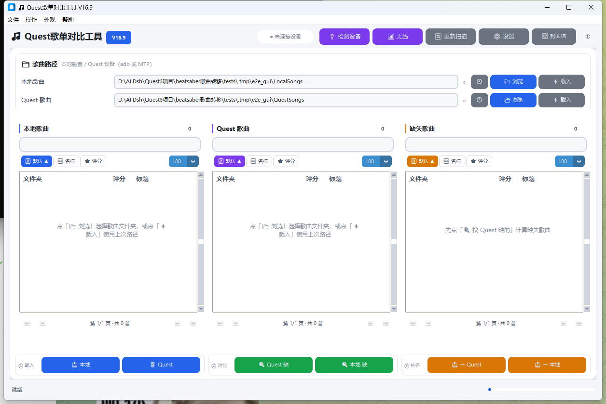

# 怎么打开这个软件

> 只想赶紧用起来？**双击 `启动.bat`** 就行。第一次要联网装依赖，之后秒开。

---

## 一、最省事的开法（推荐）

在程序文件夹里找到 **`启动.bat`**，双击。

它会自动做四件事，不需要你懂命令行：

1. 切到程序所在目录（从任何地方启动都能找到）；
2. 找 Python，优先用没有黑框的 `pythonw.exe`；
3. **检查依赖，缺了才装**（第一次约 10 MB，需要联网）；
4. 启动程序。

如果出问题，它会**停住窗口让你看清提示**，而不是黑框一闪就消失 —— 这是很多"双击没反应"的根源。

---

## 二、想放到桌面/开始菜单

双击 **`创建桌面快捷方式.vbs`**，桌面就会出现「Quest歌单对比工具」。
以后直接点桌面图标即可，不用再回这个文件夹。

（重复运行是安全的，会覆盖旧的快捷方式。）

---

## 三、三种启动文件的区别

| 文件 | 双击能开？ | 有黑框？ | 什么时候用 |
|---|---|---|---|
| **`启动.bat`** | ✅ | 有（一闪而过） | **默认选它**。出错时能看到原因、能自动装依赖 |
| **`启动.vbs`** | ✅ | **没有** | 想要完全无窗口。做成快捷方式后日常用 |
| **`启动.pyw`** | ✅ | **没有** | `.pyw` 在 Windows 上默认关联 pythonw，也能直接双击 |
| `main.py` | ❌ **不能** | — | 给命令行用的：`python main.py` |

> ⚠️ **`main.py` 双击通常打不开**。`.py` 在很多电脑上关联到编辑器，或者根本没有关联。
> 想双击就用上面三个之一。

---

## 四、打开之后的样子



三步用法：

1. **分别载入**本地的 `CustomLevels` 文件夹和 Quest 上的 `CustomLevels` 文件夹；
2. 点 **「Quest 缺的」** 看哪些歌头显上没有、点 **「本地缺的」** 看反过来缺哪些；
3. 点 **「补齐缺失 → Quest」** 一键把缺的传过去。

连接 Quest 的两种方式（详见 [`06_Quest3连接与文件夹选择.md`](06_Quest3连接与文件夹选择.md)）：

| 方式 | 需要什么 | 特点 |
|---|---|---|
| **adb**（推荐） | 装 Android Platform Tools，头显开开发者模式并允许 USB 调试 | 读写/删除快，功能最全 |
| **MTP**（免安装） | 插上就行 | 慢一些，且**不能删除设备文件** |
| **无线**（同一个 Wi-Fi） | 头显开「无线调试」 | 不用插线；配对码会过期 |

---

## 五、双击没反应 / 打不开怎么办

**按顺序试这三步：**

1. **换成双击 `启动.bat`** —— 它会停住并显示错误原因。
2. 如果提示**没有找到 Python**：去 <https://www.python.org/downloads/> 装 3.10 或更高版本，
   安装时**务必勾选 `Add Python to PATH`**，装完重开 `启动.bat`。
3. 如果提示**依赖安装失败**：手动打开命令行（在文件夹地址栏输入 `cmd` 回车），执行：
   ```
   pip install customtkinter pillow
   ```

### 想自己看看到底报了什么错

在程序文件夹的地址栏输入 `cmd` 回车，然后执行：

```powershell
python main.py
```

窗口不会自动关闭，报错就留在屏幕上了。

### 程序内的自检

```powershell
python -m quest_tool --doctor
```

会打印版本、依赖、数据目录、adb 位置、Shell 采集器状态、界面偏好（语言/缩放/外观）——
问别人"为什么我这边不对劲"时，把这个输出发过去最有用。

---

## 六、做成一键安装包（可选，进阶）

仓库里有 `quest_tool.spec`，可以打包成不依赖 Python 的 exe：

```powershell
pip install pyinstaller
pyinstaller quest_tool.spec
```

产物在 `dist\QuestSongCompare\`，整包约 37 MB，直接发给别人也能跑。
调试时想要控制台窗口：先设 `$env:QUEST_CONSOLE="1"` 再构建。
