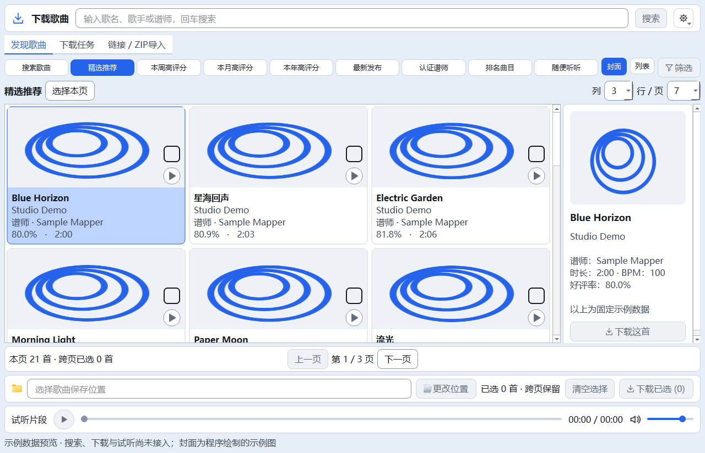
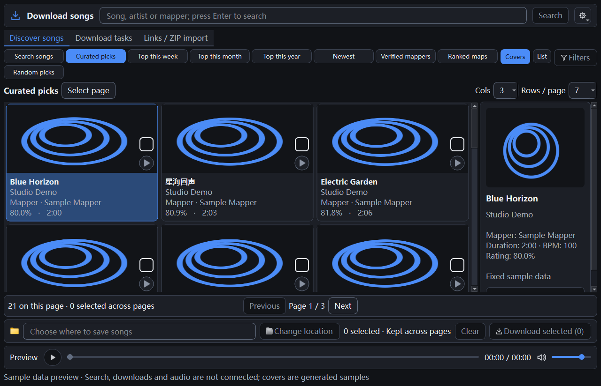
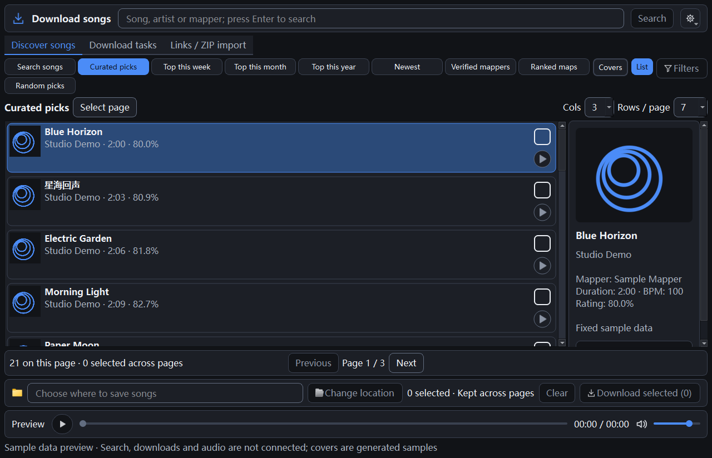

> 最新（2026-10-22T22:32:09+08:00）：UI第一批自动化验收完成：共享桌面令牌、Qt统一字体/状态/下拉箭头/滚动条、下载页固定详情动作和虚拟卡片外观已实施；默认3列×7行/页（21首）、九类入口、搜索/勾选/分页/下载/试听接线保持。默认GBK静态7项、Qt30/30、旧完整28/28退出0；182份源码/测试与隔离副本同哈希，正式五项运行数据未变。本轮不访问真实Quest，不改搜索/下载/音频/数据库/传输业务或主曲库列布局；共享样式会被其他Qt页面继承。 详见根03/04及docs/48。

# Qt M2B：歌曲模型与示例浏览

日期：2026-10-18。用户在M2A交付后要求继续，本批仅M2B。最新验收状态以根03/04为准；不自动进入M3A。

## 使用与边界

`python main_qt.py` 展示48首固定、虚构示例；不是BeatSaver实时结果。封面由Qt生成，不读取缓存或网络。保留 `--components`、`--lang en`、`--theme dark`、`--data-dir`；旧 `main.py` 仍运行原Tk产品。正式APP_VERSION仍20.4，Qt窗口及日志标M2B。

默认3列、7行/页，共21首；行数表示每页结果数，不要求在一屏同时塞入7行。可设1–6列、1–15行，结果区独立滚动。封面/列表切换、当前详情、勾选集合分开管理；鼠标点卡片浏览详情，点复选框或在列表内按空格切换勾选，方向键移动当前项。选择本页只增加当前页，清空选择清除跨页集合。页码随每页大小变化而收敛到有效范围，尽量保留仍在页内的当前歌曲。切换主题、语言、页签或视图保留勾选。

搜索、九类推荐的真实数据请求、筛选、下载队列、路径选择、导入和试听均留待后续；相关动作禁用，分类仅变更标题。卡片播放图标不触发播放，底栏明确说明预览范围。Qt不写正式设置、数据库或下载历史。

## 文件职责

| 文件 | 内容 |
| --- | --- |
| quest_tool/qt_ui/song_model.py | 不可变Song、48条fixture、QAbstractListModel；稳定key的跨页勾选、角色数据、分页边界、重复key拒绝 |
| quest_tool/qt_ui/song_view.py | QListView的IconMode/ListMode；QStyledItemDelegate绘制与勾选命中；Qt原生滚动与键盘；最多64张256像素示例封面缓存 |
| quest_tool/qt_ui/download_window.py | 接入模型、当前详情与分页/选择状态；复用M2A区域，不销毁重建页面 |
| quest_tool/qt_ui/__init__.py | Qt阶段M2B |
| quest_tool/messages.py | 中英文示例标识、详情/页码/选择状态与可访问名称 |
| tests/qt/smoke_song_browser.py | 模型边界、鼠标与空格、跨页选择、默认3×7/4×6、网格/列表、详情、空态及无Tk导入 |
| tests/smoke_downloads.py | 仅单曲安装测试同步收尾：10秒有界等待queue.task_done，再保留原无临时目录断言；下载器不改 |
| tests/qt/smoke_download_shell.py | 原M2A布局/状态回归保留，仅启动日志阶段更新 |

不改搜索、下载解压、媒体会话、试听引擎、数据库结构、设备操作或复制删除护栏；没有安装依赖、打包或切换正式入口。

## 视觉与性能

所有卡片由委托绘制，没有每首歌创建按钮/复选框子控件。无编号；复选框与播放区域均32逻辑像素，复选框在上。未选框不填充，不产生白色子控件。当前项、悬停、键盘焦点与勾选有独立反馈。文字过长使用省略和完整工具提示；详情支持换行与垂直滚动。行列变化使用Qt布局，示例图片缓存不按每次缩放重建。

最终布局测试：中英×浅深×100/125/150%×3尺寸，共36组；原本的分类自适应、固定底栏和分隔条检查继续保留。每档80次程序驱动resize+processEvents的P95约20.98/26.70/28.34ms，最大21.25/28.66/28.91ms。早期探索150%曾P95约60.66ms，未定位为确定缺陷，不能用最终较快一轮抹除波动。此数据不是鼠标拖动FPS；连续手动拖动残影、跨屏DPI和真实封面解码仍待后续验证。

Qt专项、M1基础专项及默认GBK静态均退出0；旧版完整最终28/28组通过且退出0，证据full-accepted.log与accepted-results.json；初轮full-final.log为26/28退出1（旧gui缓存/标题、filters按钮映射），两组单独复验退出0；第二轮27/28为旧下载测试过早检查临时目录，受控复现后仅修正该测试同步，保留原无残留断言与新增10秒收尾期限，下载器未改。最终第三轮完整混跑28/28退出0；三轮日志/退出码保留，首轮gui/filters原因未确认。此前M2A旧inspector偶发失败原因仍未确认，本轮通过不宣称修复该历史问题。

## 证据与回退

备份：`E:/AI-Project-Backups/P006_Qt_M2B_20261018T204707`。before为本批修改前227文件工作副本（含既有WIP/未跟踪文件，排除Git、缓存、日志、构建等）；before-hashes.json、git-status-before.txt记录原现场。validation不复制正式settings.json、songs_cache.db及downloads.json；validated-source.json记录冻结源码。

最终test-results.json保存各步骤退出码、耗时，对应*-final.log。phase-files.json保存本批文件前后哈希，verification.json保存边界与运行数据核验。rollback_m2b.py默认dry-run，只有全部交付文件和备份哈希一致时才允许 `--apply` 逐文件恢复；存在后续修改则停止，不整库覆盖，不git reset/clean。

下一批M3A才适配现有搜索/推荐/分页服务，并验证异步取消、迟到结果和空/错态。本批停止后需用户继续指令再激活；真实下载属于M5。

## 实际界面截图

以下为Qt窗口实际抓图，采用本批固定示例，不是真实网站结果。

## 验证中发现的旧测试竞态

首轮全回归26/28（旧gui、filters），两组单独复验均退出0；第二轮27/28，这两组通过，但downloads的无临时目录断言失败。下载器发布终态后才退出TemporaryDirectory，测试原先过早检查。以300ms延迟清理作受控复现，原测试稳定失败，修正等待工作队列完成后的同一断言通过；下载源码与本批开始前逐字节一致。仅调整该测试收尾同步，未改下载逻辑、清理行为或原断言。最终完整回归见根03/04，不混合独立通过记录伪造整套通过。
