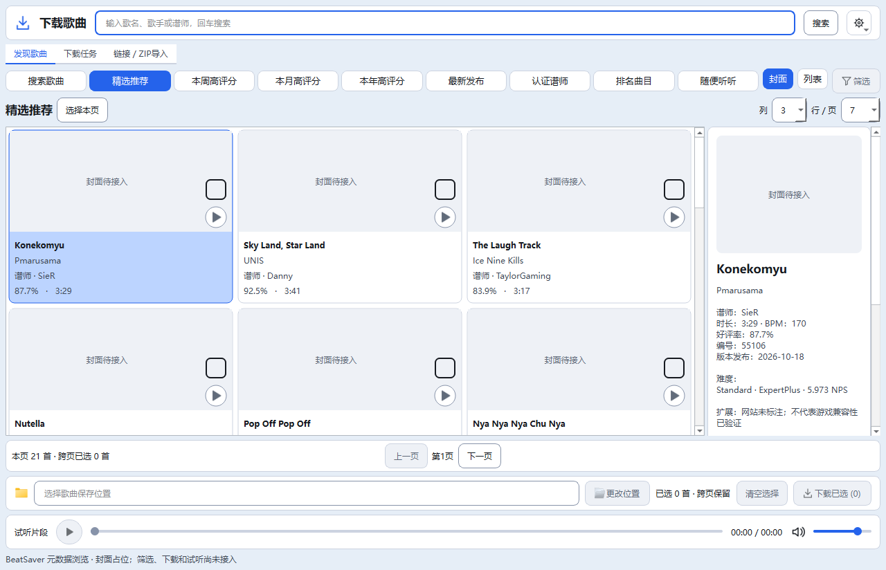

> 最新（2026-10-23T14:32:52+08:00）：Qt下载页分页预加载已实施，完整验收继续按用户要求暂缓。当前页成功显示后延迟300ms预取下一页；列表缓存最多3页、120秒、规范化元数据8MiB，封面复用现有串行通道且每页最多预取21张。同条件翻页保留当前内容，命中缓存直接切换；正在预取的同页请求直接复用。切换搜索/分类/排序/筛选/每页数量取消旧预取；随机推荐不缓存或预取。静态7项、主题、双语和7组无音频Qt专项共10项均退出0；191份源码/测试与隔离副本同哈希，正式五项运行数据未变。不改变搜索业务服务、下载解压、试听、数据库或设备护栏；未访问真实网站、播放音频、运行完整回归、启动正式实例或操作Quest。 详见[分页预加载](54_Qt下载页分页预加载.md)。

> 最新状态：M3A完成；完整28/28退出0，M3B未开始。本页末尾保留旧待验收记录，续办结果以根03/04及本轮证据为准。

# Qt M3A：搜索、推荐与真实分页适配

日期：2026-10-19。用户在M2B交付后要求继续，激活本批M3A。当前验收状态以根03/04为准，不自动进入M3B。

## 使用与范围

`python main_qt.py` 默认连接BeatSaver公开元数据接口，初次打开精选推荐；输入关键词后回车/点搜索，切换到搜索分类。九类推荐全部以按钮展示，只有搜索分类显示排序框。`--samples` 保留固定示例模式，无网络请求；`--components` 保留M1基础控件。`--lang en`、`--theme dark`、`--data-dir`继续可用。

默认3列7行=每页21首；1–6列、1–15行决定实际请求的pageSize（最多90）。分页使用接口has_next，不伪造未知总页数，保留后端最大页号1000。改变行列从第一页请求；翻页、重试使用已经提交的关键词/分类/排序，不意外提交输入框尚未搜索的草稿。切主题、语言、视图、页签或普通窗口缩放不请求网络。

翻页保留勾选，最多200首，同时保存被选Song记录供后续下载适配使用。换关键词、分类或排序清空勾选，与旧搜索页签名语义一致。当前详情与勾选集合分开。网站缺时长/BPM/评分时显示未知，评分0仍显示0.0%；歌名、作者、谱师、版本日期、难度/NPS、扩展与描述使用现有SearchClient规范化结果，不改业务参数或数据库结构。

真实封面和试听留到M4：本批只保留其URL，界面明确显示封面待接入，不请求图片/音频，也不使用示例图冒充歌曲封面。筛选窗口留到M3B，下载、路径、导入和队列留到M5，相应动作禁用。旧main.py及全部正式业务保留。

## 架构与文件

| 文件 | 本批职责 |
| --- | --- |
| quest_tool/qt_ui/search_browser.py | 新增Qt主线程适配器：绑定工具行和底部状态，复用SearchSession，处理请求、取消、重试和代次，更新模型/详情 |
| quest_tool/qt_ui/song_model.py | Song.from_result展示映射；未知值；200首及被选记录；远端页面替换；独立selectionChanged信号支持空结果时清空 |
| quest_tool/qt_ui/song_view.py | 真实数据封面占位及未知评分、空/错/加载状态绘制；离线示例绘制保留 |
| quest_tool/qt_ui/download_window.py | 接入适配器和关闭清理；详情纯文本/可复制/长文本自适应；原布局不增加状态行 |
| quest_tool/qt_ui/bootstrap.py、__init__.py | 默认在线元数据、--samples离线分支，阶段M3A |
| quest_tool/messages.py | 双语状态、错误/取消重试、真实详情/封面占位；复用原search/browse错误文案 |
| tests/qt/smoke_search_browser.py | 新增端到端Qt专项：真实SearchSession/SearchClient + 受控HTTP传输；三档DPI及默认入口 |
| tests/qt/smoke_download_shell.py | 原布局回归的实际启动显式--samples，验证日志阶段M3A；原断言保留 |

不修改song_search.py、search_filters.py、downloads.py、search_media.py、audio.py、database.py、storage.py、workers.py、设备模块、旧Tk页面、PowerShell或现有旧回归测试。不新增依赖，不改正式APP_VERSION=20.4。

## 线程、取消和关闭

HTTP与解析仍在SearchSession的现有后台线程。后台只发TaskRunner消息，不持有或更新Qt控件。UI主线程QTimer每40ms排空消息，仅加载期间运行，完成、错误、取消或关闭后停止。每个结果/错误必须匹配当前generation；取消后generation置空，迟到消息不能覆盖新界面。SearchSession仍复用原单消费者/最新请求策略。

关闭窗口先停UI消息泵，再调用原SearchSession.close取消后台请求；UI不等待网络线程。原后端reaper完成线程收尾。专项用阻塞的受控传输验证关闭事件不等待请求、关闭后消息不再改UI；真实不响应网络下的进程退出仍受原HTTP超时约束，不宣称覆盖所有网络环境。

网站歌名和描述强制PlainText，工具提示转义HTML。用标记文字及4000字无空格文本验证，避免Qt自动识别富文本、加载文本中嵌入的资源或撑宽详情。

## 验证

- 新增Qt专项：100/125/150%；UI到现有后端及受控HTTP完整链路；九类参数、排序、21/90首分页、200首上限、跨页勾选/签名清空、草稿保留、未知数值、空结果、限流/身份/拒绝/网络错误、重试、取消、迟到代次、关闭和主线程归属。中英×浅深×三尺寸×三DPI共36在线布局，含长标题/长描述；布局/主题/语言不发请求。
- 默认启动路径使用受控HTTP验证会载入21条、退出与锁释放；离线示例、原M2B浏览、M2A布局和M1基础专项继续保留。
- 公开接口探测使用同一Qt适配和原SearchClient：精选第一页、Imagine Dragons搜索第一页与下一页；每次21条。只读元数据，不下载封面、音频、ZIP，不写正式曲库。最终实际状态见外部live-metadata.json，不把网络可用性与受控专项混为同一证据。
- 默认GBK静态与完整旧28组在隔离副本执行，结果/退出码见根03/04及accepted-results.json；本文件的测试说明不代替最终通过记录。
- 手动连续拖动残影、跨屏DPI、真实封面解码/播放和EXE仍待相应阶段验收，当前占位图性能不代表真实封面负载。

## 备份与回退

备份：E:/AI-Project-Backups/P006_Qt_M3A_20261019T003822。before保存本批开始前236文件工作副本（含既有WIP/未跟踪文件，排除Git、缓存、日志、构建等）。相较M2B结束，用户settings及SQLite WAL/SHM曾变化，本批以最新磁盘状态为基线，不恢复旧值。验证副本排除settings.json、songs_cache.db及WAL/SHM、downloads.json。

validated-source.json记录被冻结源码；accepted-results.json与对应*-accepted.log记录退出码和耗时，live-metadata.json记录真实只读接口观察。phase-files.json保存本批前后哈希；verification.json保存边界、数据与回退核验。rollback_m3a.py默认dry-run，仅在全部交付与备份哈希一致时允许--apply逐文件恢复，后续修改则停止，不git reset/clean或整库覆盖。

下一批M3B才实现Qt筛选窗口，复用完整参数并逐项验证草稿/重置/取消/应用；本批结束即停止。

## 实际窗口截图

下图来自Qt窗口连接公开接口后的实际抓图：真实精选元数据，封面尚未接入，因此显示明确占位。不是设计稿或示例曲目。

## 最终收尾状态

# Quest Qt M3A · 实现已验证，完整验收待完成

更新时间：2026-10-19T01:37:59+08:00。本批停止写入，M3B未开始。

用户继续指令授权M3A。已接入真实搜索、九类推荐、排序、分页、取消/重试、错误/空态、200首跨页选择与详情。复用原SearchSession/SearchClient，不改搜索后端、下载、数据库、音频和设备。默认main_qt.py读取真实元数据；--samples保留离线示例。封面/试听/筛选/下载动作仍属后续阶段。正式版本仍20.4。

## 验证与未完成事项

- 默认GBK静态七项退出0；Qt搜索专项、原歌曲浏览、布局和基础专项均退出0，证据accepted-results.json及对应*-accepted.log。
- Qt专项覆盖九类参数、排序、21/90首分页、200首上限、取消/迟到结果、错误/重试、关闭、主线程更新、100/125/150%及36种在线布局；180字符标题与4000字符描述。
- 真实公开接口精选、Imagine Dragons搜索、下一页均21条；live-metadata.json，无UI异常，仅元数据请求，无封面/音频/ZIP。截图docs/images/qt-m3a-live.png。
- 最终完整旧回归27/28，退出1，耗时1008.25秒。唯一失败gui：“元数据标题已解析”（full-final-recheck.log:300，汇总1105）。其余27组通过，包含筛选、检查器、搜索、下载、音频、缩放和截图。**不能标记本批完整验收通过。**
- 首轮完整26/28退出1；旧gui和songlist独立原样复验均退出0。第二次试跑遇旧inspector Tab失败后主动停止，未完成不计通过，recheck-interrupted.json记录。检查器焦点诊断和原样复验均退出0。最终仍复现gui标题失败，根因待确认；未修改旧业务、旧28组测试或放宽断言，不以独立通过替代混跑通过。
- 107份源码/测试与隔离validation及validated-source.json同哈希。正式settings.json、数据库/WAL/SHM、downloads.json均与本批开始同哈希。保留全部已有WIP。

## 交接与回退

本批22文件（18改/4增），完整文件清单phase-files.json。备份及日志：E:/AI-Project-Backups/P006_Qt_M3A_20261019T003822。verification.json明确complete=false、acceptance=pending_legacy_gui；rollback_m3a.py默认仅预览，--apply核对全部交付/备份哈希后只恢复本批文件，有后续改动即停止。未实际回退。

下一步先定位隔离整套回归中旧e2e_gui“元数据标题已解析”失败，判断同步等待、共享状态或产品问题；证据不足不得预设根因。M3A完成验收前不自动进入M3B。手动拖动/残影、跨屏DPI、真实媒体性能与EXE仍待验收。未安装、打包、提交推送、操作真实设备或启动正式数据实例。验证进程结束后停止写入；接手必须从磁盘重新读取根五件套、Git及证据。

## 验收续办证据

# Quest Qt M3A · 验收续办

更新时间：2026-10-19T02:01:52+08:00。状态：**M3A完成；完整28/28退出0，M3B未开始**。本轮停止写入。

用户“好的，继续任务”授权继续定位上轮旧GUI失败并完成M3A验收，不启动M3B。磁盘重新读取根五件套，核对上轮22阶段文件和107源码哈希一致；新备份240文件，保留全部既有WIP。

## 本轮结论与依据

上轮full-final-recheck.log的旧GUI第二次载入出现约16秒停顿，而e2e_gui仅等待10秒，超时后继续断言标题。原样诊断运行中缓存和标题正确；受控后台缓存延迟10.5秒时，原测试退出1且报告缓存/标题失败，同一产品代码下候选25秒有界等待退出0。实际修正后的测试也在同一延迟下退出0，原命中4首、零重解析、精确“本地歌0”断言全部保留；新增“缓存回填在期限内完成”断言，预算与首次载入25秒一致。只改tests/e2e_gui.py，不改产品源码、数据库结构、搜索/下载/音频/设备逻辑。此证据确认测试超时可造成误报；16秒停顿本身的性能根因仍未确认，不能宣称卡顿/残影已修复。

## 验证

- 默认GBK静态退出0；受控延迟下实际修正测试退出0；完整GUI流程退出0；本轮整套退出码0，见full.log和results.json。整套结果按原28组汇总，不以独立通过替代。
- M3A Qt搜索、原浏览/布局/基础专项和真实公开接口验证结果继承上轮证据，产品源码哈希未变，本轮未重复媒体或网络探测。上轮失败26/28、未完成检查器试跑及最后27/28日志仍保留，不改写历史结果；本轮结果是新增证据。
- 107源码/测试与隔离副本同哈希。正式settings.json、数据库/WAL/SHM、downloads.json与本轮开始同哈希。全套测试仅在新隔离副本执行；无正式数据实例、安装、打包、提交推送或真实设备操作。

证据/备份：E:/AI-Project-Backups/P006_Qt_M3A_acceptance_20261019T014012。before-hashes.json、gui-probe-events.json、cache-wait-original/candidate/fixed.json及日志、results.json、full.log、validated-source.json、phase-files.json、verification.json。前批备份E:/AI-Project-Backups/P006_Qt_M3A_20261019T003822保留。

本轮共9文件（1测试、8文档），清单phase-files.json。rollback_m3a_acceptance.py默认仅预览，核对交付及备份哈希后--apply仅恢复本轮9文件；如需撤销完整M3A，先撤销本续办，再使用前批回滚，两步均不得覆盖后续修改。本轮回滚仅预演，未恢复。

Qt默认main_qt.py仍真实元数据，--samples保留离线示例；封面/试听、完整筛选和下载按M4/M3B/M5后续阶段接入。正式版本20.4不变。手动拖动残影、跨屏DPI、真实媒体性能与EXE仍待验收。本轮结束，不自动进入下一阶段；后续AI必须从磁盘重新读取根五件套、Git及上述证据。
