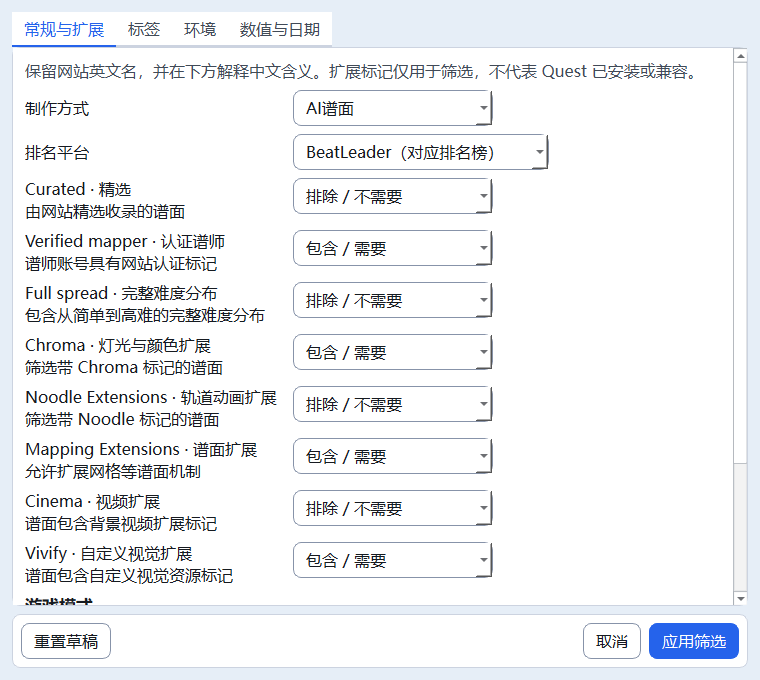
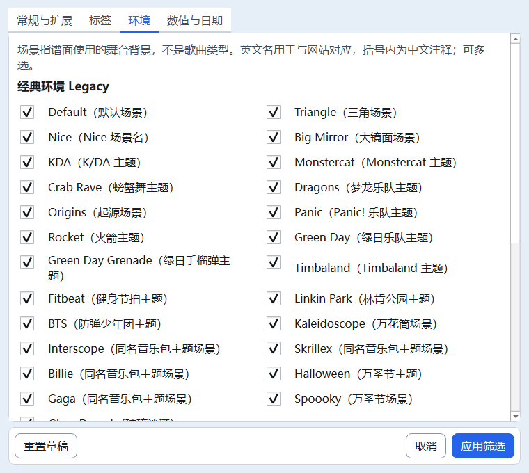
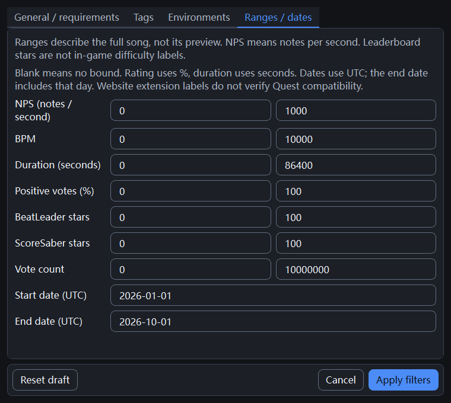

> 最新（2026-10-23T19:31:32+08:00）：Qt下载页筛选摘要与个人预设已实施，整体验收继续暂缓。摘要只显示已应用个人条件，支持逐项移除或清空，数值上下限成组移除，推荐分类自带规则保持；摘要与筛选按钮按同一条件组计数。个人预设支持保存、显式载入并筛选、删除，只保存筛选条件，不保存查询/分类/排序/页码；载入沿用原应用行为读取当前搜索框，分类冲突保留原条件。独立Qt目录qt-filter-presets.json采用QSaveFile原子保存，最多20份、名称40字、文件64KiB，重名不覆盖、损坏/未来版本文件拒绝覆写。最终默认静态7节、主题、双语与15组无音频Qt专项共18项均退出0；200份源码/测试与最终隔离副本同哈希，正式五项运行数据未变。搜索/下载/音频/数据库/设备业务及原筛选校验未改；未访问真实网站、播放音频、运行完整回归或启动正式数据实例。 详见[本批报告](59_Qt筛选摘要与个人预设.md)。

> M3B完成；Qt专项、默认静态及完整旧28/28退出0，M4未开始。最终验证证据见根03/04及本批accepted-results.json。

# Qt M3B：完整筛选窗口

日期：2026-10-19。用户在M3A完整28/28验收后再次要求继续，授权本批。最终验收状态以根03/04和本批verification.json为准；不自动进入M4。

## 使用及范围

`python main_qt.py` 的真实搜索模式可点击“筛选”，非阻塞打开父窗口所属的Qt模态对话框；重复打开激活已有窗口。四分类为常规与扩展、标签、环境、数值与日期，原有英文名和中文注释复用messages.py。`--samples`继续离线，不启用在线筛选。

全部8项三态扩展、8种模式、45标签、47环境、7组上下界、起止日期、人工/AI来源与排行榜均保留。FilterDialog只构造草稿，调用原filter_params校验；未修改search_filters.py、search_catalog.py、song_search.py或业务数据结构。范围百分比、整曲时长秒数、UTC日期结束日包含等含义由原后端处理。

首次无设置打开默认human；重置草稿为all，不会立即提交。切分类只切已有控件，不重新创建状态。取消、Esc、系统关闭按钮均丢弃本次草稿；重新打开从上次应用值开始。无效数值/日期保留窗口和输入，显示原错误文案。回车/主按钮应用，Tab导航、空格勾选；可点击换行文字切换复选框。

SearchBrowser保存深拷贝已应用条件，并将其加入原搜索签名；参数变化清空勾选并回到第一页，同参数与翻页保留选择。应用筛选会提交当前搜索框草稿，和旧版一致；空关键词且分类为Search时转Latest。推荐与排除条件冲突交给原后端错误路径，保留筛选供修改。取消不发请求；翻页/重试继续使用已应用条件。应用时若旧搜索仍在运行，原会话取消及代次机制拒绝旧结果。关闭主窗口同时拒绝筛选窗口。

## 实现与文件

| 文件 | 责任 |
| --- | --- |
| quest_tool/qt_ui/filter_dialog.py（新增） | QDialog、QTabWidget、QScrollArea、QFormLayout、原生复选框与换行标签；草稿/校验/提交 |
| quest_tool/qt_ui/search_browser.py | 单实例窗口生命周期、条件深拷贝、签名与原会话请求适配 |
| quest_tool/qt_ui/theme.py | 复用共享FORM/SPACE/语义色，新增仅筛选窗口生效的样式 |
| quest_tool/qt_ui/__init__.py、messages.py | 阶段M3B、已有双语标题/提示更新 |
| tests/qt/smoke_filters.py（新增） | 全目录/参数往返、真实键盘/鼠标、144布局组合、受控HTTP集成 |
| tests/qt/smoke_search_browser.py、smoke_download_shell.py | 实际入口退出日志阶段断言改为M3B，保留原覆盖 |
| 根五件套、README、CHANGELOG及相关接手/迁移文档 | 授权、范围、证据、停止点与回退 |

界面使用原生布局/控件，不创建Tk实例或自绘Canvas。滚动内容与底部按钮分离；窄窗口将标签与输入上下排列，模式/环境组仅跨断点时变换1/2列，控件身份及草稿保留。色板与窗口DPI使用现有Qt方案；没有新增依赖或数据库字段。

## 验证与边界

本批备份：E:/AI-Project-Backups/P006_Qt_M3B_20261019T020347，before保存240文件及全部既有WIP；validation不复制正式设置/数据库及下载历史。

新专项验证三档DPI下中英×浅深×460/760/1000宽×四分类，共144组合，实际窗口尺寸、文字heightForWidth、无水平滚动、固定底栏及未重建控件。输入8扩展、8模式、45标签、47环境和全部范围/日期，对照原filter_params输出；重置/取消/应用、非法范围/日期、Space/Tab/Enter与标签点击均验证。受控传输经过原SearchSession/SearchClient，检查实际查询参数、第一页/翻页、200首既有上限兼容、冲突错误、在途替换、关闭清理，无真实图片/音频/ZIP请求。

正式验收需新增专项、既有Qt搜索/浏览/布局/基础专项、默认GBK静态以及隔离副本旧完整28组均退出0；初步专项结果不替代最终汇总。上轮M3A的旧GUI等待修正原样保留，本批不再修改旧28组测试或断言。

正式数据、业务后端及设备护栏必须与本批开始同哈希。phase-files.json保存本批前后哈希，rollback_m3b.py默认只预览，--apply在全部交付/备份哈希一致时逐文件恢复，遇后续修改即停止。无自动提交、推送、依赖安装、打包或正式数据实例。

动态拖动残影、跨屏DPI、真实媒体性能和EXE仍待后续实测；本阶段不宣称修复旧Tk性能问题。下一批M4才接封面与试听。

## 最终现场

# Quest Qt M3B · 完整筛选窗口

更新时间：2026-10-19T02:36:31+08:00。状态：**M3B完成；Qt专项、默认静态及完整旧28/28退出0，M4未开始**。本批停止写入。

用户最新“繼續”授权M3B，M3A上批完整28/28记录保留。开始时重新读取五件套/Git，核对上批9文件及125源码快照一致，无并发写入；先备份240文件，保留已有WIP。只实现Qt筛选及必要搜索适配、共享Qt样式、文案和测试，不进入M4/M5。

## 实现与兼容

新增FilterDialog：原生QDialog/QTabWidget/QScrollArea/QFormLayout，常规与扩展、标签、环境、数值日期四分类；8扩展三态、8模式、45标签、47环境、7组上下界及日期完整保留，英文名/中文注释复用旧文案。首次human，重置all；切页不重建控件，取消/Esc/关闭不提交，无效输入保留并提示，Enter应用、Tab导航、Space及文字点击勾选。滚动区与底栏分离，窄屏上下表单/单列复选框，宽屏两列；仅跨断点重排，不自绘Canvas或增加后台GUI访问。

SearchBrowser单实例非阻塞打开父窗口所属对话框；条件深拷贝加入签名，变更条件清空勾选并回第一页，翻页/重试保留条件。应用提交搜索框草稿，Search空词转Latest；推荐冲突由原后端报错，取消不发请求，应用替换在途请求并拒绝旧结果；关闭主窗清理子窗。筛选按钮显示原参数计数语义。

## 验证证据

- 默认GBK静态七项退出0（static-accepted.log），未设置PYTHONUTF8。Qt新专项三档100/125/150%退出0，含144布局组合：中英×浅深×三尺寸×四分类；真实尺寸、文字换行高度、无水平滚动、底栏按钮几何、同一控件身份。原全目录值与filter_params输出一致；真实Space/Tab/Enter/标签点击、禁用、草稿/取消/重置/应用、非法范围/日期均通过。filters-accepted.log、shots-accepted。
- 受控HTTP经过原SearchSession/SearchClient，验证筛选实际查询、百分比/日期转换、第一页/跨页选择、冲突错误、在途替换及关闭，无真实网络图片、音频或ZIP。新专项无Tk/customtkinter/旧app/audio导入。
- 既有Qt搜索、歌曲浏览、布局、基础专项均退出0；包含200首上限、迟到结果和原36布局。对应search/browser/layout/foundation-accepted.log。两个旧Qt入口日志断言仅跟随阶段改为M3B，其余覆盖保留；旧28组测试及汇总器本批未改。
- 本批完整旧回归退出码0，accepted-results.json与full-accepted.log为最终依据。28/28全部通过。所有探索失败日志保留；早期新专项误用查询键sortOrder，已对照原SearchClient改为order，未修改后端。第一次正式试跑因截图发现中文下拉文字截断而主动停止自有进程，full-interrupted.log及interrupted-first保留，未完成不计通过；修正按完整文字计算宽度，并新增原生编辑显示区域断言后重新冻结/全量验证。
- 冻结109份当前源码/测试与隔离validation同哈希；正式设置、数据库/WAL/SHM及下载历史五文件均与本批开始一致。song_search/search_filters/search_catalog、数据库、下载、媒体、音频、设备、PowerShell和旧Tk页面全部未改。正式APP_VERSION仍20.4，Qt阶段M3B。

## 文件、回退与停止点

本批22文件（修改16/新增6），phase-files.json含完整前后哈希。新增Qt筛选窗口/专项、docs/15及3张截图，其余为Qt适配/样式/阶段、既有双语提示、2份Qt入口阶段断言和必要文档。说明见[Qt M3B完整筛选](docs/15_QtM3B完整筛选.md)。

备份及证据：E:/AI-Project-Backups/P006_Qt_M3B_20261019T020347。before保存240文件，验证副本不含正式运行数据；verification.json记录范围/结果/哈希。rollback_m3b.py默认只预览，--apply核对全部交付/备份哈希后只恢复本批文件，遇后续修改停止；未实际回退。Git diff检查与回滚预演均退出0。

未安装依赖、打包、提交推送、操作真实设备或启动正式数据实例。旧main.py及全部WIP保留；动态拖动残影、跨屏DPI、真实媒体性能及EXE仍待后续验收，本批不宣称修复旧Tk停顿。下一批M4才接封面与试听；本轮结束，不自动开始。接手须从磁盘重新读取根五件套、Git与本批证据，确认单一写入者。

## 验证截图

截图使用完整条件测试草稿，用于检查布局，不代表推荐条件。

