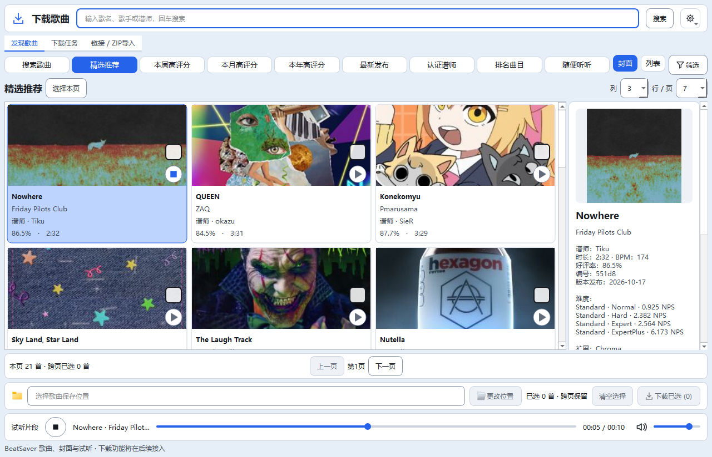

# Qt M4B · 试听适配验收

更新时间：2026-10-19T09:41:05+08:00。**M4B自动化验收完成，本批停止写入；M5未开始。** 用户在M4A完整28/28后继续，授权M4B。本轮开始备份全部源码/测试/文档及已有WIP；单写入者，隔离验证。

## 实现

默认main_qt.py在线入口启用PreviewBrowser；--samples/--components仍为离线。首次播放才构造现有PreviewClient/MediaClient/PreviewPlayer服务，启动不打开声卡。卡片圆形按钮和底部按钮共用播放/停止状态，正在播放图标为方形；底部显示歌曲名、实际片段时间、音量、进度，长歌名省略并保留完整提示。

复用既有16MiB传输上限、最多3份音频缓存、URL校验、最长30秒试听及异步停止/串行设备清理。拖动释放后提交一次，键盘/轨道操作也支持跳转，复用缓存；显示实际试听片段长度，不拿整曲时长冒充试听进度。切详情/翻页/页签/主题/语言不打断当前歌曲，点另一首播放才切歌。自然结束、错误、停止和关闭恢复控件状态。

请求代次与播放器request_id共同拒绝迟到结果；停止先取消并失效请求，关闭停泵、不在UI线程等待HTTP。100ms Qt主线程泵仅活动期间运行；后台只处理普通数据，无Qt控件访问。原audio.py、search_media.py、song_search.py、下载/数据库/设备/旧Tk入口和检查器未改；正式版本20.4不变，Qt阶段M4B。

## 验证

- 默认GBK静态七项退出0，无UTF8覆盖；新增Qt试听专项100/125/150%全部通过。真实音频回调捕获非零样本；真实卡片点击/底部停止重播、音量、拖动与键盘跳转、缓存零新增请求、30秒上限、自然结束、缺URL/不安全URL/坏音频/缺组件、迟到消息/停止/请求中切歌/关闭<0.3秒，均有断言。中英/浅深主题及无Tk导入检查保留。
- 原Qt封面、筛选、搜索、浏览、下载布局及基础专项全部退出0，旧完整回归28/28退出0；113份源码/测试与隔离副本同哈希。正式设置、数据库/WAL/SHM、downloads.json五文件与开始一致。
- 实际BeatSaver探测：21首/21张封面；歌曲Nowhere（551d8）实际试听10.152秒，跳到5.076秒继续播放，仅1次音频请求，关闭后停止；无UI异常，所有HTTP在后台线程。live-preview.json保存URL/线程证据，实际截图见docs/images/qt-m4b-live.png。未下载ZIP或写入曲库。
- 首轮真实截图发现时间标签被挤压，主动停止自有验证链；interrupted-time-label保存原截图、日志/样本，未跑完不算通过。固定宽度按字体测量完整时间/状态，补充三档DPI/双语/主题宽度断言后重新验证，踩坑90记录。本轮未改任何旧28组断言或截图基线。

## 边界、回退与停止点

本批23文件（改19/增4），新增preview_browser.py、smoke_preview.py、docs/17和实际截图，包含必要Qt适配、图标、文案、两个阶段日志断言及根文档/踩坑记录。完整清单phase-files.json；证据与备份E:/AI-Project-Backups/P006_Qt_M4B_20261019T092453。rollback_m4b.py默认预览，--apply先核对全部交付和备份哈希，遇后续修改停止；回滚只预演未执行。Git diff检查及回滚预演退出0。

未安装升级、打包、提交推送、启动正式数据实例或操作Quest设备。连续拖动残影、跨屏DPI、EXE和用户实际听感仍待人工验收；自动化通过不能替代这些项目。M5下载队列/导入/历史未启动，下一批需按迁移计划实施。接手AI从磁盘重新读取根五件套、Git和本批证据，核对单写入者。

# Qt M4B · 试听迁移

## Qt M4B试听适配

默认main_qt.py在线预览接入卡片与底部试听。复用原PreviewClient/MediaClient/PreviewPlayer，首次点击才创建播放器与媒体会话，启动不访问音频设备。播放/停止、切歌、音量、实际试听片段进度/鼠标拖动/键盘跳转、跨页签保留及关闭清理；最多30秒，显示的是试听片段而非整曲进度。保留旧main.py及--samples/--components离线入口。下载队列仍待M5，不改变数据库/设备/音频引擎。

后台仅传普通数据，Qt主线程QTimer消费消息；会话代次和音频request_id同时拒绝迟到结果，停止先取消并使请求失效，关闭停泵且不在UI线程等待网络。缓存与网络校验完全复用search_media.py。停止使用现有引擎异步关设备，不在音频回调里调用停止。当前状态：实现待最终回归；证据以根03/04为准。

