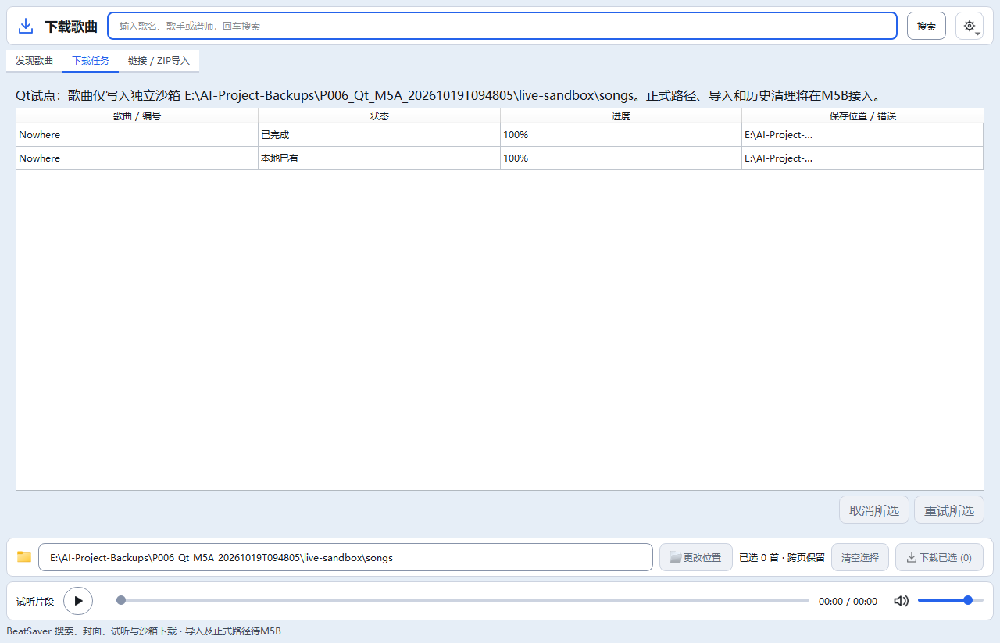

> 最新（2026-10-23T19:46:34+08:00）：Qt下载任务页结果汇总已实施，整体验收继续暂缓。汇总明确包含历史及各保存目录，分别显示已下载、已存在、失败、中断、取消和进行中；新增全部/已下载/已存在/失败或中断/取消/进行中筛选及显示数量。复制当前结果包含7列及歌曲来源/任务ID，只复制筛选可见项；状态筛选取消旧选中，状态变更隐藏行也移除选中，避免原重试/取消误操作隐藏任务；历史清理仍作用全部终态并提供说明。无自动重试或批次归属推断，原保存目录校验、队列动作、下载/解压/音频/数据库/设备业务均不变。最终默认静态7节、主题、双语与16组无音频Qt专项共19项均退出0；202份源码/测试与隔离副本同哈希，正式五项运行数据未变。未访问真实网站、操作Quest、播放音频、启动正式实例或运行全部Qt/旧完整28。 详见[本批报告](60_Qt下载队列结果汇总.md)。

> 最新（2026-10-23T18:47:51+08:00）：Qt跨页已选清单与当前目录队列/版本记录标记已实施，整体验收继续暂缓。底部“已选清单”按需打开非模态单实例窗口，支持缓存封面、清单内搜索、详情、试听/停止接线、移除勾选与全部已选下载，明确搜索隐藏项仍包含在提交集合中；失败保留清单并回显队列错误。卡片/列表/详情显示当前目录的队列状态或同/其他版本下载记录，不将历史或同名当作实时安装事实，不读取Quest。最终静态7项、主题、双语和14组无音频Qt专项共17项均退出0；197份源码/测试与隔离副本同哈希，正式五项运行数据未变。下载/搜索/音频/数据库/设备后端与护栏未改；未访问真实网站、播放音频、运行完整回归或启动正式数据实例。 详见[已选清单与状态](58_Qt已选清单与歌曲记录状态.md)。

> 最新（2026-10-23T17:15:01+08:00）：Qt下载完成后本地刷新合并已实施，完整验收继续按用户要求暂缓。同一轮多个完成任务合并一次自动刷新，250ms短窗口吸收连续通知；在读扫描不被自动刷新取消，期间仅保留一个后续刷新。手动刷新/切换目录立即执行并清掉旧排程；校验代次与目标目录，重复终态不再重复发主曲库刷新信号，关闭取消排程。静态7项、主题、双语和11组无音频Qt专项共14项均退出0；194份源码/测试与隔离副本同哈希，正式五项运行数据未变。无本地读取业务、下载解压、搜索预取、音频、数据库或设备护栏变更；未访问真实网站、播放音频、运行完整回归、启动正式实例或操作Quest。 详见[刷新合并](57_Qt下载完成后刷新合并.md)。

> 最新（2026-10-23T16:45:49+08:00）：Qt下载任务增量刷新已实施，完整验收继续按用户要求暂缓。相同任务快照不再发出表格更新通知；进度只更新发生变化的单元格，表头仅在翻译变化时通知，空轮询不重复刷新整套控件。追加/尾部移除保留原任务选中项，行身份变化重置选择以防错位；下载完成后本地刷新及动作结束恢复控件仍保持。静态7项、主题、双语和9组无音频Qt专项共12项均退出0；193份源码/测试与隔离副本同哈希，正式五项运行数据未变。无下载解压、搜索/预取、音频、数据库或设备业务变更；未访问真实网站、播放音频、运行完整回归、启动正式实例或操作Quest。 详见[增量刷新](56_Qt下载任务增量刷新.md)。

# Qt M5A · 下载队列验收

更新时间：2026-10-19T10:08:09+08:00。**M5A自动化验收完成，本批停止写入；M5B未开始。** 用户在M4B完整28/28后继续，按既有迁移计划拆分执行。开始核对M4B交付无后续修改，备份完整现有文件和WIP；单写入者、隔离验证。

## 实现与边界

默认main_qt.py在线入口接入单曲/跨页批量下载，任务页显示歌曲、状态、百分比和保存位置/错误，支持多选取消/重试。Qt页面保留原布局及试听；--samples/--components仍离线。任务表使用原生QTableView/模型，不创建每行按钮或Canvas；无活动任务时停主线程消息泵，重排不重建整表。

只写PreviewRuntime专属目录songs子目录；目标路径只读，正式路径选择、链接/ZIP导入、历史清理及本地刷新留M5B。任务记录用独立qt-downloads.json，复用原DownloadManager持久化；重试仅接受online及当前沙箱目标，拒绝旧历史改到外部路径。入队成功后只清除已提交勾选，错误保留选择。

入队、取消和重试通过消息型后台任务调用原服务；Qt主线程100ms消费队列状态。网络、解压、hash、同版本跳过、不同版本保留及临时目录清理全部沿用原下载护栏。closeEvent立即取消并关闭窗口，不等待HTTP；事件循环已退出后等待写入线程终止，才释放预览运行锁，避免新实例同时写记录。原downloads.py、音频、搜索、媒体、数据库、fsapi、设备、旧main.py和检查器均未改；正式20.4保持，Qt阶段M5A。

## 验证

- 默认GBK静态七项退出0，无UTF8覆盖。新增队列专项100/125/150%全部通过：真实Qt单曲与跨页按钮、原Manager、安全ZIP/hash及入库、同版本跳过/不同版本保留、失败重试、下载进度、取消/坏包临时目录清理、历史目标护栏、关闭<0.3秒、保存任务及实际入口退出锁顺序。受控传输都在后台，无捕获Qt异常、无Tk导入。
- 原Qt试听、封面、筛选、搜索、浏览、布局和基础专项均通过；完整旧28/28退出0，旧28组及截图基线未改。115份源码/测试与隔离副本同哈希，正式设置、数据库/WAL/SHM、downloads.json五文件与本批开始相同。
- 真实公开BeatSaver探测：21首/21封面，歌曲Nowhere（551d8）通过Qt按钮下载、校验hash并实际解压到本批live-sandbox/songs；重复同曲状态exists，未覆盖。live-download.json含两个任务、安装位置和HTTP线程。首次截图比表格最后刷新早，原图qt-m5a-live-first.png保留；随后重开实际任务记录，核对Qt模型状态done/exists及两行100%，final-ui-state.json留证，实际任务页截图docs/images/qt-m5a-live.png来自该重开窗口，无新增下载。没有写正式曲库或Quest。
- 初始静态检查误判Qt继承beginInsertRows/endInsertRows，改用super显式调用；探索测试先遇Windows临时目录短路径与resolve后的长路径字符串差异，改为规范化路径等价断言，未放宽沙箱约束。queue-exploratory.log保留初始失败，最终专项与完整日志单独保存。
- 首轮完整回归27/28，旧Tk downloadlayout在英文125%报告overflow；full-first-27of28.log及accepted-results-first.json保留。相关Tk/主题/旧测试源码均未改，原样专项复测1/1通过后重新完整28组。未放宽断言或更改旧代码，首次偶发原因未定位，不能宣称已修复旧Tk缩放问题。

## 交付、回退与停止

本批20文件（改16/增4）：新增download_browser.py、smoke_download_queue.py、docs/18及实际截图，其他为Qt入口/连接、阶段文案、两份Qt阶段日志断言及必要文档。完整清单phase-files.json；备份与证据E:/AI-Project-Backups/P006_Qt_M5A_20261019T094805，verification.json记录检查结果。rollback_m5a.py默认预览，--apply先核对全部交付及备份哈希，后续被修改则停止；仅预演未执行恢复，Git diff检查和预演退出0。

未安装升级、打包、提交推送、启动正式数据实例或操作真实设备。正式路径/导入/历史清理/本地刷新未迁移，不能宣称M5整体完成；下一批M5B。用户听感、连续拖动、跨屏DPI、EXE及Quest验收继续保留。后续AI从磁盘重新读取根五件套、Git及本批证据，核对单写入者。

# Qt M5A · 下载队列

## Qt M5A下载队列

默认main_qt.py在线预览可单曲或跨页批量下载，任务页显示状态/百分比/位置或错误，支持取消和重试。只写独立Qt预览目录的songs子目录；正式保存路径、链接/ZIP导入、历史清理和本地刷新留M5B，旧正式入口保留。复用DownloadManager的元数据、HTTPS、ZIP安全、hash校验、同版本跳过与不同版本保留，不改业务护栏。

入队/取消/重试由消息型后台任务执行，Qt主线程100ms消费消息；无活动任务后停泵。关闭窗口立即取消，事件循环退出后等全部写入者结束再释放运行目录锁。历史文件名qt-downloads.json，位于预览目录，避免与正式downloads.json混用。重试必须是online任务且目标仍为当前沙箱songs，拒绝历史记录重定向到外部路径。

当前状态：实现待最终验证。

