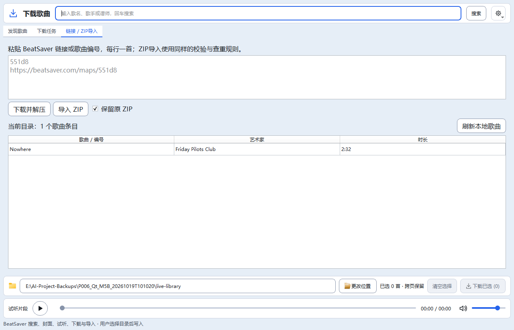

> 最新（2026-10-23T18:47:51+08:00）：Qt跨页已选清单与当前目录队列/版本记录标记已实施，整体验收继续暂缓。底部“已选清单”按需打开非模态单实例窗口，支持缓存封面、清单内搜索、详情、试听/停止接线、移除勾选与全部已选下载，明确搜索隐藏项仍包含在提交集合中；失败保留清单并回显队列错误。卡片/列表/详情显示当前目录的队列状态或同/其他版本下载记录，不将历史或同名当作实时安装事实，不读取Quest。最终静态7项、主题、双语和14组无音频Qt专项共17项均退出0；197份源码/测试与隔离副本同哈希，正式五项运行数据未变。下载/搜索/音频/数据库/设备后端与护栏未改；未访问真实网站、播放音频、运行完整回归或启动正式数据实例。 详见[已选清单与状态](58_Qt已选清单与歌曲记录状态.md)。

> 最新（2026-10-23T17:15:01+08:00）：Qt下载完成后本地刷新合并已实施，完整验收继续按用户要求暂缓。同一轮多个完成任务合并一次自动刷新，250ms短窗口吸收连续通知；在读扫描不被自动刷新取消，期间仅保留一个后续刷新。手动刷新/切换目录立即执行并清掉旧排程；校验代次与目标目录，重复终态不再重复发主曲库刷新信号，关闭取消排程。静态7项、主题、双语和11组无音频Qt专项共14项均退出0；194份源码/测试与隔离副本同哈希，正式五项运行数据未变。无本地读取业务、下载解压、搜索预取、音频、数据库或设备护栏变更；未访问真实网站、播放音频、运行完整回归、启动正式实例或操作Quest。 详见[刷新合并](57_Qt下载完成后刷新合并.md)。

> 最新（2026-10-23T16:45:49+08:00）：Qt下载任务增量刷新已实施，完整验收继续按用户要求暂缓。相同任务快照不再发出表格更新通知；进度只更新发生变化的单元格，表头仅在翻译变化时通知，空轮询不重复刷新整套控件。追加/尾部移除保留原任务选中项，行身份变化重置选择以防错位；下载完成后本地刷新及动作结束恢复控件仍保持。静态7项、主题、双语和9组无音频Qt专项共12项均退出0；193份源码/测试与隔离副本同哈希，正式五项运行数据未变。无下载解压、搜索/预取、音频、数据库或设备业务变更；未访问真实网站、播放音频、运行完整回归、启动正式实例或操作Quest。 详见[增量刷新](56_Qt下载任务增量刷新.md)。

# Qt M5B · 验收续办完成

更新时间：2026-10-19T19:27:30+08:00。M5B自动化验收完成，本批停止写入；M6未开始。用户继续授权本次阻塞项排查，保留全部既有WIP；仅在隔离副本运行产品测试。

本次修复旧Tk下载页在DPI/Configure回调读取过期面板宽度时，分类工具栏可能撑宽窗口的问题：按当前顶层客户区扣除原有两层边距限制布局宽度。受控英文125%实验原版窗口实际1000、请求1458，修正后请求828；原混跑失败时的几何未捕获，不能据此确认全部偶发问题的根因。新增回归模拟旧宽度，保留原有双语、视图与100/125/150%断言，未放宽等待或边界。

默认GBK静态七项退出0；最终不注入trace/sitecustomize的隔离完整旧回归28/28、退出0。完整运行仅设置PYTHONIOENCODING=utf-8以避免汇总打印勾号发生GBK输出异常，不启用PYTHONUTF8；原始编码异常日志full-final.log保留。受控证据stale-width-proof.json，最终日志full-final-utf8io.log。此前26/28、27/28和只读诊断通过日志均保留；不宣称旧GUI所有时序问题已修复。

117份源码/测试与最终隔离副本逐一同哈希；正式settings.json、songs_cache.db及WAL/SHM、downloads.json五文件与本次开始相同。Qt M5B及其他Qt源码未改，沿用原批专项与真实BeatSaver/ZIP链路证据：E:/AI-Project-Backups/P006_Qt_M5B_20261019T101020/accepted-results.json、live-import.json。下载/解压、搜索、数据库、音频及设备护栏未改。

本次备份与证据：E:/AI-Project-Backups/P006_Qt_M5B_acceptance_20261019T120134。phase-files.json列出本次改动与前后哈希；rollback_acceptance.py默认预览，--apply先核对全部交付/备份哈希后恢复本次续办前状态，不回退M5B功能。此前rollback_m5b.py因本次后续修改会安全拒绝，不能跳过校验强行恢复。无安装、打包、提交推送、正式数据实例或真实设备操作。

M5B目录选择、链接/编号/ZIP、保留ZIP、历史清理与当前目录本地刷新已完成自动化验收；主窗口桥接及迁移留待M6。连续拖动/残影、跨屏DPI、原生选择器、用户听感、EXE及真实Quest仍待人工验收。下一位AI须从磁盘重新读取五件套、Git和本批证据，核对单写入者后再接手。以下旧状态仅为历史，不定义当前任务。

---

## 历史状态（原文保留）

# Qt M5B · 路径、导入与本地刷新验收

更新时间：2026-10-19T10:31:08+08:00。**M5B实现及专项已验证，完整验收未完成，本批停止写入；M6未开始。** M5A完整28/28后用户继续，按既有迁移计划执行M5B。开始核对上批交付一致，备份完整现场和WIP；单写入者，隔离验证。

## 实现

下载中心接入目录选择、BeatSaver链接/编号（去重/最多200）及ZIP导入、保留原ZIP、清理已结束历史。用户主动选择现有本地非根目录；拒绝相对/不存在/UNC/根路径。变更只影响新任务，旧任务目标固定；重试需先选择任务原目录。重开仍默认专属预览目录songs，不自动采用历史外部目标，保留ZIP偏好沿用记录。默认songs被符号链接/联接重定向时拒绝初始化，入队时再次核对目标。

导入复用parse_map_ids及DownloadManager的HTTPS、ZIP路径穿越/大小、结构/hash、查重/版本保留及保留原包规则，不改业务护栏。后台处理，成功清除已提交输入，错误保留草稿；提交后新编辑的文本不被迟到结果清掉。历史清理只删任务记录，不删歌曲或已保留ZIP。

导入页新增当前目录本地列表/手动刷新，后台复用LocalFS扫描元数据和时长，不连接数据库。入库或已有结果自动刷新当前路径；切目录清空旧列表并取消旧扫描，代次/目标匹配后才更新。消息泵扫描结束后停止，关闭取消并在退出时等待清理。这里只完成独立Qt下载中心的本地列表，旧主窗口刷新桥接在M6迁移时对接，未改旧app.py。

## 验证

- 默认GBK静态七项退出0，未覆盖UTF8。新增M5B专项100/125/150%全部通过：实际Qt按钮/文件选择边界、取消目录选择、非法路径、链接去重/输入保留、ZIP失败修复重试/穿越拒绝、保留原ZIP、清历史文件哈希不变、旧任务固定目标、外部历史重试护栏、自动本地列表、迟到扫描、双语/明暗及安全重开。扫描线程ID均不在UI主线程，无捕获Qt异常、无Tk导入。原M5A测试仅更新浏览按钮已接入的预期及扫描退出等待，不删旧安全断言。
- 原Qt队列、试听、封面、筛选、搜索、浏览、布局和基础专项均退出0，完整旧27/28退出1。旧28组和截图基线未改；117份源码/测试与隔离副本同哈希，正式设置、数据库/WAL/SHM、downloads.json五文件与开始相同。
- 真实BeatSaver链路：通过Qt目录按钮选本批live-library、链接导入551d8，状态done，歌曲hash核验；保留原ZIP，清历史后歌曲/ZIP仍在，再由ZIP按钮导入返回exists。后台刷新本地列表1条（Nowhere）；live-import.json保留任务与目录证据，实际截图docs/images/qt-m5b-live.png。所有下载/导入均在本批备份目录，不写用户正式库或Quest。
- 探索时新测试最初在目标根目录寻找ZIP失败，代码原本将ZIP保存在既有隐藏目录.quest-download-archives，已将测试改为检查原服务的真实保留目录，未改产品规则；原探索失败import-exploratory.log保留，最终专项/完整日志独立保存。
- 首轮完整26/28：旧gui CSV行数不匹配（5行/3首）、旧downloadlayout英文125%宽度溢出；full-first-26of28.log和accepted-results-first.json保留。旧Tk/报告/布局/测试源码及非Qt文案均未改，原样复测两组2/2通过后重新完整回归。未放宽断言或改旧流程，首次偶发原因未定位，不能宣称修复旧Tk稳定性。

第二轮完整27/28，旧gui已通过，downloadlayout英文125%溢出再次失败；不继续盲目重跑。只读trace执行原测试时未复现，记录实际宽1000/请求828（legacy-layout-geometry.json及legacy-layout-probe.log），不把该专项通过当作完整通过。当前首要待办是定位旧Tk布局混跑稳定性并恢复完整28/28；M6不启动。

## 文件、回退及停止点

本批21文件（改17/增4）：新增download_import.py、smoke_download_import.py、docs/19与实际截图，其他为Qt下载适配/连接、阶段双语文案、Qt专项预期及必要文档。详见phase-files.json；备份及证据E:/AI-Project-Backups/P006_Qt_M5B_20261019T101020。rollback_m5b.py默认预览，--apply先核对全部交付及备份哈希，后续被修改即停止；只预演未执行恢复。Git diff检查及回滚预演退出0。

下载/解压、音频/媒体/搜索、LocalFS/解析器、数据库、设备/复制删除、旧main.py和检查器源码均未改；正式版本20.4保持，Qt阶段M5B。未安装升级、打包、提交推送、启动正式数据实例或操作真实设备。文件选择器原生外观、连续拖动残影、跨屏DPI、EXE、用户听感与Quest仍待人工验收。M5下载中心实现及专项验证通过，但完整验收未完成，不等于主窗口/设备迁移完成；M6不自动开始。接手AI从磁盘重新读取根五件套、Git和本批证据，核对单写入者。

# Qt M5B · 导入与刷新

## Qt M5B导入与本地刷新

Qt下载中心新增用户主动选择本地目录、BeatSaver链接/编号导入、ZIP文件导入、保留ZIP、清理已结束记录及当前目录本地列表。复用parse_map_ids/DownloadManager/LocalFS，不改解压校验或数据库；更改位置只影响新任务，重试需匹配用户当前选择目录。历史保存最后路径，但重开仍默认独立sandbox/songs，避免自动写外部目录。

本地扫描在消息型后台会话中执行；下载/导入完成自动刷新当前目录，切目录取消旧扫描并拒绝迟到代次。清历史只删任务记录，不删已下载歌曲或保留ZIP。默认songs如果被链接/联接重定向则拒绝初始化；入队前再次核对选择目录。关闭取消扫描和队列，退出前等待写入者结束。验证只用隔离目录，未写正式库。

状态：待最终验证；M6不启动。

