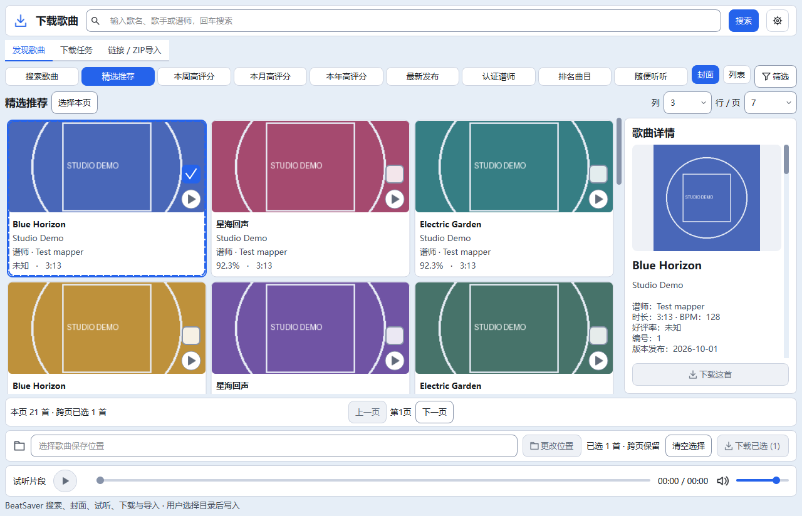
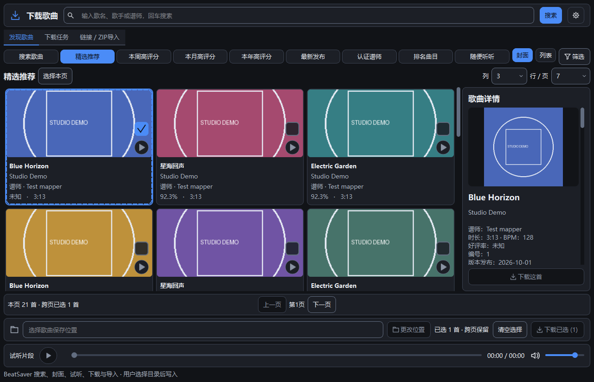

# Qt下载页统一视觉 · 第一批

更新时间：2026-10-22T22:32:09+08:00。UI第一批自动化验收完成：共享桌面令牌、Qt统一字体/状态/下拉箭头/滚动条、下载页固定详情动作和虚拟卡片外观已实施；默认3列×7行/页（21首）、九类入口、搜索/勾选/分页/下载/试听接线保持。默认GBK静态7项、Qt30/30、旧完整28/28退出0；182份源码/测试与隔离副本同哈希，正式五项运行数据未变。本轮不访问真实Quest，不改搜索/下载/音频/数据库/传输业务或主曲库列布局；共享样式会被其他Qt页面继承。

## 本次范围和实际效果

用户确认先做统一样式与下载页面，沿用既有参考图区域顺序：搜索→发现/任务/链接ZIP页签→全部分类按钮→封面/列表与右侧详情→分页→保存位置及批量操作→固定底部试听。默认每页21首，纵向滚动浏览，不把“7行/页”描述为窗口同时显示7行。

- root theme.py新增DESKTOP密度令牌，复用既有配色、字号家族、圆角、间距及控件尺寸；旧Tk配色与字号不改。Qt正文统一13逻辑像素，保留标题层级和系统DPI缩放。
- Qt下拉框采用干净的独立箭头区，修正原生灰边混入的问题。箭头、搜索、目录、设置、筛选和下载复用line_icon；主按钮图标与强调文字同色，禁用图标使用语义弱化色。聚焦使用强调边框且不改变普通按钮边框宽度，避免内容跳动。
- QSS需要图像URL，箭头用已有缓存图标在系统临时目录按配色生成一次24像素小PNG，进程持有QTemporaryDir自动清理；不新增包内资源、不在项目或正式数据目录保存图标，不在绘制帧内写文件。
- 分类仍全部可见，窗口变窄时换行；不把它们收回列表框。保留原主题和语言入口。
- 卡片选中改为白色/深色卡面与蓝边强调，统一圆角裁剪和勾选框边界；勾选与播放命中矩形保持相同尺寸，编号仍不显示。保持QListView虚拟化、既有封面LRU与后台媒体服务，不逐卡创建控件或增加Canvas重绘。
- 右侧加入“歌曲详情”标题，说明在独立滚动区域，底部“下载这首”固定在外层卡片；长说明不再把动作推到滚动内容末尾。原download_one对象、信号和业务协调器继续使用。
- 保存位置、已选计数、清空/下载已选及试听播放器仍固定在页面底部；共享于三个页签。

## 实际窗口截图

以下为真实Qt窗口的受控示例数据与本地生成封面，不是BeatSaver真实推荐、下载成功证明或AI生成效果图。新增专项通过原SearchSession/SearchClient及受控HTTP客户端供给数据；封面放入原CoverCache呈现，不发网络请求，不安装歌曲、不播放音频。

浅色：



深色：



## 文件与验证

代码/测试6文件：

- `quest_tool/theme.py`
- `quest_tool/qt_ui/theme.py`
- `quest_tool/qt_ui/icons.py`
- `quest_tool/qt_ui/download_window.py`
- `quest_tool/qt_ui/song_view.py`
- `tests/qt/smoke_download_design.py`

另更新15文档及2截图，共23文件，精确边界见phase-files.json。正式APP_VERSION20.4和默认Qt标识M7A2C保持，此批作为UI1增量，不是EXE发布；默认main.py入口未切换。

默认GBK静态7项、Qt30/30、旧完整28/28通过。新增smoke_download_design覆盖中英×浅深色×100/125/150%缩放，1000/1280/1600宽度、长说明垂直滚动且无横向滚动、固定详情动作、实际下拉弹出和键盘选择、勾选/播放同尺寸命中、默认21首、底栏顺序、缓存边界和关闭。原下载队列、导入、搜索、筛选、封面、试听、主曲库/评分/设备协议/传输等专项及旧完整回归保持原断言。

共享QSS影响其他Qt页面的字体与控件外观，主曲库布局和业务模块未改，因此仍跑全部Qt和旧版回归。Tk原样式不变，未更新旧截图基线或测试阈值。连续拖动残影、跨屏DPI和实际大库持续响应仍应在后续专项中实测，不能以本批截图和自动化通过代替全部人工体验验收。

182份正式源码/测试与隔离副本同哈希；settings.json、downloads.json及数据库/WAL/SHM五项不变。UI截图无真实用户歌曲资料；没有访问真实Quest或改变系统设置。电脑完整回归包含本地音频测试。

## 尝试记录

```text
[
  "初版QSS自定义下拉区域后原生箭头不可见，已改用现有图标系统的chevron，并只在临时目录每种配色生成一次小图供QSS使用。",
  "初次新专项直接改标签内容会被真实选择回调覆盖；改为复用受控HTTP搜索客户端提供长说明，用真实呈现流程验证固定按钮和滚动。",
  "新专项曾漏用导入且错误钩子未打印异常、子进程输出编码不统一；已修正，保留断言，没有放宽旧测试。",
  "静态检查对QListView继承的setObjectName误报，改用super调用，没有修改静态检查器。"
]
```

改造前before-light/dark.png与后续同屏比较截图保留在证据目录，不用不同显示器DPR下的像素尺寸冒充布局差异。实际截图和几何以对应*-geometry.json及qt-shots为准。

## 使用、回滚和下一批

桌面“Quest 下载歌曲”仍打开当前源码入口；窗口中可切换浅/深色和中英，列/行设置和原快捷操作保留。默认页数21，选择保存位置后才有相应下载操作；本批测试未向正式库安装歌曲。

证据：`E:/AI-Project-Backups/P006_UI_download_20261022T215246`，results.json/full.log、smoke_download_design.log、qt-shots、source.json、runtime-before.json、static-final-default.log及verification.json。

before/保存含既有WIP的原件。rollback_ui.py默认仅预检23文件，显式--apply才按交付哈希恢复本批，不覆盖运行数据或回滚旧任务；实际回滚未执行。代码通过前不自动启动下一批，UI1交付后优先收集实际布局反馈，再按既有计划界定主曲库UI批次。

Quest读取分支保持原停点：216首可浏览、1异常目录原样保留导致快照不完整、7首时长未知；本批未处理这些设备/解析项，也未解除不完整快照的对比/报告/传输限制。
