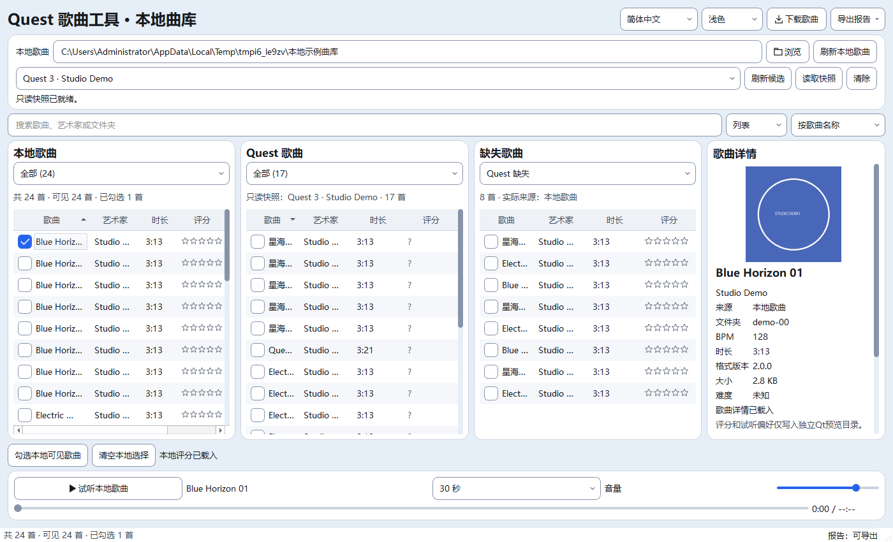
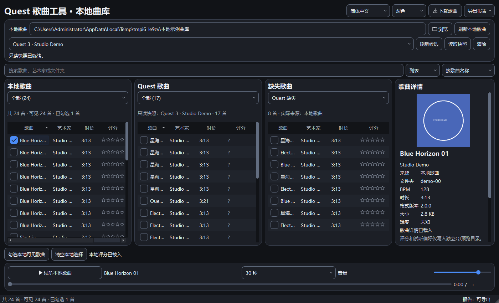

> 最新（2026-10-23T23:59:06+08:00）：Quest区新增读取完成时间/已过时长，约15分钟建议重新读取；小窗合并摘要，完整日期和非实时说明可悬停查看，不自动操作设备或改变原对比/报告/传输规则。29项必要检查通过，完整验收仍暂缓。详见[本批报告](65_QtQuest快照时效提示.md)。

> UI2音频恢复续验中途停止（2026-10-23T08:40:34+08:00）：初始会话2为Active，远程音频可枚举；默认WASAPI初始化0.368564秒并收到6次静音PCM回调。随后本地试听实际打开设备失败，复核同一会话已变Disc、输出列表为空。因测试前提消失，停止仅本任务隔离Python进程，PID/创建时间/命令行复核及记录见stopped-owned-processes.json；未更改系统设置。

本轮静态7项通过，Qt已通过22组，明确失败1组（smoke_library_preview），人为中断1组（smoke_preview），其余未运行；不得合并为完整31组结果。旧完整28组未启动。历史Qt29/31、旧26/28仍保留，UI2未验收。本轮183份源码/测试与隔离副本及正式五项数据哈希不变；无产品/测试源码、引擎、阈值、依赖变更，无正式实例和Quest操作。下一步需在整个验证期间保持执行会话及真实音频输出可用，再续验原范围。证据：E:/AI-Project-Backups/P006_UI2_accept_20261023T083242。

---

> 音频续验只读复核（2026-10-23T08:24:02+08:00）：当前执行会话为Administrator会话2，qwinsta标为Disc；console会话1为Conn。Audiosrv、AudioEndpointBuilder运行，已枚举音频驱动状态OK，但当前miniaudio输出列表仍为空。服务/驱动存在不等于该会话有可播放输出，未确认历史失败的全部因果。本轮未运行GUI/音频播放/完整回归，未改产品源码、测试、依赖或系统设置，未操作Quest。183份源码/测试、原26份交付文件及正式五项运行数据与上批哈希一致。UI2保持未验收，历史Qt29/31、旧26/28不记为本轮测试结果。下一步在可枚举真实输出的执行会话续验原范围。证据：E:/AI-Project-Backups/P006_UI2_audio_recheck_20261023T082402。

# Qt主曲库统一视觉 · 第二批（待完整验收）

更新时间：2026-10-23T07:56:41+08:00。UI第二批主曲库已实施，整体验收未完成：默认静态7项通过，修复后Qt29/31、旧完整26/28（退出1）。183份源码/测试与隔离副本同哈希，正式五项运行数据未变；没有真实Quest操作或正式数据实例。停止产品写入，下一步核查音频输出并续验原范围，不扩大迁移或设备写删。

## 已实施范围

- 顶部白色容器集中本地路径及设备选择、刷新候选、读取、取消和状态；原设备对象及回调保留，没有新增自动设备发现。

- 搜索、列表/封面、排序放在一行；本地选择动作及评分状态放在曲库下方；移除旧迁移范围提示。

- 本地、Quest、缺失三栏初始均衡，详情初始280逻辑像素；四栏最小200，保留手动分隔和原虚拟表格/封面。

- 共用设计令牌控制紧凑行高34、默认列宽120/80/60、评分72、交替背景、悬停/选中和蓝色复选框；已有手动列宽偏好保留。图标继续使用现有缓存线条系统，无新增框架和依赖。

- 中英文短筛选文案、方向提示及本地选择文字保持原参数与选择来源。详情独立滚动，试听与操作栏固定底部；长字段使用省略及横向滚动。

- 修复LibraryModel.setData的鼠标勾选兼容：Qt委托实际传入整数2，原代码只比较Checked枚举，导致点击不勾选；本批前备份同样重现。兼容枚举与整数Checked，不改搜索/下载/试听/数据库/设备/传输业务。

## 实际截图

真实Qt窗口，受控24首本地示例及模拟Quest提供者；不是用户正式曲库或真机验收。100%下窗口请求1400×850，实际鼠标勾选成功后截图，publish-geometry.json记录几何、DPR及点击结果。

before-library-light/dark.png从本批前备份重建，使用同数据及尺寸；不是改动前实时抓图。原版鼠标失败如实记录false，新版为true。

## 验证及失败记录

最终修复版：Qt29/31，旧完整26/28，静态7项通过。失败条目：smoke_library_preview, smoke_preview, full；精确失败、时间和输出见results.json及各日志。没有放宽断言、等待时限或旧截图基线。

新增smoke_library_design在中英文、浅深色及100/125/150%下执行真实鼠标勾选/取消/再勾选，覆盖1000×640到1600×900布局、模型搜索、视图切换、选择/详情保留、连续尺寸/滚动和控件数量有界，已经通过。真实长期拖动、跨屏DPI动态切换及用户听感仍待人工验收。

修复前曾达到Qt31/31和旧完整28/28，保留pre-checkbox-run/；收尾截图发现鼠标勾选漏洞，因此不沿用为修复后的完整验收。此前first-run/为Qt30/31、second-run/为29/31，存在快捷键/焦点失败；外部诊断未稳定重现，不能确认其根因。仅给原smoke_library与smoke_library_actions补按键前真实激活/焦点准备，69条原断言及wait函数AST不变，见test-contracts.json。第三轮测试准备代码widget.window()被既有LibraryGrid.window属性遮蔽，属于本批引入的测试适配错误，改为QWidget.window(widget)；third-run/保留失败与仅本任务进程停止记录。

本次修复后Qt本地试听日志先成功播放两次，随后打开音频设备failed to init device,-1；在线试听也失败。旧版推荐媒体出现等待超时，具体以full.log为准。历史音频波动原因与本轮失败的因果未确认，不宣称音频引擎已修复；没有修改音频引擎、依赖或系统设置。单组通过不替代整套通过。

主窗口20个、设备浏览器12个非显示方法AST与原件一致，boundary-audit.json；LibraryModel仅新增Checked整数兼容。正式APP_VERSION20.4、默认Qt阶段M7A2C不变，没有EXE构建。原Quest停点：216首可浏览、1异常目录使快照不完整、7首时长未知，门禁保留；本轮不做真机操作。

## 文件与回滚

代码/测试9文件：

- `quest_tool/theme.py`

- `quest_tool/messages.py`

- `quest_tool/qt_ui/theme.py`

- `quest_tool/qt_ui/icons.py`

- `quest_tool/qt_ui/library_window.py`

- `quest_tool/qt_ui/device_browser.py`

- `tests/qt/smoke_library_design.py`

- `tests/qt/smoke_library.py`

- `tests/qt/smoke_library_actions.py`

另15文档、2截图，共26文件。精确before/after哈希见phase-files.json，原件before/；证据目录E:/AI-Project-Backups/P006_UI_library_20261023T005755。183份源码/测试与最终隔离副本逐一同哈希，正式五项运行数据哈希未变。

rollback_ui2.py默认仅校验预览，显式--apply才恢复本批；后续文件变化则拒绝。不reset/clean，不回退旧WIP、桌面启动清理或歌曲数据。未实际回滚。

当前停止点为音频失败核查及原范围完整续验，尚未达到项目要求的全部通过；不自动进入下一UI批次。

