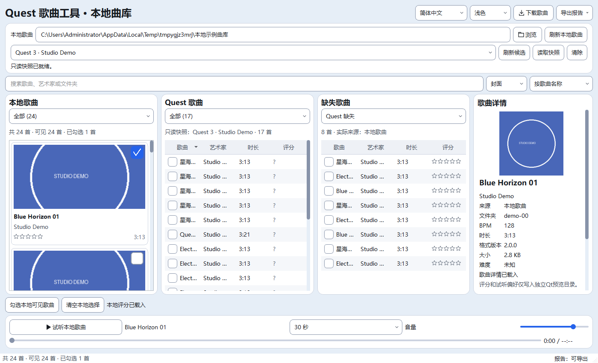
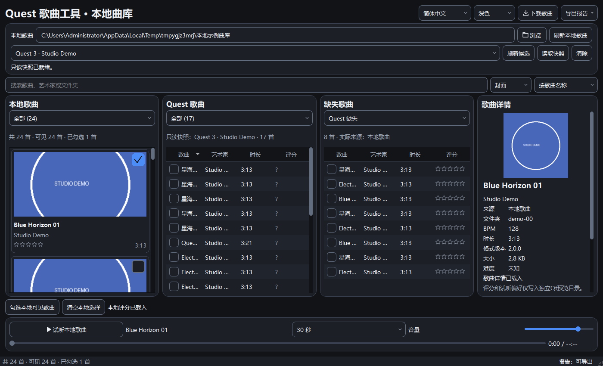

# Qt主曲库封面信息 · 第三批（已实施，待集中验收）

更新时间：2026-10-23T08:59:45+08:00。UI第三批封面卡片信息已实施，完整验收按用户要求暂缓：标题加粗、底栏增加时长，评分/时长在窄列或大字体下自动分行；保留虚拟列表、原缓存及勾选。静态7项、主题对比度及4组无音频Qt自检通过；184份源码/测试与隔离副本同哈希，正式五项运行数据未变。没有音频播放、完整回归、正式实例或Quest操作。UI2历史未通过状态保留，不计为已验收。

## 授权与边界

用户明确“先不进行验收，先进行其他任务”，本批从主曲库后续候选中选封面卡片信息完善。只调整绘制及几何，必要静态和无音频隔离自检；不运行音频/旧完整28/全部Qt，不把局部通过视为产品验收。当前任务为UI3，UI2待验及原音频失败日志保留。

## 实现

- 标题加粗，作者保留普通字体；长标题/作者按实际字体宽度省略。
- 卡片底部左评分、右时长，复用原duration值，已知显示分:秒，0/缺失沿用双语“未知”；不重新解析音频或扫描元数据。
- 宽度不足时评分和时长分成两行，文本行高随实际字体度量增长；字体/样式变化时更新网格尺寸，避免仍用旧格高裁切文字。
- 最小列宽与文本行高令牌放在theme.py（LIBRARY_COVER_MIN=192、LIBRARY_TEXT_H=24）；列数仍随可用宽度自动计算，不新增设置或改变已存偏好。
- 保留原封面区域、鼠标勾选命中区域、键盘处理、虚拟QListView及缓存。封面读取/字节限制/尺寸限制/取消/迟到护栏相关函数AST未变，见boundary-audit.json；不增加逐首控件或后台GUI调用。
- 本批不改右侧详情、下载页、主窗口导航、搜索/下载/音频/数据库/设备/传输逻辑，也不新增框架或依赖。APP_VERSION20.4保持，未打包EXE。

## 真实窗口预览

下图是隔离Qt窗口：24首受控本地示例及模拟Quest提供者，已切到封面视图；不是用户曲库、真实Quest读取或试听成功证明。

## 自检与待验

| 自检 | 结果 |
| --- | --- |
| static_check | 7项通过 |
| theme_contrast | 通过 |
| smoke_library_cards | 中英、浅深色、100/125/150%，13/24px字体、窄宽列几何、实际绘制时长/粗体及真实鼠标勾选通过 |
| smoke_library_views | 原封面缓存、非法封面、身份/取消/迟到/选择与偏好通过 |
| smoke_library_ratings | 原评分列表/卡片/排序同步通过 |
| smoke_library_design | 中英浅深色三档缩放、窗口布局及鼠标选择保留通过 |

首轮新增大字体断言失败：测试用setFont被QSS字号覆盖，未真正进入大字体。已改为显式QSS设置字号并先断言实际pixelSize，再执行原几何/绘制断言。没有放宽断言；first-run/及原validation保留，最终在全新validation-final重跑上述6项均退出0。

只做以上自检，没有音频播放/真实设备/完整回归。整体验收、用户连续拖动/滚动、跨屏动态DPI和听感均未验；UI2旧Qt29/31、旧26/28及后续中断不改写为通过。后续集中验收应从本批184份字节开始重新跑全部Qt（新增后32组）及旧完整28，不拼接UI2旧通过结果。

## 文件与回滚

代码/测试3文件：

- `quest_tool/theme.py`
- `quest_tool/qt_ui/library_covers.py`
- `tests/qt/smoke_library_cards.py`

另10文档、2截图，共15文件，精确清单与哈希见phase-files.json。证据：E:/AI-Project-Backups/P006_UI3_cards_20261023T085147，selfchecks.json及日志、source.json、runtime-before.json、boundary-audit.json。

before/保留原有WIP，rollback_ui3.py默认只预检，显式--apply才回退本批；当前文件或备份哈希不匹配则拒绝。不reset/clean，不碰歌曲、设置、设备或旧启动清理。先核对本批再回退上批，禁止绕过多批哈希保护。未实际执行回滚。
