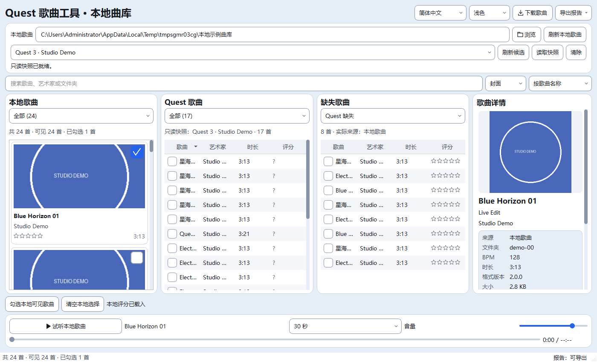
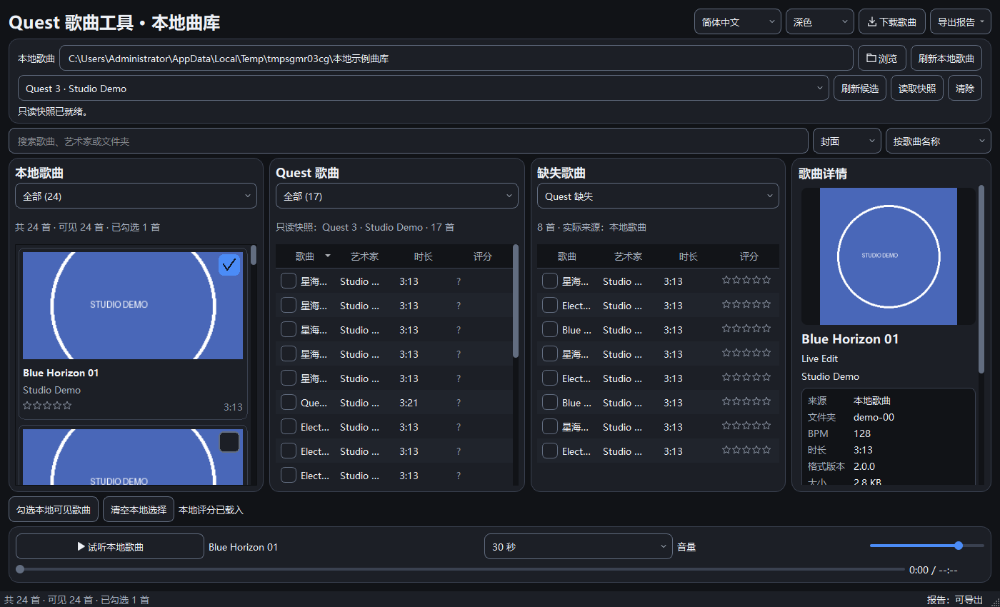

# Qt歌曲详情呈现 · 第四批（已实施，待集中验收）

更新时间：2026-10-23T09:16:33+08:00。UI第四批歌曲详情呈现已实施，完整验收仍按用户要求暂缓：详情封面使用现有有界缓存按宽度/DPI呈现；元数据独立容器、空副标题/作者收起、状态分色及窄栏整行换行。静态7项、主题对比度及5组无音频Qt自检通过；185份源码/测试与隔离副本同哈希，正式五项运行数据未变。未播放音频、运行完整回归、启动正式实例或操作Quest，UI2/3待集中验收状态保留。

## 本批范围

用户继续暂缓验收后的非音频任务，本批仅右侧歌曲详情呈现及必需的共享样式/尺寸令牌。当前任务UI4；UI2、UI3及历史音频失败/中断记录保留。没有运行全部Qt或旧完整28组，也不把局部自检视作产品验收。

- DetailCover复用CoverCache，规范化PNG内容未变时不再次解码；反复render复用已缩放图。换图、图片无效或清空时清掉旧图缓存。
- 封面最大192逻辑像素，按可用宽度缩小，按DPR缓存物理像素图；保持居中，固定封面槽高度。没有重新读文件或更改媒体校验。
- 原元数据字段放入独立浅背景圆角容器，字段名使用次级文字色。字段值、普通文字选择、自动换行与独立滚动保留。
- 根据当前中英文标签自然宽度、数值最小宽度及边距计算是否能并排；放不下时整行上下排列，布局策略不变时不重复设置。不使用固定中文字符数断点。
- 空副标题/作者显式收起；读取状态保持原文案和重试行为，失败用危险色、元数据不完整用WARNING_TEXT，其余用次级色。没有新增用户可见文案。
- DetailClient、folder_size、选择/重试/消息消费/清空/关闭等原函数AST未变，见boundary-audit.json；评分、试听接线、数据库、搜索、下载、设备及传输逻辑不改。

## 真实窗口预览

下图是隔离Qt窗口中的示例歌曲及模拟Quest提供者，不是用户正式曲库或真实设备验收。详情内容可独立滚动，截图只记录当前可见区域。

## 无音频自检

| 检查 | 结果 |
| --- | --- |
| static_check / theme_contrast | 静态7项及主题对比度通过 |
| smoke_detail_design | 中英浅深色、100/125/150%、200/320/420逻辑像素面板、13/20px字体、长纯文本、可达滚动、DPR封面、重复render不重复PNG解码、换图/坏图/清空/错误状态通过 |
| smoke_library_detail | 原本地详情/错误重试/迟到消息/来源/只读快照及显示隐藏通过 |
| smoke_library_userdata | 原评分/评价读取保存接线通过，仅隔离数据库 |
| smoke_library_design | 主窗口布局及选择保留通过 |
| smoke_library_cards | 上批卡片绘制和真实鼠标勾选通过 |

首轮新增几何自检抓到真实越界：中文20px、200px窗口下，元数据容器宽142，字段x81/宽64，超出3px。外部trace_geometry.py及geometry-debug.png保留；不是测试时限或音频问题。改为按实际字段尺寸切换整行排列，未放宽断言。最终从全新validation-final重跑上述7项均退出0；first-run/保留首轮结果。

重复render20次时缓存对象、缩放miss计数与显示pixmap键保持不变，PNG put计数不变；尺寸变化不再次解码。这里验证局部图片复用，不外推整个程序启动/拖动性能已改善。三档独立进程DPR测试不等于实际跨屏动态切换已人工验收。

完整回归、真实试听、用户连续拖动/滚动及跨屏动态DPI仍待集中验收。届时从本批185份源码重新跑全部Qt（新增后33组）及旧完整28，不拼接旧阶段通过结果。产品20.4、默认Qt阶段M7A2C保持；没有打包EXE或修改系统设置。

## 文件、证据及回滚

代码/测试4文件：

- `quest_tool/theme.py`
- `quest_tool/qt_ui/theme.py`
- `quest_tool/qt_ui/library_detail.py`
- `tests/qt/smoke_detail_design.py`

另12文档、2截图，共18文件。证据：E:/AI-Project-Backups/P006_UI4_details_20261023T090731。selfchecks.json及日志、source.json、runtime-before.json、boundary-audit.json、phase-files.json保存自检、字节身份与边界。

before/保存本批前WIP；rollback_ui4.py默认只预检，显式--apply才回退本批。任何后续哈希变化则拒绝，不reset/clean，不碰数据或桌面入口。先核对本批再处理上批回滚，不绕过多批保护；未实际回滚。
