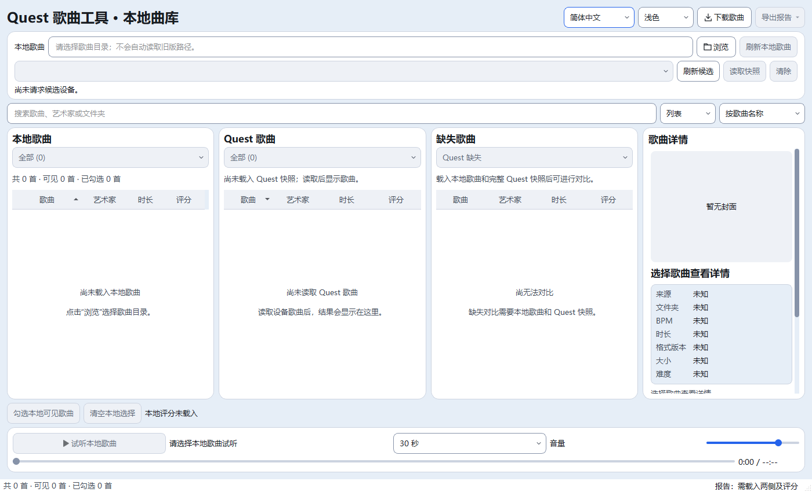
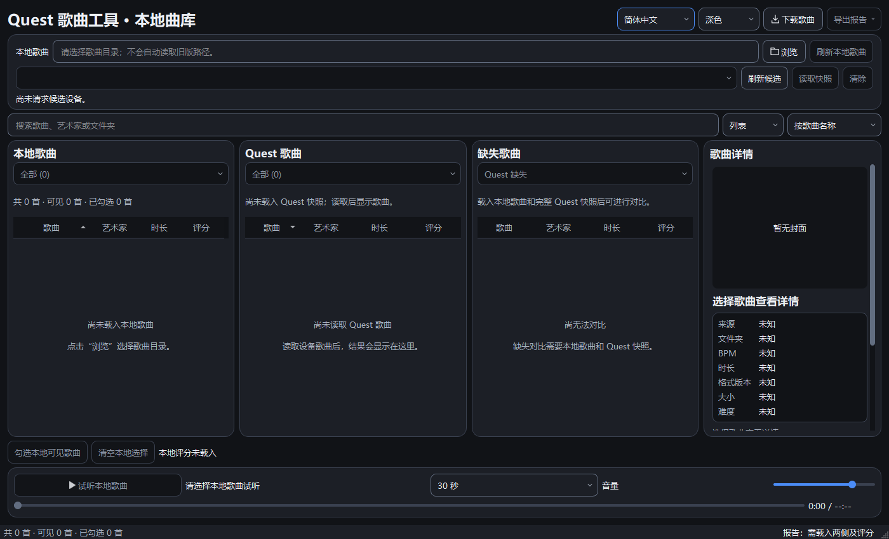
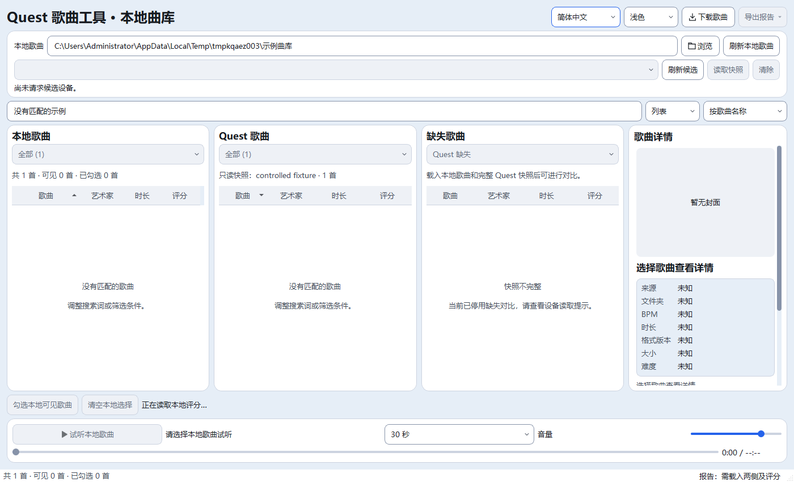

# Qt曲库空白状态 · 第五批（已实施，待集中验收）

更新时间：2026-10-23T12:47:17+08:00。UI第五批曲库空白状态提示已实施，完整验收仍按用户要求暂缓：本地列表/封面、Quest及缺失栏增加未加载、读取中、失败、空库、筛选无结果、无法对比及不完整快照等说明。固定4个原生提示标签，鼠标穿透且不接收焦点；不更改读取、搜索或快照门禁。静态7项、主题对比度、双语及5组无音频Qt自检通过；187份源码/测试与隔离副本同哈希，正式五项运行数据未变。没有音频播放、完整回归、正式实例或Quest操作。

## 范围和行为

用户继续暂缓验收后的常规PC任务，本批仅改主曲库无可显示行时的提示。当前任务UI5；UI2/3/4待验收状态及历史音频失败/中断不改写。APP_VERSION20.4、默认Qt阶段M7A2C和桌面启动入口不变，无EXE构建。

- 本地未加载时提示选择目录；模型无行时区分扫描中、读取失败、成功空库和搜索/筛选无结果。
- Quest尚未读取与成功返回0首分开呈现。读取中的进度、取消和错误仍由原顶部设备状态区负责；本批提示不自行枚举设备或启动读取。
- 缺失栏区分未载入两侧、不完整快照、当前方向没有缺失歌曲、已有缺失歌曲但被搜索过滤。保持原文件夹名集合语义，未声称歌曲内容完全一致。
- 仅当前代理模型0行时显示，不覆盖可见歌曲；刷新保留的旧行仍沿用原行为及顶部状态，不改变其选择逻辑。
- 固定4个原生QLabel放在对应viewport内，使用原次级文字色和纯文本，不创建Canvas或逐首控件；不参与列表布局，不阻止鼠标、键盘或焦点。窄高不足时只显示标题，完整说明保留在无障碍名称。
- 模型信号通过单次0ms Qt计时器合并刷新；窗口尺寸/字体/样式变化只重新排提示。关闭停止计时器并解除viewport事件过滤，不拦截输入事件。
- 新中英文文案16对在messages.py，按钮名用原翻译代入；另修正2对仍声称设备尚未接入的旧文案，改为尚未载入/需要完整快照，避免与当前功能和新提示矛盾。没有新增设置、数据库字段或第三方依赖。

LibraryWindow只增加提示控制器的创建、状态刷新及关闭调用；剥离这几处提示调用后，全部原方法AST与本批前完全一致，见boundary-audit.json。设备提供者、复制/删除/传输、下载、音频、数据库、详情与封面缓存源码未改。

## 真实窗口截图

隔离Qt窗口，初始未加载状态和受控本地示例/模拟快照；不是用户曲库或真实Quest验证。

## 无音频自检

| 检查 | 结果 |
| --- | --- |
| static_check / theme_contrast / smoke_i18n | 静态7项、主题及中英文完整性通过 |
| smoke_library_empty | 中英浅深色三档缩放；受控实际扫描/失败/恢复、空目录、搜索、快照清空/空库/不完整门禁；鼠标实际命中穿透、无焦点、提示几何/文字高度、反复缩放及控件数、关闭计时器通过 |
| smoke_library | 原本地读取/排序/勾选及导入刷新桥接通过 |
| smoke_library_actions | 原焦点、右键、快捷键及目录边界通过 |
| smoke_device_states | 原模拟设备状态/取消/重试及门禁通过 |
| smoke_library_design | 原主窗口布局及选择保留通过 |

首轮8项已通过，但截图发现上述2处旧阶段文案；修正文案后从全新validation-final重新执行8项均退出0。首轮证据保留first-run/，不沿用旧字节为最终自检；未更改已有测试、阈值或断言。未运行全套Qt、旧完整28或任何播放；不是整体验收通过。实际长期拖动/跨屏DPI/听感仍待集中验收，后续应从本批187份源码跑全部Qt（新增后34组）及旧完整28，不拼接旧阶段通过结果。

## 文件、证据与回滚

代码/测试4文件：

- `quest_tool/messages.py`
- `quest_tool/qt_ui/library_window.py`
- `quest_tool/qt_ui/library_empty.py`
- `tests/qt/smoke_library_empty.py`

另11文档、3截图，共18文件。证据：E:/AI-Project-Backups/P006_UI5_states_20261023T123524，selfchecks.json、各日志、source.json、runtime-before.json、boundary-audit.json及phase-files.json保存自检和边界。正式五项运行数据保持原哈希。

before/保存本批前WIP；rollback_ui5.py默认只预检，显式--apply才回退本批。后续文件或备份哈希不匹配则拒绝，不reset/clean，不碰歌曲、设置、Quest或旧入口。多批回滚须逐批核对保护，未实际回滚。
