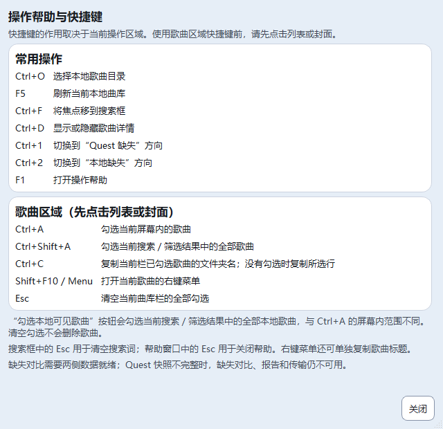
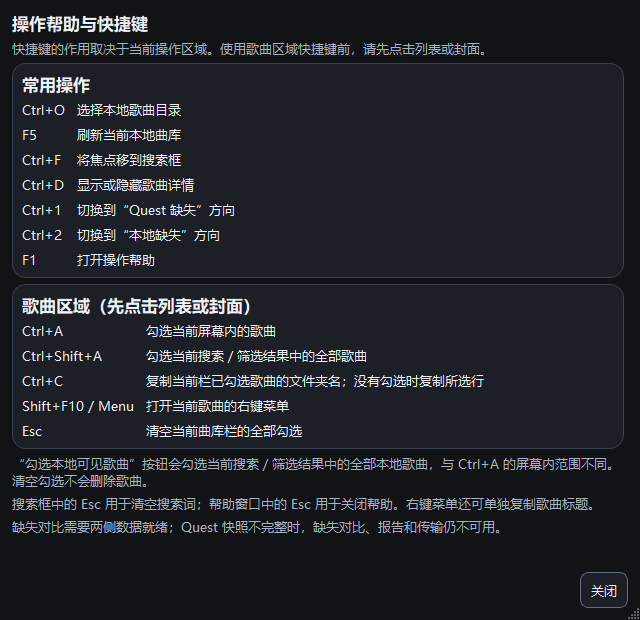

# Qt主窗口操作帮助 · 第六批（已实施，待集中验收）

更新时间：2026-10-23T13:07:25+08:00。UI第六批主窗口操作帮助已实施，完整验收仍按用户要求暂缓：顶部“操作帮助”或F1按需打开原生帮助窗口，集中说明已有快捷键及选择范围，关键控件增加双语悬停提示；不增加业务命令。静态7项、主题对比度、双语及5组无音频Qt自检通过；189份源码/测试与隔离副本同哈希，正式五项运行数据未变。未播放音频、运行完整回归、启动正式实例或操作Quest。

## 用户入口及内容

在新版主曲库窗口顶部点击“操作帮助”，或按F1。窗口内容可滚动，底部关闭按钮固定；Esc也可关闭。帮助为所属主窗口的原生模态窗口，按需创建、关闭释放，不启动浏览器或执行里面列出的操作。

| 区域 | 已有快捷键及作用 |
| --- | --- |
| 主窗口 | Ctrl+O选择本地目录；F5刷新本地；Ctrl+F搜索；Ctrl+D显示/隐藏详情；Ctrl+1/2切换缺失方向；F1帮助 |
| 先聚焦列表/封面 | Ctrl+A勾选屏幕内歌曲；Ctrl+Shift+A勾选全部当前结果；Ctrl+C复制本栏已勾选文件夹名（无勾选则所选行）；Shift+F10/Menu右键菜单；Esc清本栏全部勾选 |

说明明确：原“勾选本地可见歌曲”按钮遍历当前搜索/筛选结果全部本地歌曲，并保留原有勾选，与Ctrl+A屏幕内范围不同。清空勾选不删除歌曲；搜索框Esc清搜索词、帮助窗口Esc关闭帮助。快照不完整仍保留原对比/报告/传输门禁。

目录选择、刷新、搜索、帮助按钮显示快捷键提示；本地勾选/清空、对比方向和列表/封面切换提示明确范围。25对中英文文案在messages.py；未改原快捷键绑定和业务含义，新增的F1仅打开只读帮助。

## 真实帮助窗口截图

以下为隔离Qt窗口截图，来自中英浅深色/三档缩放自检；不是用户歌曲或真实设备验证。

## 技术边界

LibraryHelp管理单个HelpDialog；重复打开只抬起已有窗口，其他模态窗口存在时不嵌套。父窗口关闭先拒绝帮助并封闭再次打开。Qt已有模态和LibraryActions焦点护栏保持。窗口宽高/最小尺寸使用theme.py令牌，并限制到当前工作区。

剥离主窗口新增帮助入口、F1注册、翻译提示及关闭调用后，原24个方法AST完全一致，见boundary-audit.json；LibraryActions和搜索/读取/下载/试听/数据库/设备/传输源码未改。没有新增框架、依赖或外部链接，不更改正式数据及偏好格式。APP_VERSION20.4、默认Qt阶段M7A2C、桌面入口保持，未打包EXE。

## 必要无音频自检

| 检查 | 结果 |
| --- | --- |
| static_check / theme_contrast / smoke_i18n | 静态7项、主题及中英文完整性通过 |
| smoke_library_help | 中英浅深色三档缩放、真实F1/按钮、单实例/其他模态保护、底部关闭/滚动、Esc/重开/父关闭、禁止误触主窗口操作及数据不变通过 |
| smoke_library_actions | 原焦点/快捷键/右键及目录边界通过 |
| smoke_library | 原本地流程与刷新桥接通过 |
| smoke_library_userdata | 原评分评价及对话框接线通过 |
| smoke_library_design | 新按钮下主窗口窄窗/缩放布局通过 |

首轮8项已通过，但截图校对发现一处把下方勾选按钮称为“顶部”，已去掉方位描述；首轮证据保留first-run/。最终从全新validation-final重跑上述8项均退出0，没有修改原测试、等待时限或断言。

用户暂缓整体验收继续有效，UI2/3/4/5待验与历史音频失败/中断保留。本轮不跑真实播放、旧完整28或全部Qt，不宣告产品验收完成。集中验收应从本批189份源码重新执行全部Qt（新增后35组）及旧完整28；实际长期使用、跨屏动态DPI、听感仍待验，不拼接旧阶段通过结果。

## 文件、证据及回滚

代码/测试5文件：

- `quest_tool/theme.py`
- `quest_tool/messages.py`
- `quest_tool/qt_ui/library_window.py`
- `quest_tool/qt_ui/library_help.py`
- `tests/qt/smoke_library_help.py`

另11文档、2截图，共18文件。证据：E:/AI-Project-Backups/P006_UI6_help_20261023T125433。selfchecks.json、各日志、source.json、runtime-before.json、boundary-audit.json、phase-files.json保存结果与哈希。

before/保留本批前WIP；rollback_ui6.py默认只预检，显式--apply才按哈希回退本批。后续变更或备份不匹配则拒绝，不reset/clean，不碰歌曲、设置或设备。多批回滚需逐批核对，不绕过保护；未实际回滚。
