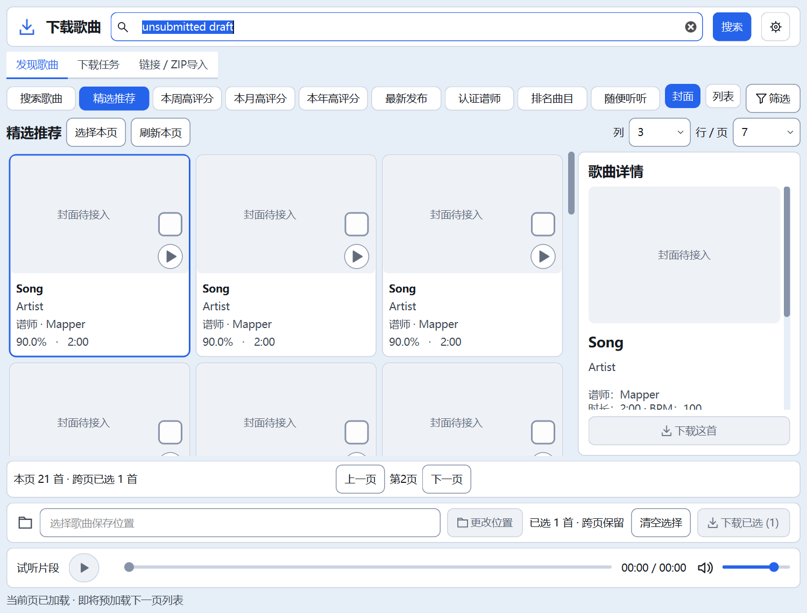
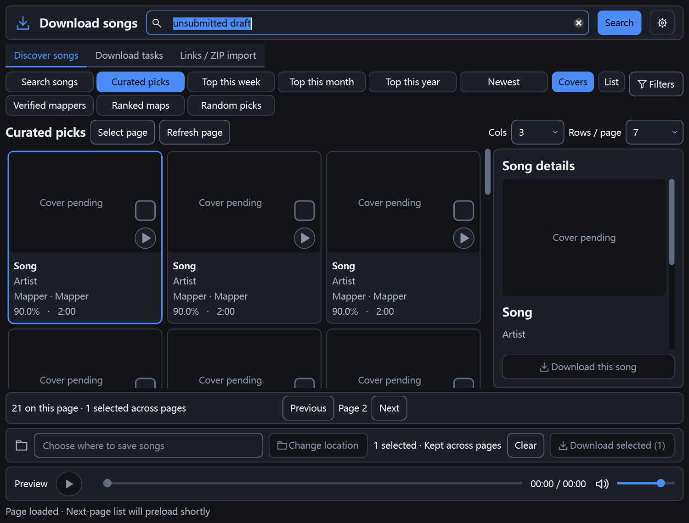

# Qt下载页预加载反馈与刷新（已实施，待集中验收）

更新时间：2026-10-23T15:04:27+08:00。Qt下载页预加载反馈与刷新本页已实施，完整验收继续按用户要求暂缓。底部显示下一页列表即将准备、准备中、已准备及当前页来自缓存；缓存到期自动撤下就绪提示，状态读取不改变LRU顺序或延长TTL。新增“刷新本页”及F5，按已提交条件重新请求当前页，保留勾选和搜索草稿；加载中、其他页签及筛选弹窗不误触。静态7项、主题、双语和8组无音频Qt专项共11项均退出0；192份源码/测试与隔离副本同哈希，正式五项运行数据未变。无搜索业务后端、下载解压、音频、数据库或设备护栏变更；未访问真实网站、播放音频、运行完整回归、启动正式实例或操作Quest。

## 用户入口与状态

发现歌曲页“选择本页”右侧新增“刷新本页”，也可按F5。刷新跳过列表缓存，继续使用已提交搜索词、分类、排序及筛选和当前页码；不提交搜索框中的未确认草稿，不清空跨页勾选，等待时保留当前内容。成功后按原方式选择第一首显示详情，当前高亮行不作保留承诺。失败仍用原错误和重试控件。

刷新仅在当前窗口处于活动状态、发现歌曲页已就绪/空结果时执行。加载中禁止重复请求；其他页签F5禁用，筛选模态窗口由Qt窗口快捷键范围及活动窗口检查保护。刷新不会扫描本地歌曲目录或操作下载队列。

底部原状态区复用以下说明，不增加常驻动画或轮询任务：

- 当前页已加载，即将预加载下一页列表。
- 正在后台准备下一页列表，可继续浏览。
- 下一页**列表**已准备，封面按需继续加载，避免把元数据就绪误报为封面全部就绪。
- 当前页来自缓存，作为前缀显示；真正发起新请求后撤下。

原前台加载、错误、取消及200首勾选上限提示优先，后台提示不覆盖它们。就绪提示使用单次定时器按剩余TTL撤下，到期不自动请求；读取提示不调整LRU或延长有效期。关闭窗口停止定时器、禁用F5。继承上一批仅预取下一页、3页/120秒/8MiB列表预算及21封面上限，不额外增加自动预取的并发或请求数量；用户手动刷新会重新请求当前页。

## 隔离窗口截图

截图来自替身歌曲，不是真实网站/设备/试听验收。封面与试听服务未启用，因此显示占位图和禁用播放；本批只观察新增按钮、状态文字及布局。

## 文件与验证

| 文件 | 改动 |
| --- | --- |
| quest_tool/qt_ui/search_browser.py | 刷新按钮/F5、页签/忙碌/活动窗口护栏、状态优先级及单次到期提示 |
| quest_tool/qt_ui/page_cache.py | get支持不触碰LRU的只读查询，remaining返回剩余有效期 |
| quest_tool/messages.py | 6对中英文案 |
| tests/qt/smoke_search_feedback.py | 新增真实按键/按钮、状态/TTL/草稿/勾选/弹窗/页签/布局及关闭专项 |

共4份代码/测试、12份文档、2张截图，18文件；保留本批前全部WIP。共享搜索/媒体/下载/音频/数据库/设备/传输服务及原测试与上一批同字节。APP_VERSION20.4、Qt阶段标记M7A2C及桌面入口保持，未安装依赖或打包EXE。

全新隔离副本`E:/AI-Project-Backups/P006_DL_feedback_20261023T145730/validation`中11项检查均退出0：

| 检查 | 结果/范围 |
| --- | --- |
| static_check / theme_contrast / smoke_i18n | 静态7节、主题对比度、双语完整性通过 |
| smoke_search_feedback | 中浅/英深，100/125/150%三档；真实F5与点击、过期自动撤提示、不改变LRU/TTL、保留页码/草稿/勾选、重复刷新拒绝、其他页签及筛选弹窗保护、窄窗排列和关闭通过 |
| smoke_prefetch | 上一批离线缓存/请求提升/回退/过期/封面顺序/真实工作线程关闭专项通过 |
| smoke_search_browser / smoke_covers / smoke_filters | 原搜索、封面、筛选专项通过 |
| smoke_download_design | 原下载页中英/浅深/三档缩放及原生布局/控件通过 |
| smoke_download_queue / smoke_download_import | 受控ZIP/队列/取消重试/隔离安装/路径/导入及本地刷新通过 |

新专项使用可控时钟推进过期，并用真实单次定时器触发回调，不等待120秒，也不改变产品默认TTL；原专项脚本、断言及等待阈值未改。本批未遇专项失败。已人工查看中浅/英深截图，新增刷新按钮与状态文字在截图中完整显示。

192份源码/测试与隔离副本同哈希，正式五项运行数据存在性/哈希一致，范围外原文件不变。没有真实网站请求或设备操作，测试不启用音频；按用户要求仍未执行全部Qt、旧完整28或真实播放，不宣告整体验收完成。此前UI各批及历史音频待验保留。

## 证据与回滚

证据：`E:/AI-Project-Backups/P006_DL_feedback_20261023T145730`。before/与before-hashes.json保留本批前状态，source.json/selfchecks.json/日志与shots/保留结果，verification.json及phase-files.json核对边界。

rollback_feedback.py默认仅校验预览，显式--apply才恢复本批原文件并移除本批新增文件；目标或备份哈希变化即拒绝。只回退本批，不清理此前UI/预加载或歌曲数据，不reset/clean。后续多批回滚需逐批核对；未实际回滚。
