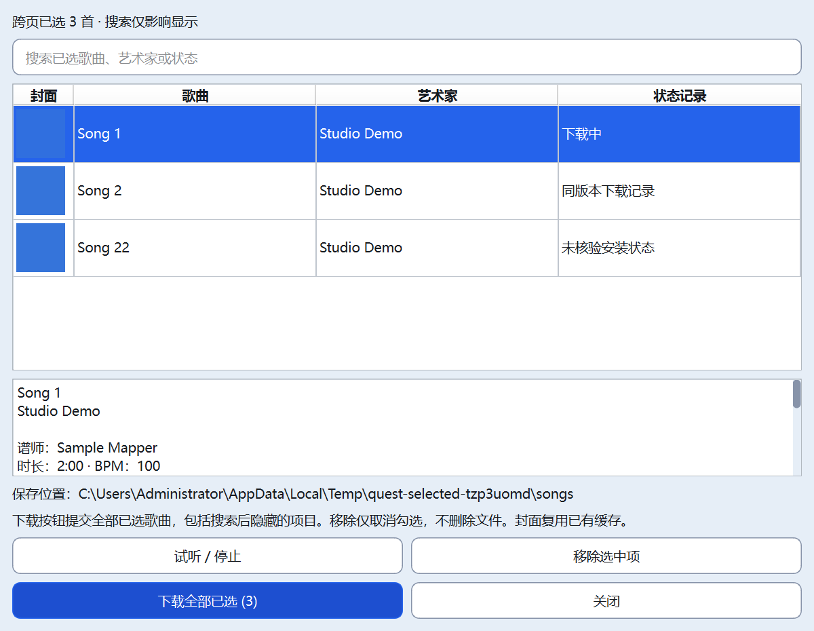
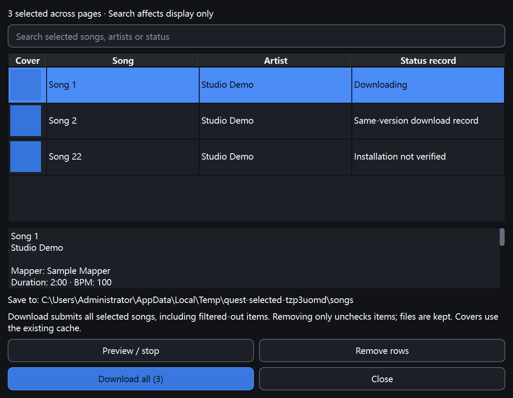
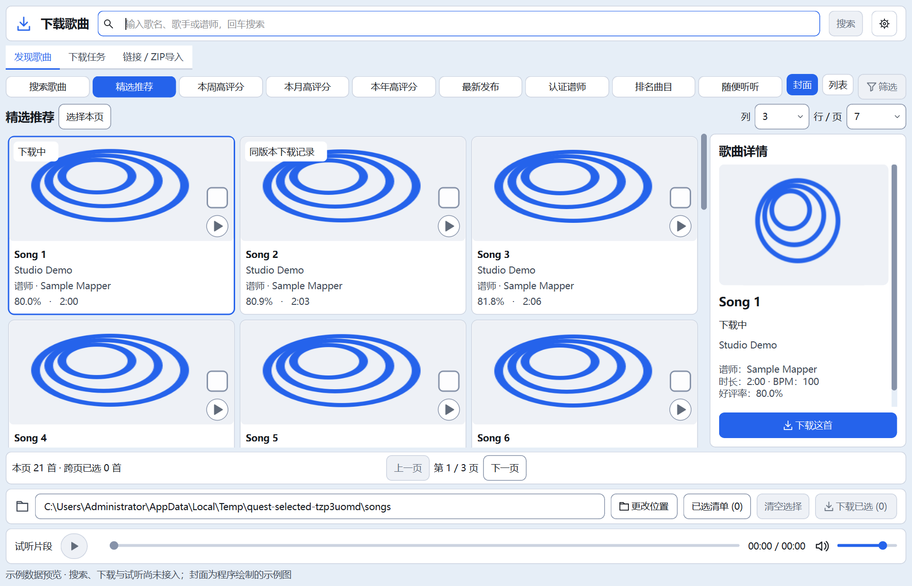

> 最新（2026-10-23T23:30:43+08:00）：下载记录对应的本地只读核验已接入，只有“已核验”标签具有本次文件检查依据；无记录歌曲保持未知，结果为快照，可从选项菜单重验。22项必要检查通过，完整验收仍暂缓。详见[本批报告](64_Qt本地下载记录核验.md)。

# Qt已选清单与歌曲记录状态（已实施，待集中验收）

更新时间：2026-10-23T18:47:51+08:00。Qt跨页已选清单与当前目录队列/版本记录标记已实施，整体验收继续暂缓。底部“已选清单”按需打开非模态单实例窗口，支持缓存封面、清单内搜索、详情、试听/停止接线、移除勾选与全部已选下载，明确搜索隐藏项仍包含在提交集合中；失败保留清单并回显队列错误。卡片/列表/详情显示当前目录的队列状态或同/其他版本下载记录，不将历史或同名当作实时安装事实，不读取Quest。最终静态7项、主题、双语和14组无音频Qt专项共17项均退出0；197份源码/测试与隔离副本同哈希，正式五项运行数据未变。下载/搜索/音频/数据库/设备后端与护栏未改；未访问真实网站、播放音频、运行完整回归或启动正式数据实例。

## 用户入口与行为

下载页底部“已选清单（数量）”按钮按需打开可调整大小的非模态窗口，重复打开只抬起已有窗口；筛选模态窗口存在时不嵌套打开。关闭清单不取消勾选，主窗口关闭会先关闭清单。Qt子模型归属于清单窗口，关闭释放。

- 汇总原SongModel.checked/selected_records，保留跨页数据与选择顺序；不建立第二套勾选状态、不改200首上限。缺失元数据时用编号占位而不丢选择。
- 原生虚拟表格显示封面、歌曲、艺术家及记录状态；封面只复用当前CoverCache，原媒体工作通道收到图片后更新视图，不因清单打开/搜索新增HTTP请求。
- 搜索为固定文本、不区分大小写，作用于清单显示；明确“下载全部已选”包括搜索隐藏项。详情用只读纯文本，提示中的HTML字符转义。
- 试听/停止按钮复用PreviewBrowser.play_song；同首播放中再次点击停止，进度和音量仍在主窗口播放器。新专项用记录器验证接线，本轮不播放真实音频。
- 移除选中行只从原checked和selected_records撤销，再发原通知；不删除任何歌曲文件。父列表、清单和计数同步。
- 下载通过原DownloadBrowser.enqueue_checked/submit/queue_action，目标取当前已确认目录；排队期间禁用提交，失败保留勾选并显示原错误。成功后沿用原入队回执清勾选语义。
- 切换搜索条件仍按原行为清理选择，并同步清空已打开清单；切换保存目录不清理勾选，但刷新清单路径和状态来源。

## 状态含义及限制

| 显示 | 判断依据 |
| --- | --- |
| 排队/下载等进行中状态 | 当前保存目录、同一BeatSaver编号的活动任务 |
| 同版本下载记录 | 当前目录成功/已有任务记录的完整digest与歌曲digest匹配，可来自原ZIP历史 |
| 其他版本下载记录 | 同编号最近记录有不同digest |
| 最近失败/取消/中断 | 当前目录同编号最近终态记录 |
| 未核验安装状态 | 清单中没有可靠匹配记录；主卡片不显示“未安装”推断 |

只根据编号、完整版本hash和规范化目标路径匹配，不用标题；路径规范化不执行磁盘读取。历史记录可能对应已经移动/删除/修改的文件，所以不显示为实时“本地已安装”，也不阻止正常下载。未做本地全库hash扫描、Quest状态或设备读取。坏类型历史字段按未知跳过，不把空hash匹配成同版本。

卡片在封面左上角显示短标记，列表加在副行末尾，详情显示同一状态；Tooltip/辅助文字同步。源图与缩放缓存预算沿用原值；状态不变时不重置清单模型或重绘状态列，详情文本不变时保留文本选择与滚动位置。

## 隔离窗口截图

以下是虚构歌曲及模拟任务，不是真实歌曲、下载或试听验收。封面纯色/程序图仅用于显示缓存和状态位置。

## 文件与安全边界

| 文件 | 改动 |
| --- | --- |
| quest_tool/qt_ui/download_selection.py | 清单控制器、原生表模型/搜索/单实例窗口、详情/移除/试听及统一下载接线 |
| quest_tool/qt_ui/song_status.py | 当前目录队列及版本历史纯数据索引，不访问磁盘 |
| quest_tool/qt_ui/download_window.py | 已选入口、详情标记、翻译/刷新/关闭接线、清理占位页面注册引用 |
| quest_tool/qt_ui/download_browser.py | 刷新状态通知清单；占位页删除改走统一清理 |
| quest_tool/qt_ui/download_import.py | 占位页删除改走统一清理，原扫描/导入流程不变 |
| quest_tool/qt_ui/song_model.py | 状态标签字典及可访问文字/转义提示；勾选/分页逻辑保持 |
| quest_tool/qt_ui/song_view.py | 封面标记与列表副行绘制 |
| quest_tool/qt_ui/cover_browser.py | 已接受图片后发UI线程imagesChanged，无新媒体请求 |
| quest_tool/theme.py / messages.py | 统一窗口尺寸/封面尺寸令牌及中英文字 |
| tests/qt/smoke_selection.py | 新增清单/记录/任务接线/生命周期/窄窗/纯文本专项 |

11份代码/测试、14份文档和3张截图，共28文件。37个勾选/分页/队列操作/路径校验/自动刷新/缓存/媒体生命周期函数AST与本批前一致，见boundary-audit.json；原搜索、下载/解压、数据库、音频、设备和传输后端同哈希。没有新增GUI框架/依赖，不自动恢复旧正式数据。APP_VERSION20.4、Qt标记M7A2C及桌面启动方式保持，未打包EXE。

原占位页删除后仍在texts保存QLabel引用，真实延迟删除后切换语言报已删除C++对象。本批在删除前解绑对应后代，并保留semantic_icons中的QAction；相关失败及修复记入踩坑104。清单关闭按钮曾名为done遮蔽Qt方法，已改close_button，记入105；未把这些中间失败当通过。

## 最终必要验证

全新`E:/AI-Project-Backups/P006_DL_selection_20261023T182025/final-review/validation`17项均退出0：

| 检查 | 关键结果 |
| --- | --- |
| static_check/theme_contrast/smoke_i18n | 静态7节、主题对比度与双语完整性通过 |
| smoke_selection | 三档缩放；跨页/顺序/固定搜索/移除/全部提交/目录切换/失败保留与回显、同编号与hash/其他目录/坏字段、缓存图片消息/无额外请求、试听记录器、单实例/关闭重开/父关闭/搜索清空、语言切换/420px实际窄窗及原文提示通过 |
| smoke_download_shell/smoke_song_browser | 原三档中英浅深布局、缩放/操作/分页/勾选200首/真实入口通过 |
| smoke_local_refresh/smoke_queue_render | 原合并扫描、任务增量通知、身份和翻译通过 |
| smoke_search_feedback/smoke_prefetch | 原F5、草稿、预加载/缓存及线程收尾通过 |
| smoke_search_browser/smoke_covers/smoke_filters | 原搜索、媒体与筛选专项通过 |
| smoke_download_design | 原下载布局/控件/三档缩放通过 |
| smoke_download_queue/smoke_download_import/smoke_library | 原真实队列+受控ZIP/隔离安装/取消重试/路径/导入/本地及主曲库刷新桥接通过 |

新清单“全部下载”经原任务线程与模拟管理器验证实际提交集合、目录与失败路径；真正的队列/ZIP安装由原专项另行覆盖。原测试脚本、断言及等待阈值未改。首次静态检查中继承Qt方法调用形式/插入缩进问题已修正；独立trial先后暴露悬挂标签、QAction类型和done命名冲突，日志保留。后续窄窗检查补实际宽度，离屏复验发现英文按钮过宽，已缩短英文动作文字，正常Windows平台三档复验通过。

中间run_checks及final轮次各专项虽退出0，期间本任务继续补提示转义/坏字段容错/失败回显与布局，结束源码哈希校验因此拒绝；记录保留，不拼接为最终结果。最终代码冻结后从final-review全新副本重跑17项并校验全部源码。截图人工查看中浅/英深及主卡片位置，未发现本批标记/按钮覆盖原复选框或试听位置。

197份源码/测试与最终隔离副本同哈希，正式五项运行数据存在性/哈希未变，范围外原文件不变。未访问真实网站/Quest或启动正式数据实例，未播放音频。用户暂缓全部Qt、旧完整28及真实听感验收继续有效，本批不宣告产品整体验收或实际磁盘安装核验完成。

## 后续与回滚

下一小批优先筛选摘要/个人预设；本地实际版本核验、Quest带时间的快照提示、下载结果汇总及收藏推荐另行分批。当前不因无历史就标“未安装”。

证据：`E:/AI-Project-Backups/P006_DL_selection_20261023T182025`。before/、before-hashes.json、runtime-before.json、trial及两轮中间日志、最终final-review/source.json/selfchecks.json/日志/截图、boundary-audit.json、verification.json与phase-files.json保留。

rollback_selection.py默认仅预检，显式--apply才按目标及备份哈希恢复本批原文件并移除本批新增文件。后续修改即拒绝，不绕过校验，不reset/clean，不回退先前UI/预加载/自动刷新，不碰歌曲或运行数据。未实际回滚。
