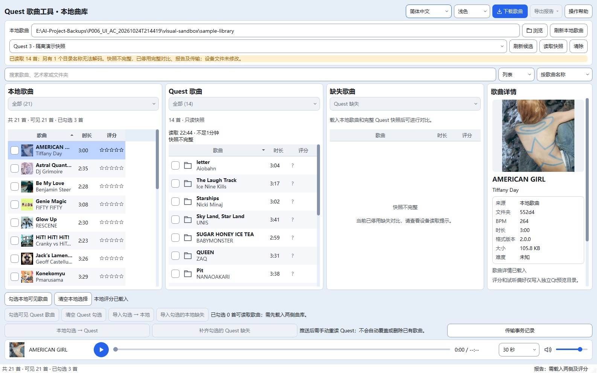

# Qt A 下载页 + C 曲库界面改版

本轮根据用户“可以就照A和C去改UI”的确认实施。A 为下载页，C 为主曲库。效果图中的示例数据不是设备实测；实现继续使用 PySide6 + Qt Widgets，没有迁移框架或增加依赖。

落地保留Windows原生标题栏及现有传输、历史记录等操作入口，不采用效果图中的自定义无边框拖动或额外阴影动画。截图为Qt窗口客户区，不包含系统标题栏；这是在现有功能与性能约束下按A/C方向落实，并非像素级复刻概念图。

## 实现范围

| 页面 | 本轮变化 | 兼容处理 |
| --- | --- | --- |
| 下载页 A | 顶部完整搜索区、轻量推荐标签、扩大右侧封面与详情区域、固定收藏/下载操作、卡片好评率与时长分左右排列 | 默认3列7行、9种分类、封面/列表切换、筛选摘要/个人预设、分页预取、跨页选择均沿用原逻辑 |
| 主曲库 C | 紧凑标题区、蓝色下载入口、歌曲列内封面和两行歌名/艺术家、统一48px列表行、缩短Quest快照摘要、不完整状态警示 | 艺术家排序/搜索仍读原模型列；隐藏原独立艺术家列但保留旧列宽数值及原配置格式；完整来源仍可悬停/辅助功能读取 |
| 详情与播放器 | 两页共用风格的单行试听栏、封面缩略图、明确播放/停止图标、原进度/音量及本地试听长度设置 | 保留现有播放/停止而不伪装成暂停；播放歌曲身份不随下载页仅选中另一歌曲而改变；不启动新音频服务 |
| 性能 | 曲库列表复用已有封面工作线程和有界缓存，只请求可见项目；Qt原生选框与虚拟绘制列表 | 最多检查64个可见候选，沿用代次/取消/缓存预算；不为每行增加控件；没有新增阴影效果或逐帧动画；Quest无封面时用占位图 |

收藏按钮接入原有收藏存储，和菜单同步；保存失败时回到实际保存状态并保留错误提示，收藏不等于下载勾选。本轮不修改歌曲搜索、下载解压、试听引擎、数据库结构及设备读写护栏。

## 设计与实际截图

确认参考：[A](images/ui-ac-reference-a.png)、[C](images/ui-ac-reference-c.png)。下图是实际Qt窗口，使用隔离样本及历史已缓存公开歌曲元数据与封面；Quest部分为模拟不完整快照，不能作为真实Quest数量、传输或音频验收证据。

## 验证

默认GBK静态7节退出0。Qt首轮 **49/52**；失败项为 `smoke_detail_design, smoke_library_actions, smoke_library_cards`。同字节复验 **2/3**：两个独立显示测试通过，菜单仍在另一倍率/步骤超时。额外150%只读诊断记录中所有菜单调用的窗口活动、索引有效并通过，但不能由此确定原失败根因。菜单测试补充合成右击事件前显式focus(view)及active断言，产品焦点/模态护栏未改，原业务断言保留；修改后100%/125%/150%全部通过。旧版完整 `tests/run_all.py` **两轮均28/28**、退出0，包含本地/在线试听真实音频回调。最终222份源码与final-2隔离副本同哈希；与首轮仅菜单测试文件不同，因此其余Qt组的产品及测试字节仍匹配。52组均有对应最终产品代码的通过结果；不是首轮或单次52/52，不隐去首次失败。

首次详情和封面单窗口在150%测试倍率等待显示超时；快捷菜单等待超时。没有据此更改窗口尺寸补偿、焦点安全条件、系统DPI或业务断言；前两项复验产品与测试源码未改，之后只补充菜单测试的焦点前置条件。关闭来源、原生拖动和现场多屏稳定性仍单列待验。

| 验证 | 证据 |
| --- | --- |
| 首轮所有Qt、静态、旧版完整 | `full-1/selfchecks.json` 与逐组log |
| 同字节失败项复验 | `retry-1/results.json` 与逐组log |
| 菜单诊断与最终焦点前置检查、静态及旧版完整 | `menu-probe.json`、`final-2/selfchecks.json` |
| 三档中英明暗截图 | `full-1/shots` |
| A/C实际窗口、历史缓存封面、隔离数据 | `actual-ui/evidence.json`，零网络/真实设备/音频初始化 |
| 源码/数据未越界 | `guard-result.json`、`phase-files.json` |

新增 `tests/qt/smoke_ui_ac.py` 检查收藏按钮的实际保存/失败状态、选择隔离、封面惰性加载、原生选框、播放身份、三档缩放下单行布局不重叠及快照完整来源提示。原列宽回归改为核验保留的三列逻辑宽度，并另断言艺术家列已隐藏；未放宽原数值要求。两份试听替身补充与真实控制器一致的song属性。

## 开发中发现并处理

- 静态检查检出新增调用形式及未使用导入，修正后静态7节通过。
- 真实截图发现FixedWidth与Ignored策略组合使文字区和按钮重叠，移除Ignored并增加实际几何断言。
- 原生单行绘制会把换行文本合并，改为在原生背景、选框与封面绘制后绘制两行省略文本，保留原点击命中规则。
- 表头局部变量覆盖顶部布局变量导致构造异常，已更名；异常日志保留。
- 新列表视口过滤器在退出时访问已销毁控件，改为持有视口对象比较并在close时卸载。
- 新70首文件样本测试用短QTest循环时后台Python文件线程未能在10秒内完成；诊断堆栈显示仍在元数据文件读取。测试循环增加5ms Python让步，保留10秒期限和原断言，不调整产品扫描或取消逻辑，不据此宣称产品性能问题已解决。

## 边界与回滚

证据目录：`E:/AI-Project-Backups/P006_UI_AC_20261024T214419`。改造前445项文件保存于before，源文件清单、运行数据清单分别在source-before.json和runtime-before.json。既有Git工作区修改全部保留，不使用Git重置回滚。

回滚按最终phase-files.json逐项验证当前字节等于本轮结束字节后，只恢复本轮修改文件及移除本轮新文件；遇到后续修改即停止。不能覆盖其他会话的新修改。

正式pythonw曲库实例25972未作为输入或停止目标。本轮不操作真实Quest、正式歌曲目录或系统显示/音频设置，不把布局测试倍率等同真实多屏原生拖动/残影验收。原生拖动、窗口短时关闭来源和历史多屏DPI问题仍见77报告。本轮之前未收尾的只读探针证据保留在P006_closeout_20261024T212356，不合并成当前UI通过结论。

## 修改文件

14个产品文件、5个既有测试及1个新测试；另同步项目说明和本报告/图片。业务后端未改。

- `quest_tool/messages.py`
- `quest_tool/theme.py`
- `quest_tool/qt_ui/cover_browser.py`
- `quest_tool/qt_ui/device_browser.py`
- `quest_tool/qt_ui/download_window.py`
- `quest_tool/qt_ui/favorites_browser.py`
- `quest_tool/qt_ui/library_covers.py`
- `quest_tool/qt_ui/library_detail.py`
- `quest_tool/qt_ui/library_preview.py`
- `quest_tool/qt_ui/library_window.py`
- `quest_tool/qt_ui/preview_browser.py`
- `quest_tool/qt_ui/snapshot_notice.py`
- `quest_tool/qt_ui/song_view.py`
- `quest_tool/qt_ui/theme.py`
- `tests/qt/smoke_favorites.py`
- `tests/qt/smoke_library_actions.py`
- `tests/qt/smoke_library_ratings.py`
- `tests/qt/smoke_library_views.py`
- `tests/qt/smoke_selection.py`
- `tests/qt/smoke_ui_ac.py`

启动：关闭已打开的旧窗口后，桌面“Quest 歌曲工具（新版曲库）”或“Quest 下载歌曲”会加载新界面；入口脚本未改。本轮不自动关闭正式实例。

回滚脚本：`E:\AI-Project-Backups\P006_UI_AC_20261024T214419\rollback.py`，默认只检查，显式加`--apply`才恢复；不自动执行。

更新时间：2026-10-24T22:47:30+08:00。
