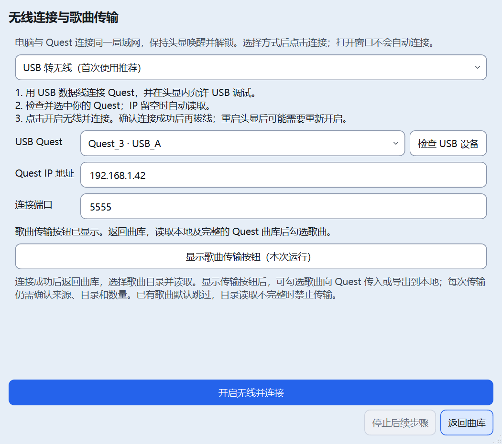

# Qt 无线连接与传输入口恢复

日期：2026-10-25。状态：实现及隔离自动化回归完成；真实无线连接与传输待验。本批不改变正式20.4版本号或Qt阶段标记。

## 原因与范围

旧版 `quest_tool/ui_wireless.py` 和 `adb.py` 保留了无线连接功能，新版 Qt `bootstrap.py` / `DeviceBrowser` 未接无线入口。默认 `启动.vbs` 只带 `--library --quest-adb`，原有双向传输按钮又受 `--quest-pull` / `--quest-push` 控制，因此普通桌面启动看不到无线向导和传输入口。

用户本轮要求找回并优化无线传输，并明确确认“允许实现，先做模拟测试”。授权包括由用户点击按钮才执行的 USB 开启无线调试、配对、连接；本轮不操作真实 Quest 网络、不传输或删除歌曲。此前自动审批拒绝的原补丁未执行；后续依明确授权实现，未绕过审批。

## 使用方式

1. 关闭并重新打开“Quest 歌曲工具（新版曲库）”。在上方 Quest 连接区点击“无线连接”。启动及打开窗口均不自动访问设备。
2. 首次使用选“USB 转无线”，用数据线连接并在头显内授权，点击“检查 USB 设备”，确认 Quest 后点击“开启无线并连接”。IP 留空时后台读取；未识别出 IP 时可手动填入。连接成功且身份核验通过后才拔线。
3. 已开启无线调试时，选择“已有地址，重新连接”，填当前 IPv4 与连接端口。只有设备提供配对页面时才用“配对码连接”，配对端口与连接端口分别填写。
4. 连接成功后返回曲库，会刷新候选目录并优先定位同一硬件、同一无线地址的 SongCore 普通目录；不自动读取整库。选择需要的目录并点击读取。
5. 在无线窗口点击“显示歌曲传输按钮（本次运行）”可显式启用原有双向传输入口，也可用于 USB 连接。读取本地及完整 Quest 曲库、勾选歌曲后，仍须通过原传输确认窗口。已有歌曲默认跳过，不完整快照仍禁止传输。此开关不保存，下次启动需重新启用；原 CLI 参数保持兼容。

## 实现与边界

- `wireless_validation.py`：纯数据校验，限制 IPv4、端口和六位配对码；USB 模式拒绝无线地址作为设备序列号。
- `wireless_form.py`：复用 Qt 主题令牌、可滚动表单及固定底部操作，三种连接方式、中英文、配对码隐藏且提交/关闭清空；仅发请求信号。
- `wireless_client.py`：复用 AdbBridge 和现有 provider 身份核验。只读取候选 USB Quest；开启前重验硬件，连接后重验模型和硬件。配对不代表连接成功，连接输出成功也不代表 Quest 已核验。
- `library_wireless.py`：单消费者、代次/取消令牌、主线程消费结果；无线与原读取/封面共用 provider I/O 锁。命令上限10秒、总操作60秒，USB 重启后的连接最多3次、间隔0.5秒，只连指定地址。
- `device_browser.py` / `library_window.py`：显式入口、连接过程中阻止旧快照传输，接收成功后按 transport+hardware 定位目录。
- `library_transfer.py` / `bootstrap.py`：按用户点击惰性创建原有传输后端，不修改启动脚本或默认传输开关；原确认、目录/身份、备份/校验护栏不变。
- 不保存 IP、配对码或自动重连，不扫描局域网、不执行断开全部设备或 kill-server，不自动改回 USB 调试；停止只阻止后续步骤，已完成的连接设置不自动撤销。
- 真实 USB 重启兼容、头显配对页面是否提供、Wi-Fi 链路速度及真实传输仍待设备验收。IPv6 / mDNS / 自动重连不在本批范围。

## 验证记录

- 修改后默认编码静态检查7节通过。
- 新专项使用真实 AdbBridge 参数、拦截 subprocess 执行并禁止 socket / Popen，模拟三种连接、错误输入、非 Quest、身份变化、取消/关闭、旧结果隔离、CLI 不自动连接及显式启用传输。
- 初轮发现按钮命名覆盖 QDialog.done，已更名 close_button；截图发现表单标签受 Ignored 策略挤压，已改标准 QLabel。初轮150%窗口显示等待失败记录于本会话工具输出，最终冻结副本 Qt 56/56 全部退出0，新增无线专项中英文100%/125%/150%均通过。旧版完整28/28通过、退出0（含音频、搜索、筛选、界面及假设备传输），执行器退出0。
- 初次隔离副本位于 tests/.tmp 下，静态检查按绝对路径排除该目录导致仅扫描2份文件，不能作为有效基线。已停止本任务的测试进程，把同字节副本复制到 E 盘独立目录，重新从头验证，未改测试规则。
- 完整回归结束后，独立布局探针对100%/125%/150%各跑中英文：主窗口1000/1400逻辑像素宽、无线窗口400×450及700×620，均实际达到请求尺寸；入口与底部按钮可见、容器内无重叠，全部退出0。仅验证程序设置尺寸及布局，不代表多屏原生拖动或残影验收。
- 232份Python源码/测试与最终隔离副本同哈希；正式运行数据及Qt配置7槽无变化，启动脚本不变。没有真实设备网络操作、歌曲传输/删除、正式实例输入/停止、依赖或系统设置操作。

检查点与日志：`E:\AI-Project-Backups\P006_wireless_20261025T014104`。原本机检查点仍保留在 `tests/.tmp/wireless_20261025T014104`。

| 检查 | 命令/记录（在隔离副本运行） | 结果 |
| --- | --- | --- |
| 默认GBK静态 | `python -B tests/static_check.py`；`static-default-encoding.log` | 7节通过、退出0 |
| Qt整组 | `run_checks.py`顺序执行`tests/qt/smoke_*.py`；`results.json`及逐项日志 | 56/56、每项退出0 |
| 旧完整回归 | `python -B tests/run_all.py`；`legacy_full.log` | 28/28、退出0 |
| 布局补验 | `layout_probe.py`，进程内倍率1/1.25/1.5；`layout-*.log` | 中英文三档通过、退出0 |
| 源码/运行数据 | `guard.json`、`final-audit.json` | 同字节及边界复核；不以Git整体脏状态代替本批差异 |

## 本批文件清单

共24个文件：10个Python源码/测试、13个Markdown文档、1张模拟设备截图。现有大量未提交及未跟踪文件均保留，不归入本批。

| 类型 | 文件 |
| --- | --- |
| 新增UI与适配 | `quest_tool/qt_ui/wireless_validation.py`、`wireless_client.py`、`wireless_form.py`、`library_wireless.py` |
| 现有接线及文案 | `quest_tool/messages.py`、`quest_tool/qt_ui/bootstrap.py`、`device_browser.py`、`library_transfer.py`、`library_window.py` |
| 新增专项 | `tests/qt/smoke_wireless.py` |
| 根文档 | `AGENTS.md`、`01_项目规格.md`、`02_开发计划.md`、`03_当前任务.md`、`04_交接状态.md`、`README.md`、`CHANGELOG.md` |
| 技术与操作文档 | `docs/README.md`、`docs/00_AI接手指南.md`、`docs/03_踩坑记录.md`、`docs/04_迭代计划.md`、`docs/06_Quest3连接与文件夹选择.md`、本报告 |
| 截图 | `docs/images/qt-wireless-form.png` |

## 回滚

改造前文件位于检查点的 `before/`，文件哈希见 `before-hashes.json`；本批前后哈希及精确文件范围见 `rollback-manifest.json`。`rollback.py` 默认只核验，显式添加 `--apply` 才恢复。本轮仅执行核验，未执行回滚。

```powershell
# 只检查当前文件及备份是否仍匹配本批记录，不修改项目。
python -B "E:\AI-Project-Backups\P006_wireless_20261025T014104\rollback.py"

# 需要撤回本批时，先关闭本程序；核验无冲突才恢复这24个文件。
python -B "E:\AI-Project-Backups\P006_wireless_20261025T014104\rollback.py" --apply
```

脚本拒绝覆盖本批结束后又被修改的文件；仅恢复原有文件、移除本批新增且哈希仍匹配的文件。无 Git reset/clean，不覆盖用户设置、数据库或歌曲。检查点及验证日志保留。

## 本轮实际窗口（模拟设备）



图片中的设备和地址为测试替身，不是真机连接记录。
